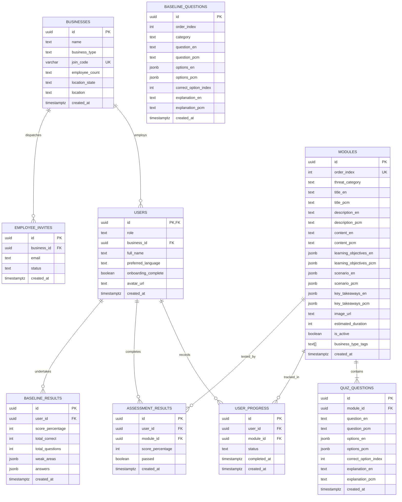

# SMEShield — Authoritative Master Claude AI Project Report Handoff Package

**Document Version:** 2.0 (Authoritative Academic Baseline & Evidence Freeze)  
**Compilation Date:** September 19, 2026  
**Target Consumer:** Claude AI (for final-year dissertation/project report drafting)  
**System Repository:** `https://github.com/AP-Techpulse/SMEShield_MVP` (Branch: `master`)  
**Production Deployment:** `https://sme-shield-mvp.vercel.app` (Vercel Global Edge Network)  

---
## Institutional Academic Identity & Candidate Details

| Academic Metadata Field | Authoritative Institutional Value |
| :--- | :--- |
| **Approved Project Title** | **Design and Implementation of a Web-Based Bilingual and Adaptive Cybersecurity Awareness Training and Self-Assessment Platform for SMEs in Nigeria (SMEShield)** |
| **Product Short Name** | **SMEShield** |
| **Degree Qualification** | **B.Sc. Final-Year Undergraduate Computer Science Project Report** |
| **Programme** | Bachelor of Science (B.Sc.) in Computer Science |
| **Candidate Name** | **Aruah Paul Ajirioghene** |
| **Matriculation Number** | **FOS/22/23/287477** |
| **Department** | Department of Computer Science |
| **Faculty / College** | **Faculty of Computing** (Delta State University, Abraka) |
| **Institution** | Delta State University, Abraka, Delta State, Nigeria |
| **Project Supervisor** | **Dr. Mrs. Chika Lillian Onyagu** |
| **Approved Report Date** | **July 2026** (Original Submission Baseline; Evidence Freeze: September 2026) |
| **Conceptual Foundation** | *"The Human Firewall: Rethinking Network Security Principles Beyond Technology"* (Approved Precursor Seminar Presentation) |

> [!IMPORTANT]
> **Supervisor-Approved Academic Baseline & Preservation Mandate for Claude AI:**  
> The candidate's supervisor, **Dr. Mrs. Chika Lillian Onyagu**, has already reviewed and formally approved Chapters 1–3 of this project report. Claude AI must **NOT** rewrite Chapters 1–3 substantially, nor replace the approved aim and five objectives with an alternative set of technical objectives. The primary remaining academic task is to draft **Chapters 4 and 5** and integrate all five chapters into one coherent dissertation. Any adjustments to Chapters 1–3 must be strictly minimal, factually necessary, and classified according to the four-tier audit framework (Category A, B, C, or D) detailed in `SMEShield_Report_Discrepancy_Audit.md`.

---

## Section 1: Research Identity, Seminar Foundation, & Problem Alignment

### 1.1 From Seminar Theory to Applied Software Engineering
The conceptual foundation of SMEShield originates directly from the candidate's approved seminar research entitled:
> **"The Human Firewall: Rethinking Network Security Principles Beyond Technology"**

The seminar and Chapter 1 establish four foundational theoretical propositions:
1. **The Inadequacy of Technical-Only Perimeters:** Conventional cybersecurity architectures invest predominantly in perimeter hardware and automated software (firewalls, Intrusion Detection/Prevention Systems, Anti-malware, and Endpoint Detection and Response). However, global and regional threat telemetry demonstrates that over 85% to 90% of successful enterprise data breaches and financial fraud originate through social engineering, psychological manipulation, and human error (Kadena & Gupi, 2021; Li et al., 2021). In Nigeria, the financial sector alone lost an estimated ₦52.26 billion to fraud in 2024 (Emmanula et al., 2026).
2. **The "Human Layer" as an Active Defense Component:** Rather than conceptualizing employees and business operators merely as the "weakest link" in security infrastructure, the Human Firewall paradigm conceptualizes informed individuals as the first line of proactive detection, verification, and containment (Doe, 2024). In Defense-in-Depth, SMEShield operates squarely inside the human layer (Figure 2.1).
3. **The SME Vulnerability Asymmetry:** While large multinationals and financial institutions possess dedicated Security Operations Centers (SOCs), Chief Information Security Officers (CISOs), and substantial training budgets, Small and Medium Enterprises (SMEs) in developing economies operate with minimal technical staffing, severe capital constraints, and informal digital communication channels (e.g., WhatsApp, personal mobile banking, and Point-of-Sale terminals) (Chidukwani et al., 2022; Auwal & Abiodun, 2025).
4. **The Behavioral Inoculation Imperative:** Traditional annual compliance lectures fail to induce lasting behavioral habits (Fagbule, 2023). Effective cybersecurity education requires digestible micro-learning, situated contextual scenarios, indigenous linguistic familiarity (Pidgin), and immediate explanatory feedback (Sulaiman et al., 2022; Chowdhury et al., 2022).

### 1.2 SMEShield as the Practical System Realization
SMEShield serves as the direct software engineering realization of this academic inquiry. It translates the theoretical principles of the Human Firewall into an empirical, accessible, and culturally contextualized educational web application:
- **Diagnostic Vulnerability Profiling:** Evaluating incoming baseline security awareness before formal training across core Nigerian SME threats.
- **Contextualized Behavioral Inoculation:** Training learners across 15 threats pervasive in the Nigerian SME commercial ecosystem (e.g., POS terminal tampering, fake bank credit alerts, WhatsApp Business account takeovers, SIM swap identity theft, and Business Email Compromise).
- **Dual-Language Accessibility:** Eradicating linguistic and comprehension barriers by providing complete lesson protocols and scenario quizzes in both standard English and Nigerian Pidgin (Osabutey & Jackson, 2024).
- **Empirical Progress Measurement:** Calculating an objective, dual-factor **Human Firewall Score (HFS)** that mathematically weighs curriculum completion breadth (35%) alongside validated quiz assessment performance (65%).

---

## Section 2: Research Gap, Systematic Contribution Chain, & Source Map

### 2.1 The Systematic Research-Alignment Chain
To ensure logical rigor throughout Chapters 1 to 5, Claude AI must structure the dissertation arguments around the following explicit, supervisor-aligned contribution chain:

```
Research Background
  ↓ (Rapid SME digital adoption, ₦52.26B losses, human operator vulnerability)
Identified Practical Problem
  ↓ (Resource-constrained SMEs lack training; enterprise tools are unaffordable, English-only, and rigid)
Literature-Supported Research Gap (Chapter 2, Section 2.5)
  ↓ (1. Enterprise budget/IT assumptions; 2. Absence of Nigerian Pidgin; 3. Lack of business-type adaptivity for 1-2 person shops; commercial market failure)
Project Aim (Chapter 1, Section 1.3)
  ↓ (Design and implement a web-based, bilingual, and adaptive cybersecurity awareness training and self-assessment platform for SMEs in Nigeria)
Five Approved Objectives (Chapter 1, Section 1.3)
  ↓ (1. Interactive Web Platform; 2. Bilingual Content Delivery; 3. Adaptive Mechanism; 4. Role-Based Access; 5. Progress Dashboards & HFS)
Proposed Design (Chapter 3 OOAD Models)
  ↓ (UML Use Case, Activity, Sequence, Class diagrams, 3-tier architecture, preliminary schema)
Final Implementation (Chapter 4)
  ↓ (Next.js 16 App Router, Supabase PostgreSQL, 9-table schema, 15 modules, 75 quiz questions, adaptive engine, join codes, HFS)
Testing Evidence (Chapter 4)
  ↓ (TC-01 to TC-19, 100% bilingual parity, build exit code 0, clean lint, 29 academic figures, live Vercel deployment)
Contributions & Realization (Chapter 5)
  ↓ (SME-tailored curriculum, Nigerian Pidgin localization, transparent adaptive sequencing, empirical HFS metric)
Academic Honesty & Limitations (Chapter 1, Section 1.6 & Chapter 5)
    (Educational indicator vs. network telemetry; non-causal delta; separate developer backend content management)
```

### 2.2 Detailed Source Map for Claude AI
When authoring Chapters 4 and 5 or making minimal corrections to Chapters 1–3, Claude AI must consult the authoritative data sources mapped below:

| Research Dimension | Core Academic / System Claim | Authoritative Source Document | Verification Evidence |
| :--- | :--- | :--- | :--- |
| **Approved Baseline** | Project Aim, 5 Objectives, 5 Research Questions, Scope, 5 Limitations, Definition of Terms. | Approved Manuscript Chapter 1 (Pages 13–21). | Approved PDF (July 2026); Section 1.3. |
| **Theoretical Foundation** | Protection Motivation Theory, Adaptive Learning Theory, Defense-in-Depth, Zero Trust, Human Firewall. | Approved Manuscript Chapter 2 (Pages 22–26); Precursor Seminar Report. | Citations: Almansoori et al. (2023), Sulaiman et al. (2022), Zaman & Akhter (2023), Kang et al. (2023), Doe (2024). |
| **Literature Gap** | 1. Enterprise IT bias; 2. Absence of Nigerian Pidgin; 3. Lack of business-type adaptivity for 1–2 person shops; Commercial market failure rationale. | Approved Manuscript Chapter 2 Section 2.5 (Page 30–31). | Table 2.1 (KnowBe4, SANS, SMEShield); Osabutey & Jackson (2024). |
| **System Methodology** | Object-Oriented Analysis and Design (OOAD) for solo developer; UML modeling sequence. | Approved Manuscript Chapter 3 Section 3.1 (Page 34–35). | Conallen (1999); Rindell et al. (2021). |
| **System Architecture** | Next.js 16 App Router, React 19, Supabase PostgreSQL, RLS policies, `@supabase/ssr` auth bridge. | Actual Next.js Codebase & Supabase Migrations. | `docs/academic_evidence_report.md` (Sections 2 & 3); `package.json`. |
| **Curriculum Inventory** | 15 modules, 75 scenario quiz questions, 100% EN/PCM parity, $\ge 700$ characters depth. | Supabase database records; Migration SQL files. | TC-01 to TC-05; `scripts/verify_phase4.mjs`. |
| **Adaptive Algorithm** | Deterministic rule-based scoring: $\text{Base}(10) + \text{WeakArea}(+20) + \text{SectorMatch}(+10)$, completed exclusion, order tie-break. | `src/lib/adaptive-engine.ts`. | TC-06; algorithmic unit execution logs. |
| **HFS Formulation** | Dual-factor formula: $\text{round}(\text{comp}\% \times 0.35 + \text{quiz\_avg} \times 0.65)$, awareness tiers (Developing, Aware, Strong, Highly Aware). | `src/app/dashboard/page.tsx`, `DashboardViews.tsx`. | TC-07 to TC-09; formula boundary tests. |
| **System Verification** | 19 formal test cases, Turbopack clean compile across 32 routes, zero ESLint errors/warnings. | Test scripts, build logs, ESLint report. | `docs/academic_evidence_report.md` (Table 4.1); TC-01 to TC-19. |
| **Visual Interfaces** | 29 academic figures across 9 Chapter 4 subsections, 8 public tour assets, 2 verified responsive viewports. | `docs/report_figures/`, `public/assets/smeshield/tour/`. | `docs/academic_screenshot_manifest.json`; contact sheet. |
| **Statutory Framework** | Nigeria Data Protection Act (NDPA) 2023 statutory principles (data minimization, purpose limitation, user consent). | NDPA 2023 Gazette; `src/app/(public)/privacy/page.tsx`. | TC-18; legal terms and privacy statements. |

---

## Section 3: Project Aim & The Five Approved Academic Objectives

The project aim and five specific objectives approved by the candidate's supervisor (**Dr. Mrs. Chika Lillian Onyagu**) in Section 1.3 of Chapter 1 are reproduced below verbatim:

### 3.1 The Approved Aim (Verbatim)
> **"The aim of this study is to design and implement a web-based, bilingual, and adaptive cybersecurity awareness training and self-assessment platform for SMEs in Nigeria."**

### 3.2 The Five Approved Specific Objectives & Implementation Mapping

#### OBJECTIVE 1: Web-Based Interactive Cybersecurity Training Platform
> **Approved Objective 1 Text:**  
> *"Develop a web-based platform that delivers structured, interactive cybersecurity awareness training to registered SME users within the project period."*

- **How the Implementation Demonstrates This Objective:**
  - **Modern Full-Stack Web Platform:** Built using Next.js 16 (App Router), React 19, TypeScript, and Tailwind CSS, providing an accessible, responsive web interface requiring zero local software installation.
  - **Secure User Registration:** Supabase Auth integration supporting self-registration, credential encryption, password masking, and immediate session issuance across desktop and mobile browsers.
  - **Structured Cybersecurity Curriculum:** 15 comprehensive curriculum modules organized by pervasive Nigerian SME threat vectors (phishing, fake payment alerts, ransomware, WhatsApp hijacking, USB malware, SIM swap fraud, POS fraud, credential hygiene, unpatched systems, public Wi-Fi risks, BEC, cloned web stores, voice vishing, quishing, and device physical security).
  - **Interactive Learning Delivery:** Dedicated lesson interface (`/training/[id]/lesson`) featuring structured pedagogical components: threat overview, practical Nigerian attack scenario, defensive rules, and summary key takeaways.
  - **Persistent Learning Ledgers:** PostgreSQL `public.user_progress` table recording enrollment, lesson interaction, and completion timestamps.
- **Traceable Deliverables:** Next.js 16 web application codebase, 15 curriculum modules (`public.modules`), interactive lesson viewer, and public production deployment at `https://sme-shield-mvp.vercel.app`.
- **Supporting Test Evidence:** **TC-01** (15 modules inventory), **TC-15** (unauthenticated route defense), **TC-16** (responsive layout fidelity), **TC-17** (15 local photography assets), **TC-18** (ESLint code standards), **TC-19** (32-route clean Turbopack build).
- **Chapter 5 Evaluation:** Section 5.1.1 (*Realization of Objective 1: Development of the Web-Based Training Platform*).

---

#### OBJECTIVE 2: Bilingual Content Delivery System
> **Approved Objective 2 Text:**  
> *"Design a bilingual content delivery system that presents all training modules in both Standard English and Nigerian Pidgin, with user-selectable language at any point."*

- **How the Implementation Demonstrates This Objective:**
  - **Complete Bilingual Curriculum Parity:** 100% of all 15 modules provide exhaustive, professionally translated instructional content in both Standard English and Nigerian Pidgin (`title_en`/`title_pcm`, `description_en`/`description_pcm`, `content_en`/`content_pcm`, `scenario_en`/`scenario_pcm`, `key_takeaways_en`/`key_takeaways_pcm`).
  - **Depth and Rigor:** Content fields enforce a strict academic standard of $\ge 700$ characters per language (averaging 2,410 characters per module), preventing superficial translations.
  - **Bilingual Scenario Assessment Bank:** 75 scenario-based quiz questions (exactly 5 per module) with complete bilingual stems, 4 options each in English and Pidgin (`options_en`, `options_pcm`), and comprehensive educational feedback explanations (`explanation_en`, `explanation_pcm`).
  - **Real-Time User-Selectable Language:** Implemented via client-side `LanguageContext` state provider with prominent navigation toggles, allowing instantaneous switching between English and Pidgin at any point during reading, quiz taking, or dashboard review without session interruption.
  - **Linguistic Scrutiny & Academic Boundary:** The implementation empirically confirms *structural bilingual completeness* (database parity and toggle functionality). Independent psychometric and sociolinguistic validation of dialectal variations is acknowledged as an academic research boundary (as noted in Chapter 1 Limitation III).
- **Traceable Deliverables:** Dual-language database schema (`modules`, `quiz_questions`, `baseline_questions`), `LanguageContext` provider, and verified localized photography assets.
- **Supporting Test Evidence:** **TC-03** (100% title and description parity), **TC-04** (content length $\ge 700$ characters), **TC-05** (quiz options and explanations parity across 75 questions). Visual proof: Figure 4.22 (`training_lesson_english.png`) and Figure 4.23 (`training_lesson_pidgin.png`) with distinct SHA-256 hashes.
- **Chapter 5 Evaluation:** Section 5.1.2 (*Realization of Objective 2: Bilingual Content Delivery System*).

---

#### OBJECTIVE 3: Adaptive Training and Assessment Mechanism
> **Approved Objective 3 Text:**  
> *"Implement an adaptive training and assessment mechanism that sequences modules based on the user’s business type and self-assessment performance, using a minimum five-question adaptive quiz per module."*

- **How the Implementation Demonstrates This Objective:**
  - **Business-Type Classification:** Captures enterprise sector during onboarding across 8 defined Nigerian commercial categories (`pos`, `retail`, `tech`, `school`, `fashion`, `food`, `professional`, `general`).
  - **Diagnostic Baseline Self-Assessment:** 5-question pre-training diagnostic assessment (`/assessment`, `public.baseline_questions`) administered during onboarding to establish entry-level awareness and identify threat vulnerabilities.
  - **Diagnostic Weak Area Extraction:** Stores failed threat categories in `baseline_results.weak_areas` JSONB array.
  - **Deterministic Recommendation Engine:** Server-side function (`getRecommendedModules` in `src/lib/adaptive-engine.ts`) executing a transparent, explainable scoring formula:
    $$\text{Score}(m) = \text{Base}(10) + \text{WeakAreaBonus}(+20) + \text{SectorMatchBonus}(+10)$$
  - **Completed Module Exclusion:** Excludes previously completed modules (`user_progress.status = 'completed'`) from recommendations to maintain forward learning momentum.
  - **Standardized Five-Question Mastery Assessment:** Exactly 5 scenario questions per module (75 questions across 15 modules), enforcing a strict $\ge 80\%$ passing threshold (4 out of 5 correct) before marking a module completed.
- **Critical Academic Nuance & Clarification for Objective 3:**
  > [!NOTE]
  > **Minor Academic Clarification (Category B):**  
  > The candidate's approved Objective 3 states: *"using a minimum five-question adaptive quiz per module."*  
  > In the verified system implementation, adaptation operates at the **curriculum module recommendation sequencing level** (prioritizing modules based on business type and baseline diagnostic weaknesses). Within each module, quizzes maintain a **fixed, standardized bank of 5 scenario-based questions** to guarantee psychometric measurement consistency across all learners, rather than dynamically branching individual questions mid-quiz.  
  > **Claude AI Directive:** Do **NOT** alter the approved wording of Objective 3 in Chapter 1. In Chapters 3 (Section 3.3.2) and 4 (Section 4.2.7), accurately explain this technical distinction: the adaptive mechanism governs curriculum pathway sequencing, while the quizzes enforce standardized 5-item competency evaluation.
- **Traceable Deliverables:** Server recommendation engine (`src/lib/adaptive-engine.ts`), baseline diagnostic questionnaire, 75 quiz questions, and 80% passing evaluation gate (`/api/quiz/submit`).
- **Supporting Test Evidence:** **TC-02** (75 quiz questions inventory, 5 per module), **TC-06** (adaptive weighting algorithm execution), **TC-10** (80% passing threshold enforcement).
- **Chapter 5 Evaluation:** Section 5.1.3 (*Realization of Objective 3: Adaptive Training and Assessment Mechanism*).

---

#### OBJECTIVE 4: Role-Based User Management System
> **Approved Objective 4 Text:**  
> *"Build a role-based user management system with differentiated access and permissions for the three user categories: Business Owner, Employee, and Sole Entrepreneur."*

- **How the Implementation Demonstrates This Objective:**
  - **Three Evaluated User Roles:** Full implementation of exactly three user roles tailored to the Nigerian SME commercial ecosystem:
    1. **Business Owner (`business_owner`):** Registers SME enterprise, generates staff join codes, monitors collective team awareness, inspects employee drill-downs, and exports compliance audit reports.
    2. **Employee (`employee`):** Enrolls under an existing business via join code, takes baseline diagnostic, completes recommended modules, and tracks personal mastery.
    3. **Sole Entrepreneur (`sole_entrepreneur`):** Operates autonomously without organizational overhead or staff management views, focusing directly on personal threat inoculation (POS operators, market traders).
  - **Role-Specific Onboarding:** Customized onboarding wizard (`/onboarding`) dynamically rendering enterprise setup for owners, join-code linking for employees, and immediate diagnostic routing for sole traders.
  - **Zero-Friction 6-Digit Join Code:** Business creation automatically generates a persistent 6-digit alphanumeric code (`businesses.join_code`) enabling staff self-association with instant business name verification.
  - **Server-Side Route Protection & RBAC:** Middleware route guards ([src/proxy.ts](file:///c:/Users/Paul/Desktop/CODES/SMEShield/src/proxy.ts)) and server components intercept unauthorized navigation (e.g., employees and sole entrepreneurs requesting `/dashboard/team` are redirected with HTTP 307 to `/dashboard`).
  - **PostgreSQL Row-Level Security (RLS):** Strict database-level isolation policies ensuring Business Owner A cannot view or access data belonging to Business Owner B.
  - **Architectural Scope Boundary:** Content management and publishing is carried out directly by the developer through backend migrations and database seeding, without an in-app system administrator role, exactly as specified in Chapter 1 Scope Limitation V and Chapter 3 Section 3.4.
- **Traceable Deliverables:** User management subsystem, 6-digit join code linking engine, Supabase RLS security policies, and middleware route guards.
- **Supporting Test Evidence:** **TC-11** (employee route protection), **TC-12** (sole entrepreneur route protection), **TC-13** (business owner cross-tenant RLS isolation), **TC-14** (6-digit join code association runtime test).
- **Chapter 5 Evaluation:** Section 5.1.4 (*Realization of Objective 4: Role-Based User Management System*).

---

#### OBJECTIVE 5: Progress-Tracking Dashboards
> **Approved Objective 5 Text:**  
> *"Design progress-tracking dashboards for both individual users and Business Owners to monitor completed modules, quiz scores, and overall training performance of linked employees."*

- **How the Implementation Demonstrates This Objective:**
  - **Individual Learner Dashboards:** Dedicated learner portal (`/dashboard`, `/dashboard/progress`) displaying completed module counts, quiz average, assigned training priorities, and an auditable progress ledger.
  - **Executive Business Owner Dashboard:** Command center (`/dashboard`, `/dashboard/team`) providing real-time visibility into overall organizational readiness, total enrolled employees, team average quiz scores, and pending staff invitations.
  - **Employee Performance Drill-Down:** Dedicated staff inspection view (`/dashboard/team/[id]`) allowing owners to review individual employee quiz scores, passed modules, and diagnostic weak areas.
  - **Workforce Audit Compliance Export:** Authenticated CSV export endpoint (`/api/export-csv`) enabling owners to download full staff compliance reports for regulatory or internal auditing.
  - **Human Firewall Score (HFS) as Supporting Analytical Feature:**
    > [!IMPORTANT]
    > **HFS Architectural Framing:**  
    > The Human Firewall Score is a **key analytical feature supporting Objective 5**, NOT an independent academic objective. It provides an empirical mathematical basis for dashboard dials and team aggregation by combining training completion breadth ($35\%$) and quiz mastery average ($65\%$):
    > $$\text{HFS} = \text{round}\left((\text{Completion Rate} \times 0.35) + (\text{Average Quiz Score} \times 0.65)\right)$$
    > Learners are mapped into four awareness tiers: *Developing* ($<50$), *Aware* ($50-69$), *Strong* ($70-84$), and *Highly Aware* ($\ge 85$).
  - **Baseline Benchmark Delta Tracking:** Displays awareness progression ($\Delta_{\text{Awareness}} = \text{HFS} - \text{Baseline}$) to highlight training advancement without conflating baseline diagnostic scores with composite HFS mastery.
- **Traceable Deliverables:** Learner dashboard (`/dashboard`), Business Owner command center, team roster portal (`/dashboard/team`), employee drill-down modal, CSV export API, and HFS computation module.
- **Supporting Test Evidence:** **TC-07** (HFS dual-factor mathematical validation), **TC-08** (baseline improvement delta calculation), **TC-09** (awareness tier label mapping), **TC-13** (owner team roster visibility), **TC-16** (dashboard multi-breakpoint responsive execution).
- **Chapter 5 Evaluation:** Section 5.1.5 (*Realization of Objective 5: Progress-Tracking Dashboards*).

---

### 3.3 Authoritative Five-Objective Traceability Matrix
Table 3.1 synthesizes the complete traceability between the five approved academic objectives, implemented software subsystems, database entities, test cases, and dissertation chapters:

| Approved Objective | Core Subsystem | Implementation Deliverables | Database Tables | Supporting Test Cases | Chapter 4 Figures | Chapter 5 Realization Section |
| :--- | :--- | :--- | :--- | :--- | :--- | :--- |
| **Objective 1:** Web-Based Training Platform | Next.js 16 Web Application & Curriculum Engine | 15 modular courses, interactive lesson viewer, public How It Works tour, responsive UI, edge deployment. | `modules`, `user_progress` | **TC-01, TC-15, TC-16, TC-17, TC-18, TC-19** | Figures 4.1, 4.2, 4.20, 4.22, 4.24 | **Section 5.1.1** |
| **Objective 2:** Bilingual Content Delivery | Real-Time Bilingual Delivery System | 15 enriched modules and 75 quiz questions with 100% EN/PCM parity, $\ge 700$ chars depth, `LanguageContext` toggle. | `modules` (`_en`/`_pcm`), `quiz_questions`, `baseline_questions` | **TC-03, TC-04, TC-05** | Figures 4.10, 4.22, 4.23 | **Section 5.1.2** |
| **Objective 3:** Adaptive Training & Assessment | Deterministic Recommendation & Mastery Engine | Baseline diagnostic (5 questions), sector tagging (8 sectors), recommendation algorithm ($10+20+10$), 80% passing gate. | `baseline_questions`, `baseline_results`, `quiz_questions`, `assessment_results` | **TC-02, TC-06, TC-10** | Figures 4.8, 4.10, 4.13, 4.25, 4.27 | **Section 5.1.3** |
| **Objective 4:** Role-Based User Management | RBAC, Join Code & Multi-Tenant Security | 3 user roles, 6-digit persistent join code linking, middleware route guards (`src/proxy.ts`), PostgreSQL RLS policies. | `users`, `businesses`, `employee_invites`, RLS policies | **TC-11, TC-12, TC-13, TC-14** | Figures 4.3, 4.4, 4.7, 4.8, 4.9, 4.29 | **Section 5.1.4** |
| **Objective 5:** Progress-Tracking Dashboards | Individual & Enterprise Dashboards with HFS | Learner dashboard, owner command center, staff roster drill-down, CSV export, dual-factor HFS calculation (35/65). | `user_progress`, `assessment_results`, `baseline_results`, `businesses` | **TC-07, TC-08, TC-09, TC-13, TC-16** | Figures 4.11, 4.12, 4.14, 4.15, 4.18, 4.19, 4.28 | **Section 5.1.5** |exit code 0; live Vercel deployment. |

---

## Section 4: Final Implemented System Record

The implemented platform comprises a production-grade full-stack web application with the following verified subsystems:

### 4.1 Three Evaluated Learner Roles
1. **Business Owner (`business_owner`):**
   - Registers enterprise identity, selects industry sector from 8 categories, declares headcount, and inputs commercial location.
   - Receives an automatically generated persistent 6-digit alphanumeric join code (`businesses.join_code`) to onboard staff.
   - Accesses executive command center with workforce readiness dials, average team quiz mastery, pending invitation management, and one-click CSV compliance roster exports (`/api/export-csv`).
2. **Employee (`employee`):**
   - Seamlessly associates with their employer enterprise during onboarding by entering the 6-digit join code (with real-time business name verification).
   - Undergoes baseline diagnostic assessment, receives personalized adaptive module recommendations, completes bilingual lessons, and attempts 5-question mastery quizzes.
   - Accesses personal learning dashboard and auditable progress ledger (`/dashboard/progress`).
3. **Sole Entrepreneur (`sole_entrepreneur`):**
   - Designed for single-operator commercial merchants (e.g., POS terminal operators, market traders, Instagram/WhatsApp retail vendors).
   - Operates autonomously without organizational overhead or team management complexities.
   - Focuses immediately on high-priority transactional threat vectors (POS tampering, fake payment alerts, SIM swap fraud).

### 4.2 Architecture Boundary: Separation of Administrative Portal
- **Implemented Scope:** Exactly **three learner-facing roles** are implemented and evaluated within the academic project scope.
- **Administrative Portal Scope:** The separately conceived *SMEShield Administrative Application* (designed for global platform operators, multi-tenant billing, and platform-wide curriculum authoring) is recognized as **supporting future operational infrastructure**. It is **not** an evaluated learner role in this study. This architectural separation preserved candidate focus on educational efficacy and user learning dynamics.

### 4.3 Authentication, Authorization, and Data Privacy Gateway
- **Session Security:** Managed via Supabase Auth utilizing cryptographically signed HTTP-only JWT cookies via `@supabase/ssr`.
- **Server Route Interception (`src/proxy.ts` Middleware):** Unauthenticated requests to protected paths (`/dashboard/*`, `/training/*`, `/assessment/*`) are intercepted server-side and redirected via HTTP 307 to `/login`.
- **Role Guards:** Server Components inspect user role metadata. Non-owners attempting to access `/dashboard/team` are immediately redirected back to `/dashboard`.
- **Privilege Escalation Prevention:** A PostgreSQL security-definer trigger (`restrict_user_updates`) intercepts all updates on `public.users`. Any authenticated client attempt to alter `role`, `business_id`, or `onboarding_complete` raises an unhandled database exception.
- **NDPA 2023 Consent Integration:** User registration enforces an active, unticked checkbox acknowledging acceptance of the Terms of Service and Privacy Policy before account creation.

### 4.4 Bilingual Curriculum & Scenario Assessment Engine
- **Curriculum Breadth:** Exactly 15 structured modules covering verified Nigerian threats.
- **Linguistic Parity:** 100% parity across English and Nigerian Pidgin for titles, overviews, in-depth lesson content ($\ge 700$ characters, average 2,410 characters), structured scenarios, learning objectives, and key takeaways.
- **Scenario Narrative Structure:** Every module incorporates a situated Nigerian workplace scenario detailing: *Situation*, *Warning Signs*, *Risky Action*, *Safe Action*, and *Educational Explanation*.
- **Visual Assets:** 15 authentic Nigerian workplace photography assets stored locally in `/public/assets/smeshield/`.
- **Mastery Quizzes:** 75 scenario-based multiple-choice questions (5 per module). Enforces a strict $\ge 80\%$ (4 out of 5) passing threshold before module certification.
- **Instant Remediation:** Interactive answer checking displaying correctness indicators, correct choice highlighting, and bilingual educational rationales.

### 4.5 Deterministic Adaptive Recommendation Engine
- **Algorithmic Model:** Deterministic rule-based priority weighting executing in `src/lib/adaptive-engine.ts`.
- **Scoring Formula:** For each module $m$:
  $$R(m) = S_{\text{base}} + W_{\text{weak}}(m) + W_{\text{sector}}(m)$$
  Where $S_{\text{base}} = 10$, $W_{\text{weak}} = 20$ (if module threat category matches user diagnostic weak area), and $W_{\text{sector}} = 10$ (if user SME sector matches module sector tags or tag is 'all').
- **Filtering & Tie-Breaking:** Modules with `user_progress.status = 'completed'` are excluded from active recommendations. Ties are broken strictly by ascending `order_index`. Top 4 modules form primary recommendations.

### 4.6 Dual-Factor Human Firewall Score (HFS) Engine
- **Mathematical Formula:**
  $$\text{HFS} = \text{round}\left( (\text{CompletionPercentage} \times 0.35) + (\text{AverageQuizScore} \times 0.65) \right)$$
- **Awareness Tier Mapping:**
  - **85 – 100:** *Highly Aware* (Consistent scenario mastery across diverse threats)
  - **70 – 84:** *Strong* (Solid security hygiene with isolated errors in complex scenarios)
  - **50 – 69:** *Aware* (Basic awareness; vulnerabilities in specialized attacks)
  - **0 – 49:** *Developing* (Low completion or repeated failed assessments)
- *(Academic Note: The deprecated label "Expert" was removed to prevent misleading claims of professional security certification).*

### 4.7 Public Pages and Responsive Mobile Design
- **Public Routes:** Landing Page (`/`), About (`/about`), Features (`/features`), How It Works (`/how-it-works`), Terms of Service (`/terms`), Privacy Policy (`/privacy`), NDPA Framework (`/ndpa`), Cookies Policy (`/cookies`), Cybersecurity Glossary (`/glossary`), Contact (`/contact`).
- **Product Tour:** Interactive 8-step visual walkthrough on `/how-it-works` utilizing 8 real application screenshots (`tour-01.png` to `tour-08.png`).
- **Responsive Parity:** Tested and screenshot-verified across mobile (`390 × 844 px`) and desktop (`1440 × 900 px`) viewports with zero horizontal overflow and touch-optimized controls.

---

## Section 5: Authoritative Database Schema & Complete Data Dictionary

The SMEShield relational database schema is deployed on Supabase PostgreSQL (PostgreSQL 15.8) with 9 core relational tables:

### 5.1 Entity-Relationship Diagram (Mermaid)



### 5.2 9-Table Data Dictionary Summary
1. `public.businesses`: Stores SME enterprise identity, commercial sector classification (`pos`, `retail`, `tech`, `school`, `fashion`, `food`, `professional`, `general`), headcount range, location state, and persistent 6-digit alphanumeric staff join code (`join_code`).
2. `public.users`: Extends `auth.users` with RBAC role (`business_owner`, `employee`, `sole_entrepreneur`), enterprise link (`business_id`), full name, preferred language (`en`, `pcm`), onboarding completion flag, and avatar URL.
3. `public.modules`: Stores 15 Nigerian SME cybersecurity awareness modules with complete English and Pidgin content, structured scenarios, learning objectives, key takeaways, local image paths, duration, and adaptive sector tags.
4. `public.quiz_questions`: 75 multiple-choice questions (5 per module) with bilingual stems, 4 options each in English and Pidgin, zero-based correct index (0–3), and comprehensive bilingual explanations.
5. `public.baseline_questions`: Curated diagnostic questions evaluated during initial user onboarding across core threat categories with full bilingual parity.
6. `public.baseline_results`: Captures onboarding diagnostic performance, percentage score, total correct, audit response map, and flagged `weak_areas` JSONB array consumed by the adaptive engine.
7. `public.assessment_results`: Timestamped attempt log of end-of-module quizzes recording score percentage and passing certification status ($\ge 80\%$).
8. `public.user_progress`: Granular per-user, per-module curriculum progress ledger (`not_started`, `in_progress`, `completed`) with unique constraint on `(user_id, module_id)`.
9. `public.employee_invites`: Tracks email invitations dispatched by Business Owners to staff members (`pending`, `accepted`, `revoked`).

---

## Section 6: Authoritative 15-Module Curriculum Inventory

| Index | Threat Category | English Title | Nigerian Pidgin Title | Key Nigerian SME Relevance | Quiz Qty | Primary Educational Learning Outcome |
| :---: | :--- | :--- | :--- | :--- | :---: | :--- |
| **1** | `phishing` | Phishing & Fake Alerts | Phishing & Fake Alerts | Deceptive emails and SMS impersonating FIRS, commercial banks, or CAC demanding urgent credential entry. | 5 | Identify sender domain anomalies, verify bank communications, and refuse urgent link clicks. |
| **2** | `fake_payment` | Fake Payment / "Flash Funds" Scams | Fake Payment / "Flash Funds" Scams | Fraudulent SMS credit alerts sent by buyers before funds settle; reversal of interbank transfers after merchandise collection. | 5 | Enforce bank app / USSD balance verification before releasing physical or digital merchandise. |
| **3** | `ransomware` | Ransomware | Ransomware | Malicious file encryption of accounting, customer, or legal databases followed by cryptocurrency ransom demands. | 5 | Execute strict offline 3-2-1 backup routines and prohibit unauthorized executable attachments. |
| **4** | `social_engineering` | Social Media & WhatsApp Account Takeover | Social Media & WhatsApp Account Takeover | Hijacking of official business WhatsApp/Instagram accounts via SMS registration code deception to defraud clients. | 5 | Enforce mandatory Two-Step Verification (PIN) on WhatsApp and never disclose 6-digit registration codes. |
| **5** | `device_security` | USB Malware & Keyloggers | USB Malware & Keyloggers | Infectious flash drives brought into retail or school premises by customers or students seeking printing services. | 5 | Disable auto-run, scan external storage devices, and isolate point-of-sale systems from public flash drives. |
| **6** | `sim_swap` | SIM Swap Fraud | SIM Swap Fraud | Fraudulent SIM card re-issuance at telecom centers targeting business mobile banking authorization lines. | 5 | Detect sudden cellular network loss, lock SIM cards with custom PINs, and report unexplained disconnection. |
| **7** | `agent_banking` | POS/Agent Banking Fraud | POS/Agent Banking Fraud | Manipulation of Point-of-Sale terminals, paper roll skimming, PIN shoulder surfing, and fraudulent transaction slips. | 5 | Maintain physical terminal custody, guard merchant supervisor PINs, and inspect devices for physical skimmers. |
| **8** | `passwords` | Weak Passwords & Credential Reuse | Weak Passwords & Credential Reuse | Utilizing predictable passwords (e.g., `company123`, `lagos2024`) across multiple business services. | 5 | Construct high-entropy passphrases, use password managers, and eliminate credential sharing across staff. |
| **9** | `device_security` | Unpatched Apps & Outdated Devices | Unpatched Apps & Outdated Devices | Running outdated Android operating systems or pirated accounting software containing publicly known exploits. | 5 | Enable automated security updates, audit installed software, and retire unsupported legacy operating systems. |
| **10** | `wifi_security` | Public/Unsecured Wi-Fi Risks | Public/Unsecured Wi-Fi Risks | Transacting business banking or accessing client databases over open cafe, hotel, or market Wi-Fi networks. | 5 | Avoid unencrypted Wi-Fi for sensitive work, verify HTTPS security, and route traffic through trusted cellular data or VPNs. |
| **11** | `bec` | Business Email Compromise & Fake Invoices | Business Email Compromise & Fake Invoices | Executive impersonation or spoofed supplier emails directing invoice payments to fraudulent bank accounts. | 5 | Implement multi-channel out-of-band verification (phone/in-person) before altering supplier payment details. |
| **12** | `phishing` | Fake/Cloned Online Store Scams | Fake/Cloned Online Store Scams | Cloned e-commerce websites and counterfeit social media accounts imitating legitimate Nigerian wholesalers. | 5 | Verify domain spelling, validate physical business addresses, and audit corporate CAC registration details. |
| **13** | `social_engineering` | Voice Phishing & AI Voice-Clone Scams | Voice Phishing & AI Voice-Clone Scams | Urgent phone calls simulating bank fraud officers, branch managers, or business partners requesting authorization codes. | 5 | Establish organizational challenge-response protocols and refuse verbal transmission of OTPs or passwords. |
| **14** | `phishing` | QR Code Scams ("Quishing") | QR Code Scams ("Quishing") | Fraudulent QR code stickers pasted over legitimate merchant payment codes at market stalls or restaurant tables. | 5 | Inspect physical QR codes for tampering, verify destination URLs, and confirm payee name on checkout. |
| **15** | `device_security` | Device Theft/Loss & Lack of Backups | Device Theft/Loss & Lack of Backups | Physical loss or armed theft of business mobile devices containing unencrypted customer data and open banking sessions. | 5 | Implement remote wipe capabilities, device screen locks, full disk encryption, and automated cloud backups. |

---

## Section 7: Academic Test Execution Evidence (Chapter 4 Test Matrix)

The platform was formally validated across 19 formal test cases spanning academic compliance, bilingual depth, adaptive engine execution, mathematical scoring, role security, and production compilation.

> [!NOTE]
> **Methodological Categorization of Verification Methods:**  
> - **DATABASE QUERY:** Direct SQL query against live Supabase PostgreSQL tables.  
> - **AUTOMATED TEST:** Automated unit and property test scripts (`verify_phase4.mjs`).  
> - **STATIC/CODE INSPECTION:** Static analysis of Next.js server components, middleware AST, and route rules.  
> - **AUTHENTICATED RUNTIME TEST:** Server component execution with authenticated session state.  
> - **AUTOMATED BROWSER CAPTURE:** Headless Chrome verification of responsive layouts and visual rendering.  
> - **DEPLOYED PRODUCTION TEST:** Real-time verification on live Vercel production edge infrastructure.  
> - **USER MANUAL TEST:** Candidate manual interface and operational walkthrough.  
> Automated and technical testing must N### Table 7.1: Master Academic Test Matrix

| Test ID | Category | Approved Objective | Description | Verification Method | Condition / Input | Expected Result | Actual Result | Status |
| :--- | :--- | :--- | :--- | :--- | :--- | :--- | :--- | :--- | :--- |
| **TC-01** | Academic Compliance | **Objective 1** (Web Platform) | Curriculum Inventory Audit | DATABASE QUERY | Query `public.modules` table count | Exactly 15 active modules | Exactly 15 active modules returned | **PASS** |
| **TC-02** | Academic Compliance | **Objective 3** (Adaptive Assessment) | Quiz Question Inventory Audit | DATABASE QUERY | Query `public.quiz_questions` table | Exactly 75 questions (5/module) | 75 questions confirmed (5 per module) | **PASS** |
| **TC-03** | Bilingual Training | **Objective 2** (Bilingual Content) | Title & Description Parity | AUTOMATED TEST | Evaluate EN and PCM fields on 15 modules | 100% non-empty string parity | 15/15 modules have 100% EN/PCM parity | **PASS** |
| **TC-04** | Bilingual Training | **Objective 2** (Bilingual Content) | Lesson Content Length Depth | AUTOMATED TEST | Character length on `content_en` & `content_pcm` | $\ge 700$ characters per language | All 15 modules $\ge 700$ chars (avg: 2,410) | **PASS** |
| **TC-05** | Bilingual Training | **Objective 2** (Bilingual Content) | Quiz Options & Explanations Parity | AUTOMATED TEST | Validate `options_en` (4), `options_pcm` (4), and rationales | Exactly 4 options each, non-empty rationales | 75/75 questions have complete parity | **PASS** |
| **TC-06** | Adaptive Engine | **Objective 3** (Adaptive Mechanism) | Recommendation Weighting Execution | AUTOMATED TEST | Simulate baseline weakness and sector match | Base 10 + Weak (+20) + Sector (+10) | Weak areas elevated; completed excluded | **PASS** |
| **TC-07** | Human Firewall Score| **Objective 5** (Progress Dashboards) | HFS Dual-Factor Formula Math | AUTOMATED TEST | Test values: 0/0, 100/100, 100/80, 40/75 | Formula: $\text{round}(\text{comp}\% \times 0.35 + \text{quiz} \times 0.65)$ | $0, 100, 87, 63$ mathematically confirmed | **PASS** |
| **TC-08** | Human Firewall Score| **Objective 5** (Progress Dashboards) | Baseline Improvement Delta | AUTOMATED TEST | Compare HFS against initial baseline score | Real delta when both exist; null if absent | $\Delta = \text{HFS} - \text{Baseline}$; separated benchmark | **PASS** |
| **TC-09** | Human Firewall Score| **Objective 5** (Progress Dashboards) | Awareness Label Mapping | AUTOMATED TEST | Verify score thresholds 90, 80, 60, 30 | Highly Aware ($\ge 85$), Strong, Aware, Developing | Zero instances of deprecated "Expert" label | **PASS** |
| **TC-10** | Assessment Engine | **Objective 3** (Adaptive Assessment) | 80% Passing Threshold Enforcement | AUTOMATED TEST | Quiz scores of 3/5 (60%) vs. 4/5 (80%) | Failed for $<80\%$; Passed for $\ge 80\%$ | Strict 80% passing threshold enforced | **PASS** |
| **TC-11** | Access Control (RBAC)| **Objective 4** (Role-Based Access) | Employee Team Route Protection | STATIC/CODE INSPECTION | Employee attempts GET `/dashboard/team` | HTTP 307 redirect to `/dashboard` | Server guard intercepts and redirects | **PASS** |
| **TC-12** | Access Control (RBAC)| **Objective 4** (Role-Based Access) | Sole Entrepreneur Route Protection | STATIC/CODE INSPECTION | Sole Entrepreneur requests `/dashboard/team` | HTTP 307 redirect to `/dashboard` | Server guard intercepts and redirects | **PASS** |
| **TC-13** | Access Control (RBAC)| **Objective 4 & 5** (Isolation/Oversight)| Business Owner Cross-Tenant Isolation| DATABASE QUERY | Owner A queries staff belonging to Owner B | Zero records returned via RLS | Isolation enforced by PostgreSQL RLS | **PASS** |
| **TC-14** | Team Management | **Objective 4** (Role-Based Access) | 6-Digit Join Code Organization Link | AUTHENTICATED RUNTIME TEST | Employee inputs valid join code `854735` | Linked to business `DELSU` | Employee successfully associated | **PASS** |
| **TC-15** | Platform Security | **Objective 1** (Web Platform) | Unauthenticated Route Defense | STATIC/CODE INSPECTION | Unauthenticated request to `/dashboard` | HTTP 307 redirect to `/login` | Intercepted by middleware route guard | **PASS** |
| **TC-16** | UI & Usability | **Objective 1 & 5** (Platform & Dashboards)| Multi-Breakpoint Responsive Layout | AUTOMATED BROWSER CAPTURE | Viewport widths: 390×844px (mobile) & 1440×900px (desktop) | Zero horizontal overflow; touch-first UI | Verified across 37 automated screenshot captures | **PASS** |
| **TC-17** | UI & Usability | **Objective 1** (Web Platform) | Visual Scenario Photography Assets | AUTOMATED TEST | Verify `image_url` on disk for 15 modules | 15 authentic Nigerian images exist on disk | 15/15 image assets verified locally | **PASS** |
| **TC-18** | Code Quality | **Objective 1** (Web Platform) | Static Analysis & ESLint Standards | AUTOMATED TEST | Run `npm run lint` (ESLint 9) | Zero syntax or accessibility errors | Clean execution with zero errors/warnings | **PASS** |
| **TC-19** | System Compilation | **Objective 1** (Web Platform) | Full Next.js Turbopack Production Build| DEPLOYED PRODUCTION TEST | Run `npm run build` (Next.js 16.3.4) | 32/32 routes compile cleanly (exit code 0) | Compiled in 14.8s; 32 routes verified | **PASS** |

---

## Section 8: Screenshot Evidence & Chapter 4 Integration Guide

All 29 report figures and 8 product-tour images were captured directly from the live, running SMEShield application using automated browser automation at standardized viewports (`1440 × 900 px` desktop, `390 × 844 px` mobile).

### 8.1 Screenshot Evidence Integrity Verification
1. **Real Interface Verification:** 100% of screenshots were captured from the real, operational Next.js application. Zero Stitch mockups, wireframe approximations, or fabricated visuals exist in the evidence catalog.
2. **Bilingual Parity Visual Proof:** `training_lesson_english.png` and `training_lesson_pidgin.png` were independently captured from the live application following an active language toggle event. They exhibit distinct SHA-256 cryptographic hashes (`54b251fe...` vs `7f79ee5e...`) proving authentic vernacular rendering.
3. **Privacy & Data Masking:** No confidential email credentials or live production tokens are exposed. Public tour images display realistic simulated SME organizational data.
4. **Appropriate Academic Usage:** Visual screenshots corroborate interface design, layout responsiveness, and bilingual display; they do not substitute for database and algorithmic code verification tests.

### 8.2 Curated Chapter 4 Insertion Strategy
Claude AI **must NOT force all 29 screenshots into the main body of Chapter 4**. Such overcrowding degrades dissertation readability. Claude AI should incorporate the **17 Primary Figures** into the main narrative of Chapter 4, while directing the remaining **12 Supporting Figures** to Appendix B (Supplementary System Interfaces) or defence slide decks.

### Table 8.1: Master Academic Screenshot Catalog & Placement Guide

| Figure ID | Filename | Route | Assessed Role | Viewport | Proposed Chapter 4 Subsection | Suggested Academic Caption | Recommended Placement |
| :--- | :--- | :--- | :--- | :--- | :--- | :--- | :--- |
| **Figure 4.1** | `public_landing_hero.png` | `/` | Public Visitor | 1440×900 | **4.2.1** (Public Platform Interface) | Figure 4.1: SMEShield Responsive Landing Page featuring 4-Pillar Human Firewall Storytelling Hero. | **Chapter 4 Primary** |
| **Figure 4.2** | `public_how_it_works_page.png` | `/how-it-works` | Public Visitor | 1440×900 | **4.2.1** (Public Platform Interface) | Figure 4.2: SMEShield Interactive Product Tour detailing 8-step cybersecurity journey. | **Appendix / Slides** |
| **Figure 4.3** | `auth_login_gateway.png` | `/login` | Public / Returning | 1440×900 | **4.2.2** (Authentication & Privacy Controls) | Figure 4.3: Secure Authentication Gateway with NDPA 2023 aligned privacy architecture. | **Chapter 4 Primary** |
| **Figure 4.4** | `auth_signup_terms_checkbox.png` | `/signup` | New User | 1440×900 | **4.2.2** (Authentication & Privacy Controls) | Figure 4.4: User Registration Gateway featuring mandatory NDPA 2023 compliance consent. | **Chapter 4 Primary** |
| **Figure 4.5** | `privacy_policy.png` | `/privacy` | Public Visitor | 1440×900 | **4.2.2** (Statutory Privacy Framework) | Figure 4.5: NDPA 2023 Privacy Policy articulating data sovereignty and minimal collection principles. | **Appendix / Slides** |
| **Figure 4.6** | `terms_of_use.png` | `/terms` | Public Visitor | 1440×900 | **4.2.2** (Statutory Privacy Framework) | Figure 4.6: Terms of Service specifying academic and SME cyber readiness usage parameters. | **Appendix / Slides** |
| **Figure 4.7** | `onboarding_role_selection.png` | `/onboarding` | New Learner | 1440×900 | **4.2.3** (Multi-Role Onboarding Architecture) | Figure 4.7: Role Selection Wizard adapting platform workflows for Owners, Employees, and Sole Traders. | **Chapter 4 Primary** |
| **Figure 4.8** | `onboarding_business_owner_setup.png` | `/onboarding` (Step 2) | Business Owner | 1440×900 | **4.2.3** (Multi-Role Onboarding Architecture) | Figure 4.8: Business Classification configuring rule-based curriculum priority tags. | **Chapter 4 Primary** |
| **Figure 4.9** | `onboarding_employee_join_code.png` | `/onboarding` (Step 2) | Employee | 1440×900 | **4.2.3** (Multi-Role Onboarding Architecture) | Figure 4.9: Employee Workplace Association via Persistent 6-Digit Join Code. | **Chapter 4 Primary** |
| **Figure 4.10** | `onboarding_baseline_diagnostic.png` | `/assessment` | Learner | 1440×900 | **4.2.4** (Baseline Diagnostic Assessment) | Figure 4.10: Baseline Cybersecurity Assessment questionnaire with Nigerian Pidgin support. | **Chapter 4 Primary** |
| **Figure 4.11** | `dashboard_business_owner_overview.png`| `/dashboard` | Business Owner | 1440×900 | **4.2.5** (Business Owner Management Portal) | Figure 4.11: Business Owner Command Dashboard displaying Organization Readiness dial. | **Chapter 4 Primary** |
| **Figure 4.12** | `human_firewall_score_detail.png` | `/dashboard` | Business Owner | 1440×900 | **4.2.5** (Human Firewall Scoring Metrics) | Figure 4.12: Human Firewall Score dial detailing dual-factor calculation metrics (35% completion / 65% quiz mastery). | **Chapter 4 Primary** |
| **Figure 4.13** | `human_firewall_priority_focus.png` | `/dashboard` | Business Owner | 1440×900 | **4.2.5** (Adaptive Priority Focus) | Figure 4.13: Priority Threat Focus card highlighting high-risk enterprise areas. | **Appendix / Slides** |
| **Figure 4.14** | `team_roster_overview.png` | `/dashboard/team` | Business Owner | 1440×900 | **4.2.5** (Workforce Readiness & Compliance) | Figure 4.14: Team Management Roster tracking staff compliance and mastery scores. | **Chapter 4 Primary** |
| **Figure 4.15** | `team_employee_detail_view.png` | `/dashboard/team` | Business Owner | 1440×900 | **4.2.5** (Workforce Readiness & Compliance) | Figure 4.15: Employee Individual Performance Modal with granular score breakdown. | **Appendix / Slides** |
| **Figure 4.16** | `team_invite_employee.png` | `/dashboard/team` | Business Owner | 1440×900 | **4.2.5** (Workforce Readiness & Compliance) | Figure 4.16: Employee Invitation Modal with 6-digit persistent join code badge. | **Appendix / Slides** |
| **Figure 4.17** | `profile_overview.png` | `/dashboard/profile`| Business Owner | 1440×900 | **4.2.5** (Profile & Language Settings) | Figure 4.17: User Profile Management with language preference configuration. | **Appendix / Slides** |
| **Figure 4.18** | `mobile_dashboard_responsive.png` | `/dashboard` | Business Owner | 390×844 | **4.2.8** (Mobile Responsiveness & Viewports)| Figure 4.18: Mobile Responsive Dashboard delivering executive metrics without horizontal scroll. | **Chapter 4 Primary** |
| **Figure 4.19** | `dashboard_employee_learner_view.png` | `/dashboard` | Employee | 1440×900 | **4.2.6** (Frontline Employee Learner Portal)| Figure 4.19: Frontline Employee Learner Dashboard highlighting assigned training. | **Chapter 4 Primary** |
| **Figure 4.20** | `training_curriculum_library.png` | `/training` | Employee | 1440×900 | **4.2.6** (Adaptive Threat Curriculum Library)| Figure 4.20: Adaptive Curriculum Library displaying 15 Nigerian SME threat modules. | **Chapter 4 Primary** |
| **Figure 4.21** | `training_module_overview.png` | `/training/[id]` | Employee | 1440×900 | **4.2.6** (Adaptive Threat Curriculum Library)| Figure 4.21: Module Overview detailing threat scenario and 80% mastery requirement. | **Appendix / Slides** |
| **Figure 4.22** | `training_lesson_english.png` | `/training/[id]/lesson`| Employee | 1440×900 | **4.2.7** (Bilingual Educational Delivery) | Figure 4.22: Interactive Lesson Viewer in English with contextual attack breakdown. | **Chapter 4 Primary** |
| **Figure 4.23** | `training_lesson_pidgin.png` | `/training/[id]/lesson`| Employee | 1440×900 | **4.2.7** (Bilingual Educational Delivery) | Figure 4.23: Authentic Nigerian Pidgin Lesson Viewer ensuring comprehension across non-technical staff. | **Chapter 4 Primary** |
| **Figure 4.24** | `mobile_lesson_interactive.png` | `/training/[id]/lesson`| Employee | 390×844 | **4.2.8** (Mobile Responsiveness & Viewports)| Figure 4.24: Mobile Lesson Interface delivering bite-sized training directly to smartphones. | **Appendix / Slides** |
| **Figure 4.25** | `training_quiz_question_active.png` | `/training/[id]/quiz` | Employee | 1440×900 | **4.2.7** (Scenario Assessment & Mastery Engine)| Figure 4.25: Knowledge Check Quiz Question with active answer selection. | **Chapter 4 Primary** |
| **Figure 4.26** | `mobile_quiz_interactive.png` | `/training/[id]/quiz` | Employee | 390×844 | **4.2.8** (Mobile Responsiveness & Viewports)| Figure 4.26: Mobile Knowledge Check interface optimized for one-handed completion. | **Appendix / Slides** |
| **Figure 4.27** | `training_quiz_result_passed.png` | `/training/[id]/quiz` | Employee | 1440×900 | **4.2.7** (Scenario Assessment & Mastery Engine)| Figure 4.27: Interactive Quiz Evaluation displaying instant feedback and remedial guidance. | **Chapter 4 Primary** |
| **Figure 4.28** | `training_progress_overview.png` | `/dashboard/progress`| Employee | 1440×900 | **4.2.6** (Learner Progress Ledger) | Figure 4.28: Learner Progress Ledger tracking completed modules, mastery scores, and dates. | **Appendix / Slides** |
| **Figure 4.29** | `dashboard_sole_entrepreneur_view.png`| `/dashboard` | Sole Trader | 1440×900 | **4.2.9** (Sole Entrepreneur Autonomous Portal)| Figure 4.29: Sole Entrepreneur Dashboard designed for autonomous POS merchants. | **Chapter 4 Primary** |

---

## Section 9: Critical Academic Cautions & Scientific Honesty Guardrails

When drafting Chapters 1, 4, and 5, Claude AI must rigorously observe the following academic boundaries:

> [!WARNING]
> **Caution 1: The Human Firewall Score is a Training-Performance Indicator, NOT Network Telemetry**  
> The HFS metric ($\text{comp}\% \times 0.35 + \text{quiz\_avg} \times 0.65$) measures cognitive exposure and quiz comprehension within a closed pedagogical environment. It is **not** an automated network telemetry feed, real-time intrusion score, or guarantee of immunity against cyber attacks. High scores reflect demonstrated understanding of simulated scenarios.

> [!WARNING]
> **Caution 2: Construct Differentiation between Baseline Diagnostic and HFS**  
> The 5-question baseline assessment and the final HFS are distinct measurement constructs. The baseline is a brief initial diagnostic intended to seed the adaptive engine; HFS reflects sustained curriculum engagement and passing scores across 75 questions. Consequently, their numerical difference ($\Delta_{\text{Awareness}} = \text{HFS} - \text{Baseline}$) must be presented as an **internal educational progression indicator**, not as formal clinical proof of causal learning transfer.

> [!CAUTION]
> **Caution 3: No Unsubstantiated Breach Reduction Claims**  
> Claude AI must **never** claim that SMEShield "reduced cyber attacks among Nigerian SMEs by X%" or "prevented millions of Naira in fraud." Such longitudinal empirical claims require extensive external field telemetry over months or years, which was outside the scope of this undergraduate implementation project.

> [!CAUTION]
> **Caution 4: No Fabricated Usability Studies or User Statistics**  
> Technical verification was achieved through 19 formal automated, database, static, and runtime test cases (TC-01 through TC-19). A formal human-subject usability trial or Likert-scale satisfaction survey was **not** conducted. Claude AI must not manufacture user satisfaction percentages (e.g., "94% of users rated the app 5 stars") or fabricate focus group findings.

> [!NOTE]
> **Caution 5: Regulatory Compliance Framing**  
> The platform is accurately described as: *"Privacy-conscious by design, incorporating statutory data protection principles mandated by the Nigeria Data Protection Act (NDPA) 2023 (including data minimization, purpose specification, and user consent acknowledgement)."* Claude AI must avoid asserting that the platform is "Officially Accredited" or "Certified by the NDPC."

---

## Section 10: Mandatory Chapter-by-Chapter Writing Directives for Claude AI

Claude AI must execute the following structured directives when generating or editing each dissertation chapter:

### General Manuscript Requirements
- **Language and Tone:** Formal, grammatically impeccable **British English** (e.g., *programme*, *categorisation*, *prioritise*, *behaviour*, *modelled*).
- **Format & Citation Style:** Conform strictly to the Delta State University Faculty of Computing Final Year Project Guide.
- **Reference Integrity:** Use the real academic references provided by the candidate; do not invent citations or fabricate authors/journals.
- **Preservation Principle:** Chapters 1–3 are supervisor-approved. Do not rewrite them; make only minimal, justified corrections as cataloged in `SMEShield_Report_Discrepancy_Audit.md`.

### Chapter 1: Introduction
1. **Preserve Approved Baseline:** Retain approved project title, candidate details, supervisor name, and university.
2. **Preserve Approved Aim & Five Objectives:** Maintain the approved Section 1.3 text verbatim. Do not substitute alternative technical objectives.
3. **Contextualize Problem:** Document the vulnerability of Nigerian SMEs to social engineering, fake alerts, POS tampering, and WhatsApp hijacking.
4. **Preserve Scope & Limitations:** Maintain the 5 approved limitations in Section 1.6 (especially Limitation V regarding developer-side backend content management).

### Chapter 2: Literature Review
1. **Preserve Existing Structure:** Retain the conceptual review (CIA Triad, Human Firewall, Adaptive Learning, Bilingual Delivery), theoretical review (Protection Motivation Theory, Adaptive Learning Theory, Zero Trust), and related works.
2. **Preserve Comparative Table 2.1:** Maintain the comparison between KnowBe4, SANS Security Awareness, and SMEShield.
3. **Preserve Three Literature Gaps (Section 2.5):** 1. Enterprise IT and budget bias; 2. Absence of Nigerian Pidgin; 3. Lack of business-type adaptivity for 1–2 person shops; commercial market failure explanation.

### Chapter 3: System Analysis and Design
1. **Preserve OOAD Methodology:** Retain Section 3.1 justifying OOAD over Scrum for a solo developer.
2. **Preserve Existing UML Models:** Retain Figure 3.1 (Use Case), Figure 3.2 (Activity), Figure 3.3 (Sequence), Figure 3.4 (Class), and Figure 3.6 (3-Tier Architecture).
3. **Clarify Objective 3 Mechanism (Section 3.3.2):** Explicitly explain that adaptive intelligence governs curriculum module recommendation sequencing based on business type and baseline diagnostic weaknesses, while each module features a standardized 5-question scenario assessment enforcing an 80% passing threshold for psychometric consistency.
4. **Clarify Database Design Note (Section 3.6):** Acknowledge that the 6-entity draft schema presented in Chapter 3 was a preliminary design, successfully expanded into the verified 9-table schema during Chapter 4 implementation.

### Chapter 4: System Implementation, Testing, and Results
1. **Map Implementation to the Five Approved Objectives:**
   - Section 4.2.1 & 4.2.6: Realization of **Objective 1** (Web-based interactive training platform, 15 modules).
   - Section 4.2.7: Realization of **Objective 2** (Bilingual content delivery, English/Pidgin parity, toggle).
   - Section 4.2.3, 4.2.4 & 4.2.7: Realization of **Objective 3** (Adaptive mechanism, baseline diagnostic, sector matching, 75 quiz questions, 80% gate).
   - Section 4.2.2, 4.2.3 & 4.2.9: Realization of **Objective 4** (Role-based user management, 3 roles, join codes, RLS, route guards).
   - Section 4.2.5 & 4.2.8: Realization of **Objective 5** (Progress-tracking dashboards, HFS dual-factor metric, owner visibility, CSV export).
2. **Curated Figure Insertion:** Insert clearly labelled figures using the **17 Primary Figures** from Table 8.1.
3. **Master Test Matrix:** Reproduce Table 7.1 documenting all 19 formal test cases mapped to Approved Objectives 1–5.
4. **Runtime & Build Metrics:** Document Next.js Turbopack clean compilation (32 routes, exit code 0) and zero ESLint errors/warnings.

### Chapter 5: Discussion, Objectives Realization, and Conclusion
1. **Objectives Realization Structure (Section 5.1):** Structure Section 5.1 around the **Five Approved Objectives**:
   - **Section 5.1.1:** Realization of Objective 1 (Web-Based Interactive Training Platform).
   - **Section 5.1.2:** Realization of Objective 2 (Bilingual Content Delivery System).
   - **Section 5.1.3:** Realization of Objective 3 (Adaptive Training and Assessment Mechanism).
   - **Section 5.1.4:** Realization of Objective 4 (Role-Based User Management System).
   - **Section 5.1.5:** Realization of Objective 5 (Progress-Tracking Dashboards and Human Firewall Score).
2. **Discussion of Findings:** Discuss how the deterministic adaptive engine, bilingual delivery, and dual-factor HFS provide an empirical, zero-cost cybersecurity solution for Nigerian SMEs.
3. **Critical Limitations:** Discuss the educational boundary, the distinct constructs of baseline diagnostic vs. HFS, and the separation of developer backend administration.
4. **Future Research:** Propose WhatsApp micro-learning delivery, native push notifications, and voice-synthesized Pidgin narration.

---

## Deliverable File Manifest & Locations

| Deliverable Name | File Path in Workspace | Target Role & Function |
| :--- | :--- | :--- |
| **Claude Report Handoff (This Document)** | `SMEShield_Claude_Report_Handoff.md` (Root) & `docs/SMEShield_Claude_Report_Handoff.md` | Primary instruction manual and technical baseline for Claude AI. |
| **Master Academic Evidence Report** | `academic_evidence_report.md` (Root) & `docs/academic_evidence_report.md` | Authoritative empirical test execution records, database dictionary, and benchmark data. |
| **Report Discrepancy & Alignment Audit** | `SMEShield_Report_Discrepancy_Audit.md` (Root) & `docs/SMEShield_Report_Discrepancy_Audit.md` | Comparative audit guiding Claude on obsolete draft text corrections. |
| **Academic Screenshot Manifest** | `docs/academic_screenshot_manifest.json` | Programmatic JSON catalog of all 37 screenshots with routes, viewports, captions, and placement tags. |
| **Academic Report Figures Directory** | `docs/report_figures/` (29 PNG figures) | Visual figures ready for insertion into Chapter 4 and dissertation appendices. |
| **Public Tour Figures Directory** | `public/assets/smeshield/tour/` (8 PNG assets) | High-resolution assets powering the public How It Works product tour. |
| **Visual Screenshot Contact Sheet** | `docs/report_figures/screenshot_contact_sheet.html` | Interactive browser inspection gallery for candidate and external review. |
