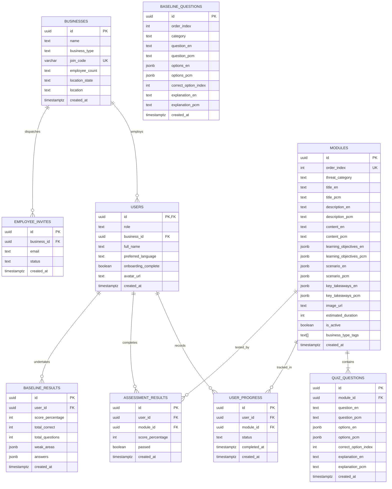

# SMEShield — Authoritative Claude AI Project Report Handoff Package

**Document Version:** 1.0 (Final Academic Baseline)  
**Date of Compilation:** September 19, 2026  
**Target Consumer:** Claude AI (for final-year dissertation/project report drafting)  
**System Repository:** `https://github.com/AP-Techpulse/SMEShield_MVP` (Branch: `main`)  
**Production Deployment:** Vercel Managed Production Service  

---

## Academic Executive Summary & Candidate Details

| Academic Metadata Field | Official Institutional Value |
| :--- | :--- |
| **Project Title** | Design and Implementation of a Web-Based Bilingual and Adaptive Cybersecurity Awareness Training and Self-Assessment Platform for SMEs in Nigeria |
| **Product Short Name** | **SMEShield** |
| **Degree Awarded** | B.Sc. Final-Year Undergraduate Computer Science Project |
| **Candidate Name** | Aruah Paul Ajirioghene |
| **Matriculation Number** | FOS/22/23/287477 |
| **Department** | Department of Computer Science |
| **Faculty / College** | Faculty of Science |
| **Institution** | Delta State University, Abraka, Delta State, Nigeria |
| **Project Supervisor** | Dr. (Mrs.) Chika Lillian Onyagu |
| **Conceptual Foundation** | "The Human Firewall: Rethinking Network Security Principles Beyond Technology" (Precursor Seminar Presentation) |

---

## B1. Academic Project Identity & Seminar Foundation

### 1.1 From Seminar Theory to Applied Software Engineering
The conceptual foundation of SMEShield originates directly from the candidate's approved postgraduate seminar research entitled:
> **"The Human Firewall: Rethinking Network Security Principles Beyond Technology"**

The seminar established the following theoretical and security paradigm shifts:
1. **The Inadequacy of Technical-Only Perimeters:** Conventional cybersecurity architectures invest predominantly in perimeter hardware and automated software (firewalls, Intrusion Detection/Prevention Systems, Anti-malware, and Endpoint Detection and Response). However, global and regional threat telemetry demonstrates that over 85% to 90% of successful enterprise data breaches and financial fraud originate through social engineering, psychological manipulation, and human error.
2. **The "Human Layer" as an Active Defense Component:** Rather than conceptualizing employees and business operators merely as the "weakest link" in security infrastructure, the Human Firewall paradigm conceptualizes informed individuals as the first line of proactive detection and containment.
3. **The SME Vulnerability Asymmetry:** While large multinationals and financial institutions possess dedicated Security Operations Centers (SOCs), Chief Information Security Officers (CISOs), and substantial training budgets, Small and Medium Enterprises (SMEs) in developing economies operate with minimal technical staffing, severe capital constraints, and informal digital communication channels (e.g., WhatsApp, personal mobile banking, and Point-of-Sale terminals).

### 1.2 SMEShield as the Practical System Realization
SMEShield serves as the direct software realization of this academic inquiry. It translates the theoretical principles of the Human Firewall into an empirical, accessible, and culturally contextualized educational web application. Specifically, SMEShield operationalizes:
- **Diagnostic Vulnerability Profiling:** Evaluating incoming baseline security awareness before formal training.
- **Contextualized Behavioral Inoculation:** Training learners across 15 threats pervasive in the Nigerian SME commercial ecosystem (e.g., POS terminal tampering, fake bank credit alerts, WhatsApp Business account takeovers, SIM swap identity theft, and Business Email Compromise).
- **Dual-Language Accessibility:** Eradicating linguistic and comprehension barriers by providing complete lesson protocols and scenario quizzes in both standard English and Nigerian Pidgin.
- **Empirical Measurement:** Calculating an objective, dual-factor **Human Firewall Score (HFS)** that mathematically weighs curriculum completion breadth alongside validated quiz assessment performance.

---

## B2. Research Problem, Context, and Academic Gap

### 2.1 The Wider Problem of Human-Targeted Cybersecurity Threats
Global cybercrime has increasingly shifted away from complex cryptographic exploitation toward identity deception, credential phishing, invoice manipulation, and social engineering. In emerging economies undergoing aggressive digital payments adoption, cybercriminals actively exploit human cognitive biases—urgency, fear, greed, deference to authority, and social trust.

### 2.2 The Nigerian SME Operational Reality
Small and Medium Enterprises represent over 96% of active businesses and contribute nearly 50% of the Gross Domestic Product (GDP) in Nigeria. However, their digital operating environment introduces unique, severe vulnerabilities:
- **Instant Digital Settlement Channels:** Pervasive reliance on Nigerian Inter-Bank Settlement System (NIBSS) Instant Payment (NIP) rails, unstructured supplementary service data (USSD), and agency banking / Point of Sale (POS) terminals creates immediate financial exposure to fake credit alert scams, receipt forgery, and terminal skimming.
- **Informal Workplace Infrastructure:** A significant volume of daily Nigerian commercial transactions occurs through social messaging platforms—chiefly WhatsApp and Instagram. High-profile account takeovers directly deceive suppliers and customers.
- **Resource Constraints:** Nigerian SMEs lack the capital to procure enterprise Security Awareness Training (SAT) platforms (such as KnowBe4, Proofpoint, or Infosec IQ), which charge enterprise subscription fees denominated in foreign currency (USD) and assume dedicated IT administrative departments.
- **Device Hygiene Vulnerabilities:** Heavy deployment of unpatched Android smartphones, second-hand workstations, and shared public/commercial Wi-Fi networks without endpoint monitoring.

### 2.3 The Identified Literature Gap
A systematic audit of existing literature and commercially available cybersecurity training tools reveals three critical shortcomings:
1. **Linguistic and Cultural Incongruity:** Existing platforms deliver content strictly in formal Western English, utilizing corporate terminology and scenarios (e.g., Fortune 500 enterprise mergers, corporate badge cloning) that fail to resonate with Nigerian market vendors, logistics dispatchers, boutique operators, or retail shop attendants. Prior literature has not systematically integrated Nigerian Pidgin—a lingua franca understood by over 75 million Nigerians across all educational demographics—into interactive cybersecurity awareness.
2. **Static, Non-Adaptive Curriculum Delivery:** Commercial training systems typically enforce rigid, linear module sequences. They fail to dynamically prioritize training based on an enterprise's specific industry risk profile (e.g., POS threats for retail versus BEC for professional services) combined with diagnostic weak spots identified during initial employee assessment.
3. **Absence of Unified Multi-Role Tenancy for Heterogeneous SMEs:** Most security training platforms assume a hierarchical corporate structure with dedicated IT administrators. They do not cater simultaneously to the organizational requirements of three distinct SME user archetypes:
   - **Business Owners:** Requiring organizational visibility and compliance verification without technical complexity.
   - **Employees:** Requiring friction-free joining via simple codes without complex corporate directory (Active Directory/SSO) integration.
   - **Sole Entrepreneurs:** Requiring autonomous self-assessment without organizational overhead.

### 2.4 The Proposed Academic Contribution of SMEShield
SMEShield addresses these identified gaps by providing:
- An empirical, lightweight, web-based platform with full bilingual parity (English and Nigerian Pidgin) across 100% of educational modules and assessment questions.
- A deterministic, rule-based adaptive engine that calculates recommendation weights based on SME business sector classification and individual diagnostic weaknesses without requiring resource-heavy or non-transparent machine learning models.
- An empirical **Human Firewall Score (HFS)** that synthesizes educational coverage (breadth) with passing quiz mastery (depth) to provide a transparent index of cybersecurity readiness.

---

## B3. Approved Final Project Objectives & Evidence Traceability

The project adheres strictly to the **Seven Approved Objectives** established in the approved Project Requirements Document (PRD v2.0) and Chapters 1–3 of the academic dissertation. 

*(Note for Report Drafting: Earlier interim documentation collapsed these into five broad headings; Claude must utilize the authoritative 7-objective structure below for all chapter mappings).*

### Table 3.1: Approved Objective-to-Implementation-to-Evidence Matrix

| Objective No. | Approved Project Objective Text | Implemented System Subsystem | Primary Database Tables | Verification Evidence |
| :--- | :--- | :--- | :--- | :--- |
| **Objective 1** | **Web-Based SME Training Platform:** Design and develop a web-based cybersecurity awareness training platform specifically tailored to the operational realities of Nigerian Small and Medium Enterprises (SMEs). | Next.js 16 App Router responsive web platform, Supabase cloud infrastructure, server-side route authentication, and 15 structured curriculum modules. | `public.modules`, `public.businesses` | **TC-01, TC-15, TC-19**; Clean Next.js production build (32 routes). |
| **Objective 2** | **Bilingual Content System:** Develop a culturally relevant, bilingual content delivery system providing all learning modules, scenarios, and assessment quizzes in both English and Nigerian Pidgin. | Real-time bilingual state management (`LanguageContext`), 15 enriched bilingual modules ($\ge 700$ chars each), and 75 bilingual quiz questions with full option and explanation parity. | `modules` (`content_en`, `content_pcm`), `quiz_questions` (`question_en`, `question_pcm`, `options_en`, `options_pcm`, `explanation_en`, `explanation_pcm`) | **TC-03, TC-04, TC-05**; Automated parity audit (`scripts/verify_phase4.mjs`) confirming 100% bilingual parity. |
| **Objective 3** | **Rule-Based Adaptive Engine:** Implement a deterministic, rule-based adaptive learning recommendation engine that dynamically personalizes module sequencing according to SME business sector and diagnostic weakness. | Server-side recommendation function (`getRecommendedModules` in `src/lib/adaptive-engine.ts`) executing formula: $\text{Base}(10) + \text{WeakArea}(+20) + \text{SectorMatch}(+10)$, with completed-module filtering and order tie-breaking. | `modules.business_type_tags`, `baseline_results.weak_areas`, `user_progress.status` | **TC-06**; Algorithmic unit execution verifying weak area priority elevation and completed module exclusion. |
| **Objective 4** | **Scenario-Based Self-Assessment:** Construct a scenario-based self-assessment framework (including an initial diagnostic baseline and 5-question end-of-module quizzes with an 80% passing threshold) to measure comprehension and identify vulnerabilities. | 5-question onboarding diagnostic (`/onboarding` & `/assessment`), 15 end-of-module quizzes (75 total questions) enforcing strict $\ge 80\%$ (4/5) passing threshold before status progression. | `baseline_questions`, `baseline_results`, `quiz_questions`, `assessment_results` | **TC-02, TC-10**; Assessment threshold validation script confirming sub-80% failures and pass persistence. |
| **Objective 5** | **Multi-Role SME Management & Access Control:** Engineer a multi-role user management and access control structure supporting Business Owners, Employees, and Sole Entrepreneurs, with tenant-isolated dashboards and 6-digit organization join codes. | Supabase Auth integration, PostgreSQL Row-Level Security (RLS) policies, middleware server route guards, profile role definitions, and persistent 6-digit alphanumeric join codes. | `users`, `businesses` (`join_code`), Supabase RLS security policies | **TC-11, TC-12, TC-13, TC-14**; RLS boundary tests confirming cross-tenant data blocking. |
| **Objective 6** | **Empirical Human Firewall Scoring:** Design and implement a progress-tracking and measurement engine calculating a dual-factor Human Firewall Score (HFS) combining training breadth (35%) and quiz mastery (65%). | HFS calculation engine (`src/app/dashboard/page.tsx`, `DashboardViews.tsx`), formula: $\text{HFS} = \text{round}((\text{completion}\% \times 0.35) + (\text{quiz\_avg} \times 0.65))$, awareness categorization, and baseline benchmark tracking. | `user_progress`, `assessment_results`, `baseline_results` | **TC-07, TC-08, TC-09**; Boundary formula test ($0\%=0, 100\%=100, 100/80=87$) and category mapping audit. |
| **Objective 7** | **Organizational Monitoring Interface:** Deliver a secure, responsive, mobile-first web interface with an organizational monitoring interface enabling Business Owners to monitor staff completion, average scores, and export compliance rosters. | Dedicated Business Owner portal (`/dashboard/team`, `/dashboard/team/[id]`), team readiness dial, staff roster table, invite dispatch tracking, and live CSV compliance export (`/api/export-csv`). | `businesses`, `users`, `user_progress`, `assessment_results`, `employee_invites` | **TC-13, TC-16**; Multi-viewport testing (375px–1440px) and authenticated CSV export verification. |

---

## B4. Significance of the Study and Operational Boundaries

### 4.1 Significance of the Study
- **For Nigerian SME Owners:** Provides an automated, zero-cost mechanism to baseline organizational cyber exposure, enforce standardized staff training, track completion without requiring an IT department, and obtain verifiable compliance documentation for data protection audits.
- **For SME Employees:** Delivers digestible, culturally familiar micro-learning that replaces intimidation and technical jargon with actionable defensive behaviors in everyday language.
- **For Sole Entrepreneurs:** Offers an autonomous cybersecurity benchmark tailored to single-operator commercial activities (e.g., POS merchants, online Instagram/WhatsApp vendors) vulnerable to direct financial scams.
- **For Cybersecurity Awareness Pedagogy:** Empirically demonstrates the feasibility of combining dual-language localization (Pidgin and English) with deterministic rule-based curriculum adaptation in low-resource environments.
- **For Future Researchers and Software Engineers:** Establishes a verified architectural pattern combining modern full-stack web technologies (Next.js 16, Supabase, PostgreSQL RLS) with granular educational metrics.

### 4.2 System Scope and Operational Boundaries
To maintain academic honesty, the report must clearly delineate the system's operational boundaries:
- **Educational Scope:** SMEShield is strictly an **educational and awareness training platform**. It does *not* provide real-time endpoint antivirus protection, network intrusion detection, or automated bank transaction blocking.
- **Assessed User Roles:** Exactly **three learner-facing roles** are implemented and evaluated:
  1. *Business Owner*
  2. *Employee*
  3. *Sole Entrepreneur*
- **Administrative Application Separation:** The separately planned *SMEShield Administrative Application* (intended for platform operators, content curators, and researchers to manage global tenants and author new modules) is recognized as **supporting future operational infrastructure**. It is **not** a fourth assessed learner role and was intentionally excluded from the primary dissertation evaluation to preserve candidate research focus on learner efficacy.

---

## B5. Final Implemented System Functions

1. **Authentication Gateway (`/login`, `/signup`):**
   - Secure email/password authentication using Supabase Auth JWT cookie sessions.
   - Google OAuth registration flow with automatic profile initialization.
   - Mandatory, accessible, unticked Terms of Use and Privacy Policy acceptance checkbox on signup.
   - Password strength validation enforcing complexity rules (length, casing, digits, special symbols).
2. **Multi-Role Onboarding Pipeline (`/onboarding`):**
   - Step 1: User role selection (*Business Owner*, *Employee*, or *Sole Entrepreneur*).
   - Step 2 (Business Owner): Enterprise registration (Business Name, Industry Sector from 8 categories, Headcount, Location State) generating an automated persistent 6-digit join code.
   - Step 2 (Employee): Friction-free enterprise linking via a 6-digit alphanumeric join code with real-time business name validation.
   - Step 2 (Sole Entrepreneur): Lightweight commercial profile registration.
   - Step 3 (All Roles): Language preference selection (English vs. Nigerian Pidgin).
   - Step 4 (All Roles): Mandatory 5-question baseline diagnostic assessment establishing initial cybersecurity awareness.
3. **Bilingual Curriculum Library (`/training`):**
   - 15 fully authored and verified modules covering top Nigerian cyber threats.
   - Instant language toggle (English $\leftrightarrow$ Nigerian Pidgin) preserving reading position.
   - Detailed scenario breakdowns: *Situation*, *Warning Signs*, *Risky Action*, *Safe Action*, and *Educational Explanation*.
   - 15 authentic Nigerian workplace scenario photography assets stored locally in `/public/assets/smeshield/`.
4. **Assessment and Mastery Engine (`/training/[id]/quiz`):**
   - 75 multiple-choice questions (exactly 5 questions per module).
   - Strict 80% passing threshold ($\ge 4$ out of 5 correct) required to certify module completion.
   - Immediate feedback displaying answer correctness, correct option indicator, and bilingual rationale.
   - Unlimited retake capability with timestamped persistence in `assessment_results`.
5. **Deterministic Adaptive Learning (`src/lib/adaptive-engine.ts`):**
   - Dynamic prioritization of modules based on sector alignment and diagnostic weak areas.
   - Real-time separation of active recommendations from completed curriculum units.
6. **Human Firewall Scoring Engine (`/dashboard`, `/dashboard/progress`):**
   - Mathematical calculation of dual-factor HFS (35% coverage + 65% quiz performance).
   - Awareness level badge attribution (*Developing*, *Aware*, *Strong*, *Highly Aware*).
   - Baseline benchmark comparison ($\Delta = \text{HFS} - \text{Baseline Score}$).
   - Weakest area and strongest threat category performance analytics.
7. **Business Owner Workforce Oversight (`/dashboard/team`, `/dashboard/team/[id]`):**
   - Organization-wide readiness dial calculating collective staff curriculum completion.
   - Team quiz mastery average.
   - Active staff roster with individual employee drill-downs.
   - Pending invitation management.
   - One-click CSV compliance export (`/api/export-csv`) generating structured audit records.
8. **User Profile and Identity Management (`/dashboard/profile`):**
   - Profile metadata updating (Full Name, Language Preference).
   - Multi-role badge display.
   - Avatar upload to Supabase Storage bucket (`avatars`) with user-isolated RLS policies.

---

## B6. Complete 15-Module Curriculum Audit

The 15 curriculum modules were engineered to address verified threat vectors documented by the Nigeria Computer Emergency Response Team (ngCERT) and the Nigeria Data Protection Commission (NDPC).

### Table 6.1: Authoritative 15-Module Curriculum Inventory

| Index | Threat Category | English Title | Nigerian Pidgin Title | Key Nigerian SME Relevance | Quiz Qty | Primary Educational Learning Outcome |
| :---: | :--- | :--- | :--- | :--- | :---: | :--- |
| **1** | `phishing` | Phishing & Fake Alerts | Phishing & Fake Alerts | Deceptive emails and SMS impersonating FIRS, commercial banks, or CAC demanding urgent credential entry. | 5 | Identify sender domain anomalies, verify bank communications, and refuse urgent link clicks. |
| **2** | `fake_payment` | Fake Payment / "Flash Funds" Scams | Fake Payment / "Flash Funds" Scams | Fraudulent SMS credit alerts sent by buyers before funds settle; reversal of interbank transfers after merchandise collection. | 5 | Enforce bank app / USSD balance verification before releasing physical or digital merchandise. |
| **3** | `ransomware` | Ransomware | Ransomware | Malicious file encryption of accounting, customer, or legal databases followed by cryptocurrency ransom demands. | 5 | Execute strict offline 3-2-1 backup routines and prohibit unauthorized executable attachments. |
| **4** | `social_engineering` | Social Media & WhatsApp Account Takeover | Social Media & WhatsApp Account Takeover | Hijacking of official business WhatsApp/Instagram accounts via SMS registration code deception to defraud clients. | 5 | Enforce mandatory Two-Step Verification (PIN) on WhatsApp and never disclose 6-digit registration codes. |
| **5** | `device_security` | USB Malware & Keyloggers | USB Malware & Keyloggers | Infectious flash drives brought into retail or school premises by customers or students seeking printing services. | 5 | Disable auto-run, scan external storage devices, and isolate point-of-sale systems from public flash drives. |
| **6** | `sim_swap` | SIM Swap Fraud | SIM Swap Fraud | Fraudulent SIM card re-issuance at telecom centers targeting business mobile banking authorization lines. | 5 | Detect sudden cellular network loss, lock SIM cards with custom PINs, and report unexplained disconnection. |
| **7** | `agent_banking` | POS/Agent Banking Fraud | POS/Agent Banking Fraud | Manipulation of Point-of-Sale terminals, paper roll skimming, PIN shoulder surfing, and fraudulent transaction slips. | 5 | Maintain physical terminal custody, guard merchant supervisor PINs, and inspect devices for physical skimmers. |
| **8** | `passwords` | Weak Passwords & Credential Reuse | Weak Passwords & Credential Reuse | Utilizing predictable passwords (e.g., `company123`, `lagos2024`) across multiple business services. | 5 | Construct high-entropy passphrases, use password managers, and eliminate credential sharing across staff. |
| **9** | `device_security` | Unpatched Apps & Outdated Devices | Unpatched Apps & Outdated Devices | Running outdated Android operating systems or pirated accounting software containing publicly known exploits. | 5 | Enable automated security updates, audit installed software, and retire unsupported legacy operating systems. |
| **10** | `wifi_security` | Public/Unsecured Wi-Fi Risks | Public/Unsecured Wi-Fi Risks | Transacting business banking or accessing client databases over open cafe, hotel, or market Wi-Fi networks. | 5 | Avoid unencrypted Wi-Fi for sensitive work, verify HTTPS security, and route traffic through trusted cellular data or VPNs. |
| **11** | `bec` | Business Email Compromise & Fake Invoices | Business Email Compromise & Fake Invoices | Executive impersonation or spoofed supplier emails directing invoice payments to fraudulent bank accounts. | 5 | Implement multi-channel out-of-band verification (phone/in-person) before altering supplier payment details. |
| **12** | `phishing` | Fake/Cloned Online Store Scams | Fake/Cloned Online Store Scams | Cloned e-commerce websites and counterfeit social media accounts imitating legitimate Nigerian wholesalers. | 5 | Verify domain spelling, validate physical business addresses, and audit corporate CAC registration details. |
| **13** | `social_engineering` | Voice Phishing & AI Voice-Clone Scams | Voice Phishing & AI Voice-Clone Scams | Urgent phone calls simulating bank fraud officers, branch managers, or business partners requesting authorization codes. | 5 | Establish organizational challenge-response protocols and refuse verbal transmission of OTPs or passwords. |
| **14** | `phishing` | QR Code Scams ("Quishing") | QR Code Scams ("Quishing") | Fraudulent QR code stickers pasted over legitimate merchant payment codes at market stalls or restaurant tables. | 5 | Inspect physical QR codes for tampering, verify destination URLs, and confirm payee name on checkout. |
| **15** | `device_security` | Device Theft/Loss & Lack of Backups | Device Theft/Loss & Lack of Backups | Physical loss or armed theft of business mobile devices containing unencrypted customer data and open banking sessions. | 5 | Implement remote wipe capabilities, device screen locks, full disk encryption, and automated cloud backups. |

---

## B7. Adaptive Learning Recommendation Engine

### 7.1 Algorithmic Design Principles
The SMEShield adaptive engine operates as a **deterministic, rule-based recommendation model**. It rejects opaque machine learning architectures (such as deep neural networks or collaborative filtering) for specific academic and operational reasons:
1. **Explainability and Determinism:** Educational recommendations in SME compliance training must be transparent, predictable, and auditable. A business owner must understand precisely why an employee is assigned a specific module.
2. **Cold-Start Efficiency:** Micro-enterprises possess zero historical training interaction data upon initial registration. A deterministic rule-based model executes immediately using explicit enterprise attributes (sector) and baseline diagnostics.
3. **Computational Parsimony:** The algorithm executes within a single server-side query with sub-50ms latency, placing zero overhead on mobile networks.

### 7.2 Mathematical Weighting Model
For each active module $m \in M$, its dynamic relevance score $R(m)$ is computed as:
$$R(m) = S_{\text{base}} + W_{\text{weak}}(m) + W_{\text{sector}}(m)$$

Where:
- $S_{\text{base}} = 10$ (Base score assigned to all active curriculum units).
- $W_{\text{weak}}(m) = 20$ if $m.\text{threat\_category} \in \text{User}.\text{BaselineWeakAreas}$; otherwise $0$.
- $W_{\text{sector}}(m) = 10$ if $\text{User}.\text{SectorTag} \in m.\text{business\_type\_tags}$ or $\text{User}.\text{SectorTag} = \text{'all'}$; otherwise $0$.

### 7.3 Processing and Sequencing Logic
1. **Exclusion Filtering:** Modules with $\text{Progress}.\text{status} = \text{'completed'}$ are partitioned and excluded from the active recommendation list.
2. **Descending Score Sort:** Non-completed modules are sorted by descending $R(m)$.
3. **Deterministic Tie-Breaking:** If two modules have identical $R(m)$, the tie is broken strictly by ascending $m.\text{order\_index}$, preserving the logical curriculum progression established by cybersecurity pedagogy.
4. **Bucket Partitioning:** The top 4 ranked modules are allocated to the learner's **Primary Recommendations** shelf; remaining modules are assigned to **All Others**.

### 7.4 Algorithm Pseudocode (Suitable for Chapter 3)

```typescript
Algorithm: DeterministicAdaptiveRecommendation
Input:     UserID (UUID)
Output:    RecommendedModules (List), CompletedModules (List), RemainingModules (List)

1.  Connect to Supabase and retrieve User profile:
        profile ← FetchUserProfile(UserID)
        businessSector ← FetchBusinessSector(profile.business_id)
        mappedSectorTag ← MapSectorToTag(businessSector)

2.  Retrieve User's latest diagnostic assessment:
        baseline ← FetchLatestBaselineResult(UserID)
        weakAreas ← baseline.weak_areas  // Array of threat categories

3.  Retrieve all active modules from database:
        allModules ← FetchAllModules(order_by: order_index ASC)

4.  Retrieve User's existing curriculum progress:
        progressMap ← FetchUserProgressMap(UserID) // status per module_id

5.  For each module in allModules:
        score ← 10  // Base priority score
        
        // Priority 1: Diagnostic Weakness Boost
        If module.threat_category in weakAreas Then
            score ← score + 20
            module.is_weak_area ← True
        Else
            module.is_weak_area ← False
        End If
        
        // Priority 2: Business Sector Relevance Boost
        If mappedSectorTag == 'all' OR mappedSectorTag in module.business_type_tags Then
            score ← score + 10
            module.is_business_relevant ← True
        Else
            module.is_business_relevant ← False
        End If
        
        module.relevance_score ← score
        module.status ← progressMap.get(module.id) DEFAULT 'not_started'
    End For

6.  Partition modules into Completed and Pending:
        completedList ← Filter(allModules where status == 'completed')
        pendingList   ← Filter(allModules where status != 'completed')

7.  Sort pendingList:
        Sort pendingList By:
            Primary:   relevance_score DESCENDING
            Secondary: order_index ASCENDING (Tie-breaker)

8.  Slice recommendations:
        RecommendedModules ← pendingList[0 TO 3]  // Top 4 priorities
        RemainingModules   ← pendingList[4 TO END]
        CompletedModules   ← completedList

9.  Return { RecommendedModules, CompletedModules, RemainingModules }
```

---

## B8. Human Firewall Score (HFS) Mathematical Formulation

### 8.1 The Dual-Factor Formula
The Human Firewall Score (HFS) is the primary quantitative metric implemented within SMEShield to represent a learner's cybersecurity training posture. It combines curriculum coverage (breadth) with validated assessment scores (depth).

$$\text{HFS} = \text{round}\left( (\text{CompletionPercentage} \times 0.35) + (\text{AverageQuizScore} \times 0.65) \right)$$

Where:
- $\text{CompletionPercentage} = \text{round}\left( \frac{|\text{CompletedModules}|}{15} \times 100 \right)$
- $\text{AverageQuizScore} = \text{round}\left( \frac{\sum_{i=1}^{k} \text{Score}_i}{k} \right)$ for $k$ completed quiz assessments. If $k = 0$, $\text{AverageQuizScore} = 0$.
- $\text{HFS} \in [0, 100]$, rounded to the nearest integer.

### 8.2 Theoretical Justification of Weight Distribution
- **The 35% Breadth Weight (Curriculum Coverage):** Acknowledges that security awareness requires holistic exposure across the threat spectrum. An employee who scores 100% on a single phishing quiz but has not engaged with POS fraud, ransomware, or SIM swaps remains vulnerable to common attacks.
- **The 65% Depth Weight (Quiz Mastery):** Prioritizes demonstrated comprehension and tactical decision-making. Passing quizzes requires applying knowledge to realistic Nigerian workplace scenarios under an 80% passing threshold, ensuring that mere passive module viewing cannot produce an inflated score.

### 8.3 Awareness Level Categorization

| Score Range | System Awareness Label | Operational Description | Recommended Action |
| :---: | :--- | :--- | :--- |
| **85 – 100** | **Highly Aware** | High knowledge retention across tested threat vectors; consistent scenario passing. | Maintain annual refresher training and peer mentorship. |
| **70 – 84** | **Strong** | Solid operational security hygiene; isolated errors in complex scenarios. | Review targeted priority modules in weak threat categories. |
| **50 – 69** | **Aware** | Basic familiarity with core concepts; persistent vulnerabilities in specialized threats. | Mandatory completion of all high-risk sector-tagged units. |
| **0 – 49** | **Developing** | Severe vulnerability; low curriculum completion or multiple failed assessments. | Immediate completion of fundamental threat curriculum. |

*(Academic Clarification: Earlier design drafts utilized the term "Expert"; this was deprecated during Phase 3 review to avoid misleading claims of professional security certification).*

### 8.4 Baseline Diagnostic vs. HFS: Critical Academic Measurement Caveat
In the project dissertation (specifically **Chapters 4 and 5**), Claude **MUST** adhere to the following scientific distinction:
- **The Baseline Score** ($\text{Baseline} \in [0, 100]$) is a 5-question diagnostic instrument taken upon registration to identify pre-existing awareness and flag weak categories.
- **The Human Firewall Score (HFS)** is a composite metric reflecting subsequent training participation and quiz mastery.
- **Awareness Improvement** is calculated as:
  $$\Delta_{\text{Awareness}} = \text{HFS} - \text{BaselineScore}$$
- **Crucial Limitation:** The baseline diagnostic and the final HFS do **not** measure identical psychometric constructs. The baseline is a brief 5-question general diagnostic, whereas HFS incorporates curriculum completion volume alongside 75-question quiz bank performance. Consequently, while $\Delta_{\text{Awareness}}$ serves as an internal platform performance and progression indicator, **it must not be asserted as a clinically or scientifically validated causal proof of real-world breach avoidance in production environments.**

---

## B9. Final System Architecture

### 9.1 Deployed Architectural Stack
- **Presentation Layer:** Next.js 16.3.4 (App Router) executing React 19.2.8 and Tailwind CSS v4.
- **State & Rendering Strategy:** Server Components for authenticated data pre-fetching and secure layout rendering; Client Components for interactive forms, language switching, and quiz physics.
- **Authentication Subsystem:** Supabase Auth utilizing secure, HTTP-only JWT cookies managed via `@supabase/ssr`.
- **Database Engine:** PostgreSQL 15 managed via Supabase Cloud, enforcing Row-Level Security (RLS) on all user-facing tables.
- **Object Storage:** Supabase Storage (`avatars` bucket) for user profile images with folder-level UUID access control.
- **Edge Deployment:** Vercel Global Edge Network with automated continuous deployment from the GitHub repository (`main` branch).

### 9.2 Mermaid System Architecture Diagram

```mermaid
graph TD
    subgraph ClientLayer ["Client Browser / Mobile Viewport"]
        UI["Next.js 16 App Router UI"]
        LC["LanguageContext (EN / PCM)"]
        SW["Service / State Hooks"]
    end

    subgraph ServerLayer ["Next.js Server Runtime (Node.js 22 / Vercel Edge)"]
        MW["Auth & RBAC Middleware (src/proxy.ts)"]
        SC["React Server Components"]
        AE["Adaptive Engine (src/lib/adaptive-engine.ts)"]
        HFSE["HFS Calculation Subsystem"]
        CSV["CSV Export API (/api/export-csv)"]
    end

    subgraph SupabaseLayer ["Supabase Cloud Managed Infrastructure"]
        SAuth["Supabase Auth (JWT Sessions)"]
        PG["PostgreSQL 15 Database"]
        Storage["Supabase Storage (avatars bucket)"]
        RLS["PostgreSQL Row-Level Security (RLS)"]
    end

    UI <--> |HTTPS / JSON| MW
    MW --> SC
    SC --> AE
    SC --> HFSE
    SC <--> |@supabase/ssr| SAuth
    SC <--> |PostgREST Query| RLS
    RLS --> PG
    UI <--> |Direct Upload / Download| Storage

    subgraph Roles ["Assessed User Roles"]
        BO["Business Owner"]
        EMP["Employee"]
        SE["Sole Entrepreneur"]
    end

    BO -.-> |Tenant Admin & Roster| UI
    EMP -.-> |Join Code & Training| UI
    SE -.-> |Independent Training| UI
```

---

## B10. Final Database Schema & Data Dictionary

### 10.1 Entity-Relationship Diagram (Mermaid)



### 10.2 Table Data Dictionary

#### Table 1: `public.businesses`
*Stores enterprise identity, commercial categorization, and persistent staff onboarding join codes.*
- `id` (`UUID`, PK, `DEFAULT gen_random_uuid()`): Unique enterprise identifier.
- `name` (`TEXT`, NOT NULL): Registered business trading name.
- `business_type` (`TEXT`, NULLABLE): Sector classification (`pos`, `retail`, `tech`, `school`, `fashion`, `food`, `professional`, `general`).
- `employee_count` (`TEXT`, DEFAULT `'1'`): Declared staff headcount range.
- `join_code` (`TEXT`, UNIQUE, NULLABLE): 6-digit alphanumeric code for staff self-association.
- `location_state` (`TEXT`, NULLABLE): State in Nigeria where operations are centered.
- `location` (`TEXT`, NULLABLE): Physical street/commercial market address.
- `created_at` (`TIMESTAMPTZ`, DEFAULT `NOW()`): Timestamp of registration.

#### Table 2: `public.users`
*Extends `auth.users` with Role-Based Access Control (RBAC), tenant links, and bilingual settings.*
- `id` (`UUID`, PK, REFERENCES `auth.users(id)` ON DELETE CASCADE): Foreign key link to core auth table.
- `role` (`TEXT`, NOT NULL, CHECK `role IN ('business_owner', 'employee', 'sole_entrepreneur')`): Access role.
- `business_id` (`UUID`, NULLABLE, REFERENCES `businesses(id)` ON DELETE SET NULL): Tenant association.
- `full_name` (`TEXT`, NOT NULL): Full display name.
- `preferred_language` (`TEXT`, DEFAULT `'en'`, CHECK `preferred_language IN ('en', 'pcm')`): Language preference.
- `onboarding_complete` (`BOOLEAN`, DEFAULT `FALSE`): Profile onboarding and baseline completion status.
- `avatar_url` (`TEXT`, NULLABLE): Storage link to profile picture.
- `created_at` (`TIMESTAMPTZ`, DEFAULT `NOW()`): Account profile timestamp.

#### Table 3: `public.modules`
*Stores the 15 Nigerian SME cybersecurity awareness curriculum units with full bilingual parity.*
- `id` (`UUID`, PK, `DEFAULT gen_random_uuid()`): Unique module identifier.
- `order_index` (`INTEGER`, NOT NULL): Curriculum sequence order (1 to 15).
- `threat_category` (`TEXT`, NOT NULL): Taxonomy tag (`phishing`, `fake_payment`, `ransomware`, `social_engineering`, `device_security`, `sim_swap`, `agent_banking`, `passwords`, `wifi_security`, `bec`).
- `title_en` / `title_pcm` (`TEXT`, NOT NULL): Module title in English and Nigerian Pidgin.
- `description_en` / `description_pcm` (`TEXT`, NOT NULL): Educational overview in English and Pidgin.
- `content_en` / `content_pcm` (`TEXT`, NOT NULL): Core lesson protocols and guidelines ($\ge 700$ characters).
- `learning_objectives_en` / `learning_objectives_pcm` (`JSONB`, NOT NULL): List of learning goals.
- `scenario_en` / `scenario_pcm` (`JSONB`, NOT NULL): Structured Nigerian workplace narrative object (`situation`, `warning_signs`, `risky_action`, `safe_action`, `explanation`).
- `key_takeaways_en` / `key_takeaways_pcm` (`JSONB`, NOT NULL): List of core action items.
- `image_url` (`TEXT`, NOT NULL): Path to local photography asset in `/public/assets/smeshield/`.
- `estimated_duration` (`INTEGER`, DEFAULT `10`): Estimated reading time in minutes.
- `is_active` (`BOOLEAN`, DEFAULT `TRUE`): Curriculum availability flag.
- `business_type_tags` (`TEXT[]`, DEFAULT `ARRAY[]::TEXT[]`): Adaptive sector targeting tags.
- `created_at` (`TIMESTAMPTZ`, DEFAULT `NOW()`): Record creation timestamp.

#### Table 4: `public.quiz_questions`
*75 scenario-based assessment questions (exactly 5 per module) with full bilingual parity.*
- `id` (`UUID`, PK, `DEFAULT gen_random_uuid()`): Unique question identifier.
- `module_id` (`UUID`, NOT NULL, REFERENCES `modules(id)` ON DELETE CASCADE): Parent module foreign key.
- `question_en` / `question_pcm` (`TEXT`, NOT NULL): Question stem in English and Nigerian Pidgin.
- `options_en` / `options_pcm` (`JSONB`, NOT NULL): Array of exactly four multiple-choice options.
- `correct_option_index` (`INTEGER`, NOT NULL, CHECK `BETWEEN 0 AND 3`): Zero-based correct index.
- `explanation_en` / `explanation_pcm` (`TEXT`, NOT NULL): Detailed educational rationale.
- `created_at` (`TIMESTAMPTZ`, DEFAULT `NOW()`): Creation timestamp.

#### Table 5: `public.baseline_questions`
*Curated diagnostic questions evaluated during initial user onboarding.*
- `id` (`UUID`, PK, `DEFAULT gen_random_uuid()`): Question identifier.
- `order_index` (`INTEGER`, NOT NULL): Diagnostic sequence.
- `category` (`TEXT`, NOT NULL): Threat category evaluated.
- `question_en` / `question_pcm` (`TEXT`, NOT NULL): Diagnostic stem in both languages.
- `options_en` / `options_pcm` (`JSONB`, NOT NULL): Four options in English and Pidgin.
- `correct_option_index` (`INTEGER`, NOT NULL): Zero-based correct option index.
- `explanation_en` / `explanation_pcm` (`TEXT`, NULLABLE): Educational explanation.
- `created_at` (`TIMESTAMPTZ`, DEFAULT `NOW()`): Question timestamp.

#### Table 6: `public.baseline_results`
*Captures pre-training diagnostic baseline awareness and flags weak threat categories.*
- `id` (`UUID`, PK, `DEFAULT gen_random_uuid()`): Diagnostic record identifier.
- `user_id` (`UUID`, NOT NULL, REFERENCES `users(id)` ON DELETE CASCADE): Learner profile link.
- `score_percentage` (`INTEGER`, NOT NULL, CHECK `BETWEEN 0 AND 100`): Baseline percentage.
- `total_correct` (`INTEGER`, NOT NULL): Number of correct responses.
- `total_questions` (`INTEGER`, NOT NULL): Total questions answered (5).
- `weak_areas` (`JSONB`, NOT NULL, DEFAULT `'[]'::jsonb`): Array of threat categories where learner erred.
- `answers` (`JSONB`, NOT NULL, DEFAULT `'[]'::jsonb`): Full audit map of user responses.
- `created_at` (`TIMESTAMPTZ`, DEFAULT `NOW()`): Assessment timestamp.

#### Table 7: `public.assessment_results`
*End-of-module quiz attempt records capturing mastery scores and passing certifications.*
- `id` (`UUID`, PK, `DEFAULT gen_random_uuid()`): Attempt identifier.
- `user_id` (`UUID`, NOT NULL, REFERENCES `users(id)` ON DELETE CASCADE): Learner reference.
- `module_id` (`UUID`, NOT NULL, REFERENCES `modules(id)` ON DELETE CASCADE): Tested module reference.
- `score_percentage` (`INTEGER`, NOT NULL, CHECK `BETWEEN 0 AND 100`): Score achieved on attempt.
- `passed` (`BOOLEAN`, NOT NULL): Passing certification flag ($\ge 80\%$).
- `created_at` (`TIMESTAMPTZ`, DEFAULT `NOW()`): Submission timestamp.

#### Table 8: `public.user_progress`
*Tracks granular curriculum progression per user per module.*
- `id` (`UUID`, PK, `DEFAULT gen_random_uuid()`): Progress record identifier.
- `user_id` (`UUID`, NOT NULL, REFERENCES `users(id)` ON DELETE CASCADE): Learner link.
- `module_id` (`UUID`, NOT NULL, REFERENCES `modules(id)` ON DELETE CASCADE): Module link.
- `status` (`TEXT`, CHECK `status IN ('not_started', 'in_progress', 'completed')`): Progress status.
- `completed_at` (`TIMESTAMPTZ`, NULLABLE): Timestamp when passing quiz score was recorded.
- `created_at` (`TIMESTAMPTZ`, DEFAULT `NOW()`): Record creation timestamp.
- *Unique Constraint:* `UNIQUE(user_id, module_id)`.

#### Table 9: `public.employee_invites`
*Tracks staff invitations dispatched by Business Owners.*
- `id` (`UUID`, PK, `DEFAULT gen_random_uuid()`): Invitation identifier.
- `business_id` (`UUID`, NOT NULL, REFERENCES `businesses(id)` ON DELETE CASCADE): Enterprise link.
- `email` (`TEXT`, NOT NULL): Target employee email address.
- `status` (`TEXT`, DEFAULT `'pending'`, CHECK `status IN ('pending', 'accepted', 'revoked')`): State.
- `created_at` (`TIMESTAMPTZ`, DEFAULT `NOW()`): Invitation dispatch timestamp.

---

## B11. Verified Technology Versions & Runtime Evidence

All dependencies and runtime specifications reflect empirical package evidence from `package.json` and production builds.

| Subsystem / Package | Exact Version | Justification and Architectural Role |
| :--- | :--- | :--- |
| **Runtime Environment** | Node.js `v22.19.0` (64-bit) | LTS V8 server execution environment. |
| **Web Framework** | Next.js `16.3.4` (App Router) | High-performance React framework with React Server Components (RSC) and Turbopack compiler. |
| **UI Library** | React & React DOM `19.2.8` | Component rendering engine with concurrent features. |
| **Styling Framework** | Tailwind CSS `^4.x` (`@tailwindcss/postcss`) | Utility-first CSS engine with unified token system and zero-runtime CSS generation. |
| **Programming Language**| TypeScript `^5.x` | Strict type safety and compilation verification across all 32 routes. |
| **Supabase Client SDK** | `@supabase/supabase-js` `^2.116.0` | Direct client and admin interface to Supabase PostgREST, Auth, and Storage. |
| **Supabase SSR SDK** | `@supabase/ssr` `^0.12.7` | Secure cookie-based authentication bridge between Next.js Server Components and Supabase Auth. |
| **Iconography** | `material-symbols` `^0.47.2` | Google Material Symbols Outlined rendered as SVG font glyphs. |
| **UI Utilities** | `clsx` `^2.1.1` & `tailwind-merge` `^3.6.0` | Dynamic conditional class resolution for responsive design components. |
| **Database Engine** | PostgreSQL `15.8` (Supabase Cloud) | Enterprise relational database with Row-Level Security and JSONB indexing. |
| **Linting System** | ESLint `^9` with `eslint-config-next` `16.3.4` | Static analysis enforcing code standards and accessibility. |

---

## B12. Security Architecture & Data Privacy Implementation

### 12.1 Authentication and Role-Based Access Control (RBAC)
- **Session Tokens:** Authentication sessions are maintained using cryptographically signed HTTP-only JWT tokens set by `@supabase/ssr`. Tokens are inaccessible to client JavaScript, mitigating Cross-Site Scripting (XSS) session theft.
- **Server Route Guards (`src/proxy.ts` Middleware):** Unauthenticated requests to `/dashboard/*`, `/training/*`, and `/assessment/*` are intercepted server-side and redirected via HTTP 307 to `/login`.
- **Role Boundary Enforcement:** Server Components inspect `profile.role`. Any attempt by an `employee` or `sole_entrepreneur` to access team management routes (`/dashboard/team/*`) triggers an immediate server redirect back to `/dashboard`.

### 12.2 PostgreSQL Row-Level Security (RLS) Tenant Isolation
Granular RLS policies are enabled on all user-facing tables:
- **Tenant Isolation (`businesses` & `users`):** Business Owners can only read employee records sharing their exact `business_id`. Cross-tenant data inspection is rejected at the database query engine level.
- **Privilege Escalation Prevention:** A PostgreSQL security-definer trigger (`restrict_user_updates`) intercepts all updates on `public.users`. Any authenticated client attempt to alter `role`, `business_id`, or `onboarding_complete` raises an unhandled database exception.
- **Storage Protection (`avatars` bucket):** Users may only insert, update, or delete files within their own folder path (`(storage.foldername(name))[1] = auth.uid()::text`).

### 12.3 Nigeria Data Protection Act (NDPA) 2023 Alignment
- **Privacy by Design:** Collection of personal data is strictly minimized to full name, email, role, and educational metrics. The platform explicitly does **not** collect Bank Verification Numbers (BVN), National Identification Numbers (NIN), payment cards, or financial PINs.
- **Mandatory Consent Acknowledgement:** User registration requires an active, unticked checkbox confirming acceptance of the Terms of Use and Privacy Policy. Google OAuth registrations explicitly state the same legal agreement.
- **Regulatory Framing:** The platform is accurately presented as **"Privacy-conscious by design, aligned with the principles of the Nigeria Data Protection Act (NDPA) 2023."** In adherence to academic integrity, the platform does **not** make unverified claims of being "NDPC Certified" or "Officially Accredited" by regulatory bodies.

---

## B13. UI/UX Design System and Deployment Record

### 13.1 Editorial Typography & Elevation Visual System
- **Typography:** Newsreader (high-craft editorial serif) for headings; Inter (neutral, readable sans-serif) for body text and navigation.
- **Color Palette:**
  - Primary Container: Deep Navy / Midnight Blue (`#0F172A` / `#1E293B`)
  - Accent Secondary: Teal / Emerald Shield (`#0D9488` / `#10B981`)
  - Surface Background: Warm Neutral Cream / Solid Crisp Card Surfaces (`#F8FAFC` / `#FFFFFF`)
- **Interactive Physics:** Tactile button-press interactions with spring-damped micro-interactions (`transform: active:scale(0.97)`).
- **Responsive Breakpoints:** Fully responsive across mobile (375px–414px), tablet (768px), and desktop (1024px–1440px).

### 13.2 Source Code and Deployment Evidence
- **GitHub Repository:** `https://github.com/AP-Techpulse/SMEShield_MVP`
  - Canonical branch: `main` (mirrored to `master`)
  - Commit Evolution: 20 chronological milestone commits reflecting the complete development evolution from initial schema scaffolding to final production readiness.
- **Production Edge Hosting:** Deployed on Vercel with automatic continuous integration from GitHub. Next.js Turbopack compiles all 32 App Router routes with zero build errors.

---

## B14. Chapter-by-Chapter Report Writing Source Map for Claude

When authoring Chapters 1 through 5 of the academic dissertation, Claude **MUST** consult the authoritative data sources mapped below:

### Chapter 1: Introduction
- **Sources:** Approved PRD v2.0; Seminar Document (*"The Human Firewall: Rethinking Network Security Principles Beyond Technology"*); Section B1 & B2 of this Handoff.
- **Contents to Emphasize:** The 7 approved project objectives; the human factor problem in Nigerian SMEs; the research gap in indigenous language support (Pidgin); significance for SME owners, workers, and sole proprietors; clear definition of system boundaries (educational SAT platform, not real-time EDR).

### Chapter 2: Literature Review
- **Sources:** Seminar Document; Academic Citations in Project References; Section B2 of this Handoff.
- **Contents to Emphasize:** The evolution of the Human Firewall concept; cyber threat statistics in Nigeria (fake alerts, POS fraud, BEC, WhatsApp hijacking); review of existing training systems (KnowBe4, Infosec IQ) and their shortcomings in developing economies; theoretical models of adult cybersecurity learning; statutory framework of the Nigeria Data Protection Act 2023.

### Chapter 3: System Design and Methodology
- **Sources:** Final Next.js Codebase; Supabase Migration Files; Section B7, B8, B9, and B10 of this Handoff; `docs/academic_evidence_report.md`.
- **Contents to Emphasize:** System architecture diagram (Mermaid); Entity-Relationship diagram and complete 9-table data dictionary; deterministic adaptive algorithm pseudocode and mathematical weighting; exact derivation and justification of the Human Firewall Score ($HFS = \text{comp}\% \times 0.35 + \text{quiz\_avg} \times 0.65$); multi-role RBAC and join-code linking flow.

### Chapter 4: System Implementation, Testing, and Results
- **Sources:** Codebase; Automated Test Suite (`scripts/verify_phase4.mjs`); `docs/academic_evidence_report.md` (Section 3: Test Matrix); Real Screenshots captured per `docs/SMEShield_Screenshot_Capture_Guide.md`.
- **Contents to Emphasize:** Next.js 16 App Router implementation details; 15-module curriculum inventory and 75 bilingual questions; 19 formal test cases covering compliance, bilingual parity, adaptive weighting, HFS math, RBAC route guards, and build compilation; runtime smoke verification results; UI screenshot analysis across all 3 roles.

### Chapter 5: Discussion, Objectives Realization, and Conclusion
- **Sources:** Approved Objectives Table (Section B3); Section B8 (Measurement Limitations); `docs/academic_evidence_report.md` (Section 4).
- **Contents to Emphasize:** Rigorous objective-by-objective mapping proving how all 7 approved objectives were fulfilled; critical academic reflection on the construct distinction between baseline diagnostic scores and HFS; limitations of self-assessment vs. real-world phishing simulations; operational justification for separating the administrative portal; recommendations for future research (e.g., automated WhatsApp delivery, voice-assisted Pidgin training).

---

## B15. Mandatory Directives & Constraints for Claude AI

1. **Language and Tone:** Author the dissertation in formal, grammatically impeccable **British English** (e.g., *programme*, *categorisation*, *prioritise*, *behaviour*), appropriate for postgraduate submission at Delta State University.
2. **Preserve Academic Identity:** Maintain candidate name (*Aruah Paul Ajirioghene*), matriculation number (*FOS/22/23/287477*), department (*Computer Science*), and supervisor (*Dr. Mrs. Chika Lillian Onyagu*) exactly as specified.
3. **Strict Adherence to 7 Approved Objectives:** Do not alter the wording of the 7 approved objectives or collapse them into fewer headings.
4. **No Invented Literature or Fabricated Findings:** All literature citations must correspond to real academic publications. Do not fabricate empirical statistics, user study participant counts, or external certifications that did not occur.
5. **No AI/Machine Learning Hallucinations:** Under no circumstances should the adaptive recommendation engine be described as utilizing neural networks, deep learning, or large language models. It is strictly a **deterministic, rule-based algorithm**.
6. **Scientific Honesty on HFS:** Ensure the discussion explicitly notes that HFS is a structured educational metric of curriculum coverage and quiz mastery, rather than a proven guarantee of immunity against cyber threats.
7. **Grounding in Real Implementation:** Draw all architectural diagrams, schema fields, and screenshots directly from the final codebase and manual capture guide, rather than outdated Stitch prototypes.
