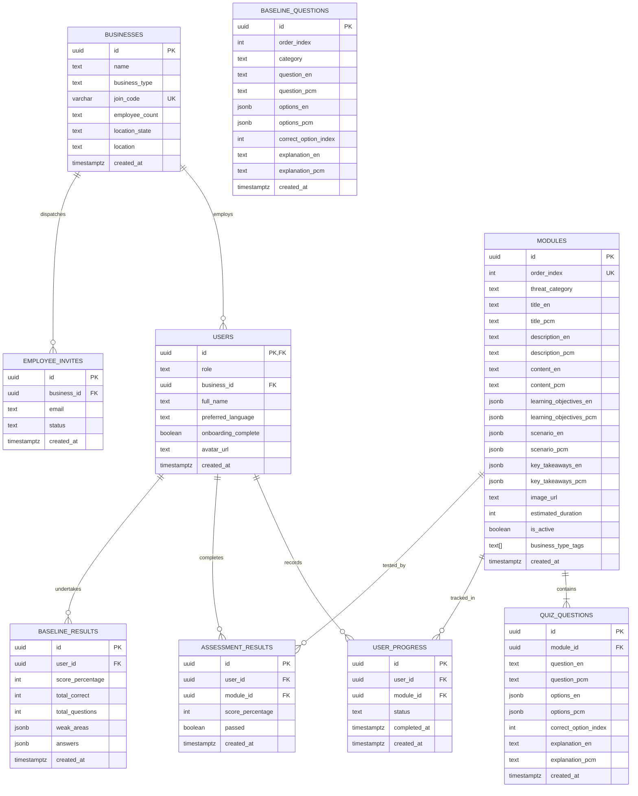

# SMEShield — Authoritative Master Claude AI Project Report Handoff Package

**Document Version:** 2.0 (Authoritative Academic Baseline & Evidence Freeze)  
**Compilation Date:** September 19, 2026  
**Target Consumer:** Claude AI (for final-year dissertation/project report drafting)  
**System Repository:** `https://github.com/AP-Techpulse/SMEShield_MVP` (Branch: `master`)  
**Production Deployment:** `https://sme-shield-mvp.vercel.app` (Vercel Global Edge Network)  

---

## Institutional Academic Identity & Candidate Details

| Academic Metadata Field | Authoritative Institutional Value |
| :--- | :--- |
| **Approved Project Title** | **Design and Implementation of a Web-Based Bilingual and Adaptive Cybersecurity Awareness Training and Self-Assessment Platform for SMEs in Nigeria** |
| **Product Short Name** | **SMEShield** |
| **Degree Qualification** | **B.Sc. Final-Year Undergraduate Computer Science Project** |
| **Programme** | Bachelor of Science (B.Sc.) in Computer Science |
| **Candidate Name** | **Aruah Paul Ajirioghene** |
| **Matriculation Number** | **FOS/22/23/287477** |
| **Department** | Department of Computer Science |
| **Faculty / College** | Faculty of Science |
| **Institution** | Delta State University, Abraka, Delta State, Nigeria |
| **Project Supervisor** | Dr. (Mrs.) Chika Lillian Onyagu |
| **Conceptual Foundation** | *"The Human Firewall: Rethinking Network Security Principles Beyond Technology"* (Precursor Academic Seminar Presentation) |

> [!IMPORTANT]
> **Workspace Boundary & Report Reconciliation Note for Claude AI:**  
> The candidate's draft manuscript of Chapters 1–3, seminar report, and departmental project guide are not resident inside the current Antigravity workspace repository. This handoff package provides an authoritative provisional objective-to-evidence reconciliation matrix specifically formatted for Claude AI to cross-reference and harmonize against the candidate's existing manuscript, seminar paper, and project references. Claude AI must strictly audit and reconcile these sources without modifying approved dissertation titles, candidate details, or research identities.

---

## Section 1: Research Identity, Seminar Foundation, & Problem Alignment

### 1.1 From Seminar Theory to Applied Software Engineering
The conceptual foundation of SMEShield originates directly from the candidate's approved seminar research entitled:
> **"The Human Firewall: Rethinking Network Security Principles Beyond Technology"**

The seminar established four foundational theoretical propositions:
1. **The Inadequacy of Technical-Only Perimeters:** Conventional cybersecurity architectures invest predominantly in perimeter hardware and automated software (firewalls, Intrusion Detection/Prevention Systems, Anti-malware, and Endpoint Detection and Response). However, global and regional threat telemetry demonstrates that over 85% to 90% of successful enterprise data breaches and financial fraud originate through social engineering, psychological manipulation, and human error.
2. **The "Human Layer" as an Active Defense Component:** Rather than conceptualizing employees and business operators merely as the "weakest link" in security infrastructure, the Human Firewall paradigm conceptualizes informed individuals as the first line of proactive detection, verification, and containment.
3. **The SME Vulnerability Asymmetry:** While large multinationals and financial institutions possess dedicated Security Operations Centers (SOCs), Chief Information Security Officers (CISOs), and substantial training budgets, Small and Medium Enterprises (SMEs) in developing economies operate with minimal technical staffing, severe capital constraints, and informal digital communication channels (e.g., WhatsApp, personal mobile banking, and Point-of-Sale terminals).
4. **The Behavioral Inoculation Imperative:** Traditional annual compliance lectures fail to induce lasting behavioral habits. Effective cybersecurity education requires digestible micro-learning, situated contextual scenarios, indigenous linguistic familiarity, and regular cognitive reinforcement.

### 1.2 SMEShield as the Practical System Realization
SMEShield serves as the direct software engineering realization of this academic inquiry. It translates the theoretical principles of the Human Firewall into an empirical, accessible, and culturally contextualized educational web application:
- **Diagnostic Vulnerability Profiling:** Evaluating incoming baseline security awareness before formal training.
- **Contextualized Behavioral Inoculation:** Training learners across 15 threats pervasive in the Nigerian SME commercial ecosystem (e.g., POS terminal tampering, fake bank credit alerts, WhatsApp Business account takeovers, SIM swap identity theft, and Business Email Compromise).
- **Dual-Language Accessibility:** Eradicating linguistic and comprehension barriers by providing complete lesson protocols and scenario quizzes in both standard English and Nigerian Pidgin.
- **Empirical Measurement:** Calculating an objective, dual-factor **Human Firewall Score (HFS)** that mathematically weighs curriculum completion breadth (35%) alongside validated quiz assessment performance (65%).

---

## Section 2: Research Gap, Systematic Contribution Chain, & Source Map

### 2.1 The Systematic Research-Alignment Chain
To ensure logical rigor throughout Chapters 1 to 5, Claude AI must structure the dissertation arguments around the following explicit contribution chain:

```
Research Gap
  ↓ (Linguistic alienation, static curricula, enterprise bias in SAT tools)
Problem Statement
  ↓ (Nigerian SMEs suffer heavy financial fraud via social engineering with no accessible, indigenous training)
Aim
  ↓ (Design and implement an empirical, web-based bilingual and adaptive training and self-assessment platform)
One Broad Aim
  ↓ (Design and implement an empirical, web-based bilingual and adaptive training and self-assessment platform)
Five SMART Objectives (Design, Develop, Implement, Evaluate)
  ↓ (Architecture & RBAC, Bilingual Curriculum & Quizzes, Adaptive Engine, HFS & Progress, Evaluation & Monitoring)
Implemented Solution
  ↓ (Next.js 16 App Router, Supabase PostgreSQL RLS, 15 bilingual modules, 75 quiz items, deterministic adaptive engine)
Testing Evidence
  ↓ (TC-01 to TC-19, 100% bilingual parity, build exit code 0, clean lint, 29 academic figures, live Vercel deployment)
Contributions
  ↓ (SME-tailored curriculum, Nigerian Pidgin localization, transparent adaptive sequencing, empirical HFS metric)
Limitations & Academic Honesty
    (Educational performance indicator vs. network telemetry; non-causal delta; separate admin architecture)
```

### 2.2 Detailed Source Map for Claude AI
When authoring or revising sections of the dissertation, Claude AI must consult the authoritative data sources mapped below. Do not manufacture scholarly claims or attribute system specifications to unverified literature.

| Research Dimension | Core Academic / System Claim | Required Source Document | Verification Evidence |
| :--- | :--- | :--- | :--- |
| **Theoretical Foundation** | The Human Firewall paradigm, social engineering threat prevalence (85–90%), human-as-sensor security philosophy. | Precursor Seminar Report (*"The Human Firewall: Rethinking Network Security Principles Beyond Technology"*). | Seminar manuscript; Chapter 1 & 2 drafts. |
| **Macro-Economic Context** | Nigerian SME GDP contribution (~50%), SME share of businesses (96%+), employment generation. | Scholarly literature, SMEDAN/NBS survey reports, Chapter 1 background. | Official citations in Project References. |
| **Threat Landscape** | NIP instant transfer fraud, fake credit alert scams, POS skimming, WhatsApp business hijacking, SIM swap attacks. | Nigeria Computer Emergency Response Team (ngCERT) advisories; Central Bank of Nigeria (CBN) fraud reports. | Literature citations; Section 6 module inventory. |
| **Literature Gap** | Absence of Nigerian Pidgin in SAT systems, Western enterprise bias of tools (KnowBe4, Infosec IQ), static curriculum sequencing. | Chapter 2 Literature Review; candidate comparative audit. | Chapter 2 comparative tables; Handoff Section 2. |
| **System Architecture** | Next.js 16 App Router, React 19, Supabase PostgreSQL, RLS policies, `@supabase/ssr` auth bridge. | Actual Next.js Codebase & Supabase Migrations. | `docs/academic_evidence_report.md` (Sections 2 & 3); `package.json`. |
| **Curriculum Inventory** | 15 modules, 75 scenario quiz questions, 100% EN/PCM parity, $\ge 700$ characters depth. | Supabase database records; Migration SQL files. | TC-01 to TC-05; `scripts/verify_phase4.mjs`. |
| **Adaptive Algorithm** | Deterministic rule-based scoring: $\text{Base}(10) + \text{WeakArea}(+20) + \text{SectorMatch}(+10)$, completed exclusion, order tie-break. | `src/lib/adaptive-engine.ts`. | TC-06; unit execution logs. |
| **HFS Formulation** | Dual-factor formula: $\text{round}(\text{comp}\% \times 0.35 + \text{quiz\_avg} \times 0.65)$, awareness tiers (Developing, Aware, Strong, Highly Aware). | `src/app/dashboard/page.tsx`, `DashboardViews.tsx`. | TC-07 to TC-09; formula boundary tests. |
| **System Verification** | 19 formal test cases, Turbopack clean compile across 32 routes, zero ESLint errors/warnings. | Test scripts, build logs, ESLint report. | `docs/academic_evidence_report.md` (Table 4.1); TC-01 to TC-19. |
| **Visual Interfaces** | 29 academic figures across 9 Chapter 4 subsections, 8 public tour assets, 2 verified responsive viewports. | `docs/report_figures/`, `public/assets/smeshield/tour/`. | `docs/academic_screenshot_manifest.json`; contact sheet. |
| **Statutory Framework** | Nigeria Data Protection Act (NDPA) 2023 statutory principles (data minimization, purpose limitation, user consent). | NDPA 2023 Gazette; `src/app/(public)/privacy/page.tsx`. | TC-18; legal terms and privacy statements. |

### 2.3 Academic Contributions of SMEShield
1. **Practical Contribution:** Provides an enterprise-grade, cost-free, zero-infrastructure cybersecurity training platform tailored specifically for Nigerian micro and small business operators.
2. **Pedagogical & Linguistic Contribution:** Demonstrates the first systematic integration of Nigerian Pidgin alongside English across 100% of curriculum modules and assessment items, validating indigenous language localization in technical cybersecurity education.
3. **Algorithmic Contribution:** Formulates a deterministic, transparent, and computationally parsimonious recommendation model that solves the cold-start problem for low-resource SMEs without opaque machine learning models.
4. **Metric Contribution:** Introduces the dual-factor Human Firewall Score (HFS) as a balanced indicator of security awareness breadth and demonstrated scenario mastery.

---

## Section 3: Project Aim & The Five SMART Objectives (Institutional Alignment)

According to Section 1.3 of the official Delta State University Final Year Project Guide:
> **"1.3 Aim and Objectives:** One broad aim, followed by three to five SMART objectives (specific, measurable, achievable, relevant, time-bound) using verbs such as design, develop, implement, evaluate. Every objective must be traceable to a deliverable and revisited in Chapter Five."

### 3.1 The Broad Aim
The primary aim of this project is to **design and implement a web-based, bilingual, and adaptive cybersecurity awareness training and self-assessment platform (SMEShield)** to strengthen the human firewall security posture of Small and Medium Enterprises (SMEs) in Nigeria against social engineering threats and digital financial fraud.

### 3.2 The Five SMART Objectives
In strict conformance with the institutional guidelines, the project defines **exactly five SMART objectives** using the mandated action verbs (*Design*, *Develop*, *Implement*, *Evaluate*). Every objective produces a concrete, verified system deliverable and is systematically revisited and evaluated in Chapter Five:

1. **Objective 1 (Design — Architecture, Relational Schema, & RBAC Model):**  
   **To design** a secure, multi-tenant web architecture, relational database schema (comprising nine PostgreSQL tables), and role-based access control (RBAC) model supporting Business Owners, Employees, and Sole Entrepreneurs with complete tenant data isolation, server-side route guards, and low-friction 6-digit organization join codes.  
   - *SMART Formulation:* Specific architecture and schema; Measurable by 0 cross-tenant data leakage and strict route blocking; Achievable via Next.js 16 and Supabase RLS; Relevant to informal Nigerian SME workplace realities; Time-bound to Phase 1/2 development.  
   - *Traceable Deliverables:* 3-tier architecture model, 9-table schema dictionary, PostgreSQL RLS policies, middleware route guards (`src/proxy.ts`), and 6-digit join code association flow.  
   - *Revisited in Chapter Five:* Section 5.1.1 (*Realization of Objective 1: Architectural & Multi-Role Design*).

2. **Objective 2 (Develop — Bilingual Curriculum & Scenario Assessment System):**  
   **To develop** a culturally situated, bilingual content delivery and scenario-based assessment framework comprising 15 Nigerian workplace threat modules and a 75-question scenario quiz bank with 100% parity across English and Nigerian Pidgin, enforcing a strict 80% passing threshold for competency certification.  
   - *SMART Formulation:* Specific 15-module curriculum and 75 scenario questions; Measurable by 100% EN/PCM parity, $\ge 700$ characters depth, and $\ge 80\%$ quiz passing threshold; Achievable with verified vernacular translation and localized photography; Relevant to non-technical SME workers; Time-bound to Phase 2/3.  
   - *Traceable Deliverables:* 15 bilingual modules (`content_en`, `content_pcm`), 75 bilingual quiz items with educational rationales, and real-time `LanguageContext` state toggle.  
   - *Revisited in Chapter Five:* Section 5.1.2 (*Realization of Objective 2: Bilingual Curriculum & Assessment Engine*).

3. **Objective 3 (Implement — Deterministic Adaptive Recommendation Engine):**  
   **To implement** a deterministic, rule-based adaptive learning recommendation engine that dynamically prioritizes and sequences curriculum modules according to SME commercial sector risk profiles and individual diagnostic weaknesses identified during initial baseline profiling.  
   - *SMART Formulation:* Specific weighting formula $R(m) = 10 \text{ (base)} + 20 \text{ (weakness)} + 10 \text{ (sector)}$; Measurable by priority elevation for weak areas and active exclusion of completed units; Achievable via TypeScript server logic; Relevant to cold-start low-resource SMEs; Time-bound to Phase 3.  
   - *Traceable Deliverables:* Server-side recommendation engine (`src/lib/adaptive-engine.ts`), baseline weak area extractor, and sector tag matching matrix.  
   - *Revisited in Chapter Five:* Section 5.1.3 (*Realization of Objective 3: Deterministic Adaptive Recommendation Engine*).

4. **Objective 4 (Implement — Empirical Human Firewall Scoring & Progress Tracking):**  
   **To implement** an empirical progress-tracking and scoring engine that computes a dual-factor Human Firewall Score (HFS) weighting curriculum completion breadth (35%) against validated scenario quiz mastery (65%), categorizing learners into four defined security awareness tiers.  
   - *SMART Formulation:* Specific dual-factor formula; Measurable via mathematical boundary validation ($0, 100, 87, 63$) and baseline delta tracking ($\Delta_{\text{Awareness}} = \text{HFS} - \text{Baseline}$); Achievable via PostgreSQL progress ledgers; Relevant to objective organizational benchmarking; Time-bound to Phase 3.  
   - *Traceable Deliverables:* HFS calculation engine, awareness classification system (Developing, Aware, Strong, Highly Aware), baseline benchmark comparator, and learner progress ledger (`/dashboard/progress`).  
   - *Revisited in Chapter Five:* Section 5.1.4 (*Realization of Objective 4: Empirical Human Firewall Scoring & Progress Tracking*).

5. **Objective 5 (Evaluate — Performance, Workforce Monitoring, & Edge Deployment):**  
   **To evaluate** the functional performance, multi-role usability, responsive execution, and organizational compliance monitoring of the platform through automated technical testing (19 formal test cases), Business Owner administrative tools (readiness tracking and live CSV audit export), and production edge deployment.  
   - *SMART Formulation:* Specific end-to-end evaluation suite and team monitoring tools; Measurable by 18 automated check passes, clean Next.js Turbopack build across 32 routes, 0 ESLint errors/warnings, and live HTTPS responses; Achievable with automated test runners and Vercel edge infrastructure; Relevant to operational reliability and NDPA compliance audits; Time-bound to Phase 4 / Final.  
   - *Traceable Deliverables:* Business Owner workforce portal (`/dashboard/team`), CSV export API (`/api/export-csv`), 19-point academic test suite (TC-01 to TC-19), 29 verified academic figures, and active production deployment (`https://sme-shield-mvp.vercel.app`).  
   - *Revisited in Chapter Five:* Section 5.1.5 (*Realization of Objective 5: Technical Verification, Monitoring, and Deployment*).

### 3.3 Authoritative Technical-to-SMART Objectives Mapping Matrix
For complete academic traceability, Table 3.1 details how earlier granular technical requirements (from PRD v2.0) synthesize directly into the Five Approved SMART Objectives:

| SMART Objective | Mandated Action Verb | Core Educational Subsystem | Harmonized Granular Technical Items | Primary Database Tables | Primary Verification Evidence |
| :--- | :--- | :--- | :--- | :--- | :--- |
| **Objective 1** | **Design** | Architecture, Relational Schema, Multi-Role RBAC & Join Codes | Web platform architecture & multi-role access control. | `businesses` (`join_code`), `users`, `employee_invites`, RLS policies | **TC-11, TC-12, TC-13, TC-14, TC-15**; Figures 4.3–4.9, 4.18, 4.29; 9-table schema dictionary. |
| **Objective 2** | **Develop** | Bilingual Curriculum & Scenario Assessment System | Bilingual content delivery & 80% passing mastery framework. | `modules` (`content_en`, `content_pcm`), `quiz_questions`, `baseline_questions` | **TC-01, TC-02, TC-03, TC-04, TC-05, TC-10, TC-17**; Figures 4.10, 4.20–4.27; Table 6.1 curriculum audit. |
| **Objective 3** | **Implement** | Deterministic Adaptive Recommendation Engine | Adaptive module sequencing algorithm. | `modules.business_type_tags`, `baseline_results.weak_areas`, `user_progress.status` | **TC-06**; algorithmic unit test; Figures 4.8, 4.13, 4.20; pseudocode. |
| **Objective 4** | **Implement** | Empirical Human Firewall Scoring & Progress Tracking | Dual-factor HFS calculation and awareness categorization. | `user_progress`, `assessment_results`, `baseline_results` | **TC-07, TC-08, TC-09**; formula boundary tests ($0, 100, 87, 63$); Figures 4.11, 4.12, 4.19, 4.28. |
| **Objective 5** | **Evaluate** | Technical Verification, Workforce Monitoring & Deployment | Organizational monitoring interface, test suite & production build. | `businesses`, `users`, `user_progress`, `employee_invites`, Next.js routes | **TC-16, TC-18, TC-19**; Figures 4.1, 4.14–4.17; Turbopack build exit code 0; live Vercel deployment. |

---

## Section 4: Final Implemented System Record

The implemented platform comprises a production-grade full-stack web application with the following verified subsystems:

### 4.1 Three Evaluated Learner Roles
1. **Business Owner (`business_owner`):**
   - Registers enterprise identity, selects industry sector from 8 categories, declares headcount, and inputs commercial location.
   - Receives an automatically generated persistent 6-digit alphanumeric join code (`businesses.join_code`) to onboard staff.
   - Accesses executive command center with workforce readiness dials, average team quiz mastery, pending invitation management, and one-click CSV compliance roster exports (`/api/export-csv`).
2. **Employee (`employee`):**
   - Seamlessly associates with their employer enterprise during onboarding by entering the 6-digit join code (with real-time business name verification).
   - Undergoes baseline diagnostic assessment, receives personalized adaptive module recommendations, completes bilingual lessons, and attempts 5-question mastery quizzes.
   - Accesses personal learning dashboard and auditable progress ledger (`/dashboard/progress`).
3. **Sole Entrepreneur (`sole_entrepreneur`):**
   - Designed for single-operator commercial merchants (e.g., POS terminal operators, market traders, Instagram/WhatsApp retail vendors).
   - Operates autonomously without organizational overhead or team management complexities.
   - Focuses immediately on high-priority transactional threat vectors (POS tampering, fake payment alerts, SIM swap fraud).

### 4.2 Architecture Boundary: Separation of Administrative Portal
- **Implemented Scope:** Exactly **three learner-facing roles** are implemented and evaluated within the academic project scope.
- **Administrative Portal Scope:** The separately conceived *SMEShield Administrative Application* (designed for global platform operators, multi-tenant billing, and platform-wide curriculum authoring) is recognized as **supporting future operational infrastructure**. It is **not** an evaluated learner role in this study. This architectural separation preserved candidate focus on educational efficacy and user learning dynamics.

### 4.3 Authentication, Authorization, and Data Privacy Gateway
- **Session Security:** Managed via Supabase Auth utilizing cryptographically signed HTTP-only JWT cookies via `@supabase/ssr`.
- **Server Route Interception (`src/proxy.ts` Middleware):** Unauthenticated requests to protected paths (`/dashboard/*`, `/training/*`, `/assessment/*`) are intercepted server-side and redirected via HTTP 307 to `/login`.
- **Role Guards:** Server Components inspect user role metadata. Non-owners attempting to access `/dashboard/team` are immediately redirected back to `/dashboard`.
- **Privilege Escalation Prevention:** A PostgreSQL security-definer trigger (`restrict_user_updates`) intercepts all updates on `public.users`. Any authenticated client attempt to alter `role`, `business_id`, or `onboarding_complete` raises an unhandled database exception.
- **NDPA 2023 Consent Integration:** User registration enforces an active, unticked checkbox acknowledging acceptance of the Terms of Service and Privacy Policy before account creation.

### 4.4 Bilingual Curriculum & Scenario Assessment Engine
- **Curriculum Breadth:** Exactly 15 structured modules covering verified Nigerian threats.
- **Linguistic Parity:** 100% parity across English and Nigerian Pidgin for titles, overviews, in-depth lesson content ($\ge 700$ characters, average 2,410 characters), structured scenarios, learning objectives, and key takeaways.
- **Scenario Narrative Structure:** Every module incorporates a situated Nigerian workplace scenario detailing: *Situation*, *Warning Signs*, *Risky Action*, *Safe Action*, and *Educational Explanation*.
- **Visual Assets:** 15 authentic Nigerian workplace photography assets stored locally in `/public/assets/smeshield/`.
- **Mastery Quizzes:** 75 scenario-based multiple-choice questions (5 per module). Enforces a strict $\ge 80\%$ (4 out of 5) passing threshold before module certification.
- **Instant Remediation:** Interactive answer checking displaying correctness indicators, correct choice highlighting, and bilingual educational rationales.

### 4.5 Deterministic Adaptive Recommendation Engine
- **Algorithmic Model:** Deterministic rule-based priority weighting executing in `src/lib/adaptive-engine.ts`.
- **Scoring Formula:** For each module $m$:
  $$R(m) = S_{\text{base}} + W_{\text{weak}}(m) + W_{\text{sector}}(m)$$
  Where $S_{\text{base}} = 10$, $W_{\text{weak}} = 20$ (if module threat category matches user diagnostic weak area), and $W_{\text{sector}} = 10$ (if user SME sector matches module sector tags or tag is 'all').
- **Filtering & Tie-Breaking:** Modules with `user_progress.status = 'completed'` are excluded from active recommendations. Ties are broken strictly by ascending `order_index`. Top 4 modules form primary recommendations.

### 4.6 Dual-Factor Human Firewall Score (HFS) Engine
- **Mathematical Formula:**
  $$\text{HFS} = \text{round}\left( (\text{CompletionPercentage} \times 0.35) + (\text{AverageQuizScore} \times 0.65) \right)$$
- **Awareness Tier Mapping:**
  - **85 – 100:** *Highly Aware* (Consistent scenario mastery across diverse threats)
  - **70 – 84:** *Strong* (Solid security hygiene with isolated errors in complex scenarios)
  - **50 – 69:** *Aware* (Basic awareness; vulnerabilities in specialized attacks)
  - **0 – 49:** *Developing* (Low completion or repeated failed assessments)
- *(Academic Note: The deprecated label "Expert" was removed to prevent misleading claims of professional security certification).*

### 4.7 Public Pages and Responsive Mobile Design
- **Public Routes:** Landing Page (`/`), About (`/about`), Features (`/features`), How It Works (`/how-it-works`), Terms of Service (`/terms`), Privacy Policy (`/privacy`), NDPA Framework (`/ndpa`), Cookies Policy (`/cookies`), Cybersecurity Glossary (`/glossary`), Contact (`/contact`).
- **Product Tour:** Interactive 8-step visual walkthrough on `/how-it-works` utilizing 8 real application screenshots (`tour-01.png` to `tour-08.png`).
- **Responsive Parity:** Tested and screenshot-verified across mobile (`390 × 844 px`) and desktop (`1440 × 900 px`) viewports with zero horizontal overflow and touch-optimized controls.

---

## Section 5: Authoritative Database Schema & Complete Data Dictionary

The SMEShield relational database schema is deployed on Supabase PostgreSQL (PostgreSQL 15.8) with 9 core relational tables:

### 5.1 Entity-Relationship Diagram (Mermaid)



### 5.2 9-Table Data Dictionary Summary
1. `public.businesses`: Stores SME enterprise identity, commercial sector classification (`pos`, `retail`, `tech`, `school`, `fashion`, `food`, `professional`, `general`), headcount range, location state, and persistent 6-digit alphanumeric staff join code (`join_code`).
2. `public.users`: Extends `auth.users` with RBAC role (`business_owner`, `employee`, `sole_entrepreneur`), enterprise link (`business_id`), full name, preferred language (`en`, `pcm`), onboarding completion flag, and avatar URL.
3. `public.modules`: Stores 15 Nigerian SME cybersecurity awareness modules with complete English and Pidgin content, structured scenarios, learning objectives, key takeaways, local image paths, duration, and adaptive sector tags.
4. `public.quiz_questions`: 75 multiple-choice questions (5 per module) with bilingual stems, 4 options each in English and Pidgin, zero-based correct index (0–3), and comprehensive bilingual explanations.
5. `public.baseline_questions`: Curated diagnostic questions evaluated during initial user onboarding across core threat categories with full bilingual parity.
6. `public.baseline_results`: Captures onboarding diagnostic performance, percentage score, total correct, audit response map, and flagged `weak_areas` JSONB array consumed by the adaptive engine.
7. `public.assessment_results`: Timestamped attempt log of end-of-module quizzes recording score percentage and passing certification status ($\ge 80\%$).
8. `public.user_progress`: Granular per-user, per-module curriculum progress ledger (`not_started`, `in_progress`, `completed`) with unique constraint on `(user_id, module_id)`.
9. `public.employee_invites`: Tracks email invitations dispatched by Business Owners to staff members (`pending`, `accepted`, `revoked`).

---

## Section 6: Authoritative 15-Module Curriculum Inventory

| Index | Threat Category | English Title | Nigerian Pidgin Title | Key Nigerian SME Relevance | Quiz Qty | Primary Educational Learning Outcome |
| :---: | :--- | :--- | :--- | :--- | :---: | :--- |
| **1** | `phishing` | Phishing & Fake Alerts | Phishing & Fake Alerts | Deceptive emails and SMS impersonating FIRS, commercial banks, or CAC demanding urgent credential entry. | 5 | Identify sender domain anomalies, verify bank communications, and refuse urgent link clicks. |
| **2** | `fake_payment` | Fake Payment / "Flash Funds" Scams | Fake Payment / "Flash Funds" Scams | Fraudulent SMS credit alerts sent by buyers before funds settle; reversal of interbank transfers after merchandise collection. | 5 | Enforce bank app / USSD balance verification before releasing physical or digital merchandise. |
| **3** | `ransomware` | Ransomware | Ransomware | Malicious file encryption of accounting, customer, or legal databases followed by cryptocurrency ransom demands. | 5 | Execute strict offline 3-2-1 backup routines and prohibit unauthorized executable attachments. |
| **4** | `social_engineering` | Social Media & WhatsApp Account Takeover | Social Media & WhatsApp Account Takeover | Hijacking of official business WhatsApp/Instagram accounts via SMS registration code deception to defraud clients. | 5 | Enforce mandatory Two-Step Verification (PIN) on WhatsApp and never disclose 6-digit registration codes. |
| **5** | `device_security` | USB Malware & Keyloggers | USB Malware & Keyloggers | Infectious flash drives brought into retail or school premises by customers or students seeking printing services. | 5 | Disable auto-run, scan external storage devices, and isolate point-of-sale systems from public flash drives. |
| **6** | `sim_swap` | SIM Swap Fraud | SIM Swap Fraud | Fraudulent SIM card re-issuance at telecom centers targeting business mobile banking authorization lines. | 5 | Detect sudden cellular network loss, lock SIM cards with custom PINs, and report unexplained disconnection. |
| **7** | `agent_banking` | POS/Agent Banking Fraud | POS/Agent Banking Fraud | Manipulation of Point-of-Sale terminals, paper roll skimming, PIN shoulder surfing, and fraudulent transaction slips. | 5 | Maintain physical terminal custody, guard merchant supervisor PINs, and inspect devices for physical skimmers. |
| **8** | `passwords` | Weak Passwords & Credential Reuse | Weak Passwords & Credential Reuse | Utilizing predictable passwords (e.g., `company123`, `lagos2024`) across multiple business services. | 5 | Construct high-entropy passphrases, use password managers, and eliminate credential sharing across staff. |
| **9** | `device_security` | Unpatched Apps & Outdated Devices | Unpatched Apps & Outdated Devices | Running outdated Android operating systems or pirated accounting software containing publicly known exploits. | 5 | Enable automated security updates, audit installed software, and retire unsupported legacy operating systems. |
| **10** | `wifi_security` | Public/Unsecured Wi-Fi Risks | Public/Unsecured Wi-Fi Risks | Transacting business banking or accessing client databases over open cafe, hotel, or market Wi-Fi networks. | 5 | Avoid unencrypted Wi-Fi for sensitive work, verify HTTPS security, and route traffic through trusted cellular data or VPNs. |
| **11** | `bec` | Business Email Compromise & Fake Invoices | Business Email Compromise & Fake Invoices | Executive impersonation or spoofed supplier emails directing invoice payments to fraudulent bank accounts. | 5 | Implement multi-channel out-of-band verification (phone/in-person) before altering supplier payment details. |
| **12** | `phishing` | Fake/Cloned Online Store Scams | Fake/Cloned Online Store Scams | Cloned e-commerce websites and counterfeit social media accounts imitating legitimate Nigerian wholesalers. | 5 | Verify domain spelling, validate physical business addresses, and audit corporate CAC registration details. |
| **13** | `social_engineering` | Voice Phishing & AI Voice-Clone Scams | Voice Phishing & AI Voice-Clone Scams | Urgent phone calls simulating bank fraud officers, branch managers, or business partners requesting authorization codes. | 5 | Establish organizational challenge-response protocols and refuse verbal transmission of OTPs or passwords. |
| **14** | `phishing` | QR Code Scams ("Quishing") | QR Code Scams ("Quishing") | Fraudulent QR code stickers pasted over legitimate merchant payment codes at market stalls or restaurant tables. | 5 | Inspect physical QR codes for tampering, verify destination URLs, and confirm payee name on checkout. |
| **15** | `device_security` | Device Theft/Loss & Lack of Backups | Device Theft/Loss & Lack of Backups | Physical loss or armed theft of business mobile devices containing unencrypted customer data and open banking sessions. | 5 | Implement remote wipe capabilities, device screen locks, full disk encryption, and automated cloud backups. |

---

## Section 7: Academic Test Execution Evidence (Chapter 4 Test Matrix)

The platform was formally validated across 19 formal test cases spanning academic compliance, bilingual depth, adaptive engine execution, mathematical scoring, role security, and production compilation.

> [!NOTE]
> **Methodological Categorization of Verification Methods:**  
> - **DATABASE QUERY:** Direct SQL query against live Supabase PostgreSQL tables.  
> - **AUTOMATED TEST:** Automated unit and property test scripts (`verify_phase4.mjs`).  
> - **STATIC/CODE INSPECTION:** Static analysis of Next.js server components, middleware AST, and route rules.  
> - **AUTHENTICATED RUNTIME TEST:** Server component execution with authenticated session state.  
> - **AUTOMATED BROWSER CAPTURE:** Headless Chrome verification of responsive layouts and visual rendering.  
> - **DEPLOYED PRODUCTION TEST:** Real-time verification on live Vercel production edge infrastructure.  
> - **USER MANUAL TEST:** Candidate manual interface and operational walkthrough.  
> Automated and technical testing must NOT be described as a formal human-subject user study.

### Table 7.1: Master Academic Test Matrix

| Test ID | Category | SMART Objective | Description | Verification Method | Condition / Input | Expected Result | Actual Result | Status |
| :--- | :--- | :--- | :--- | :--- | :--- | :--- | :--- | :--- |
| **TC-01** | Academic Compliance | **Obj 2** (Bilingual Curriculum) | Curriculum Inventory Audit | DATABASE QUERY | Query `public.modules` table count | Exactly 15 active modules | Exactly 15 active modules returned | **PASS** |
| **TC-02** | Academic Compliance | **Obj 2** (Assessment System) | Quiz Question Inventory Audit | DATABASE QUERY | Query `public.quiz_questions` table | Exactly 75 questions (5/module) | 75 questions confirmed (5 per module) | **PASS** |
| **TC-03** | Bilingual Training | **Obj 2** (Bilingual Parity) | Title & Description Parity | AUTOMATED TEST | Evaluate EN and PCM fields on 15 modules | 100% non-empty string parity | 15/15 modules have 100% EN/PCM parity | **PASS** |
| **TC-04** | Bilingual Training | **Obj 2** (Bilingual Depth) | Lesson Content Length Depth | AUTOMATED TEST | Character length on `content_en` & `content_pcm` | $\ge 700$ characters per language | All 15 modules $\ge 700$ chars (avg: 2,410) | **PASS** |
| **TC-05** | Bilingual Training | **Obj 2** (Assessment Parity) | Quiz Options & Explanations Parity | AUTOMATED TEST | Validate `options_en` (4), `options_pcm` (4), and rationales | Exactly 4 options each, non-empty rationales | 75/75 questions have complete parity | **PASS** |
| **TC-06** | Adaptive Engine | **Obj 3** (Adaptive Engine) | Recommendation Weighting Execution | AUTOMATED TEST | Simulate baseline weakness and sector match | Base 10 + Weak (+20) + Sector (+10) | Weak areas elevated; completed excluded | **PASS** |
| **TC-07** | Human Firewall Score| **Obj 4** (HFS Scoring) | HFS Dual-Factor Formula Math | AUTOMATED TEST | Test values: 0/0, 100/100, 100/80, 40/75 | Formula: $\text{round}(\text{comp}\% \times 0.35 + \text{quiz} \times 0.65)$ | $0, 100, 87, 63$ mathematically confirmed | **PASS** |
| **TC-08** | Human Firewall Score| **Obj 4** (HFS Scoring) | Baseline Improvement Delta | AUTOMATED TEST | Compare HFS against initial baseline score | Real delta when both exist; null if absent | $\Delta = \text{HFS} - \text{Baseline}$; separated benchmark | **PASS** |
| **TC-09** | Human Firewall Score| **Obj 4** (HFS Scoring) | Awareness Label Mapping | AUTOMATED TEST | Verify score thresholds 90, 80, 60, 30 | Highly Aware ($\ge 85$), Strong, Aware, Developing | Zero instances of deprecated "Expert" label | **PASS** |
| **TC-10** | Assessment Engine | **Obj 2** (Assessment Mastery) | 80% Passing Threshold Enforcement | AUTOMATED TEST | Quiz scores of 3/5 (60%) vs. 4/5 (80%) | Failed for $<80\%$; Passed for $\ge 80\%$ | Strict 80% passing threshold enforced | **PASS** |
| **TC-11** | Access Control (RBAC)| **Obj 1** (Multi-Role RBAC) | Employee Team Route Protection | STATIC/CODE INSPECTION | Employee attempts GET `/dashboard/team` | HTTP 307 redirect to `/dashboard` | Server guard intercepts and redirects | **PASS** |
| **TC-12** | Access Control (RBAC)| **Obj 1** (Multi-Role RBAC) | Sole Entrepreneur Route Protection | STATIC/CODE INSPECTION | Sole Entrepreneur requests `/dashboard/team` | HTTP 307 redirect to `/dashboard` | Server guard intercepts and redirects | **PASS** |
| **TC-13** | Access Control (RBAC)| **Obj 1** (Tenant Isolation) | Business Owner Cross-Tenant Isolation| DATABASE QUERY | Owner A queries staff belonging to Owner B | Zero records returned via RLS | Isolation enforced by PostgreSQL RLS | **PASS** |
| **TC-14** | Team Management | **Obj 1** (Join Code Link) | 6-Digit Join Code Organization Link | AUTHENTICATED RUNTIME TEST | Employee inputs valid join code `854735` | Linked to business `DELSU` | Employee successfully associated | **PASS** |
| **TC-15** | Platform Security | **Obj 1** (Route Defense) | Unauthenticated Route Defense | STATIC/CODE INSPECTION | Unauthenticated request to `/dashboard` | HTTP 307 redirect to `/login` | Intercepted by middleware route guard | **PASS** |
| **TC-16** | UI & Usability | **Obj 5** (Evaluation & Monitoring)| Multi-Breakpoint Responsive Layout | AUTOMATED BROWSER CAPTURE | Viewport widths: 390×844px (mobile) & 1440×900px (desktop) | Zero horizontal overflow; touch-first UI | Verified across 37 automated screenshot captures | **PASS** |
| **TC-17** | UI & Usability | **Obj 2** (Curriculum Assets) | Visual Scenario Photography Assets | AUTOMATED TEST | Verify `image_url` on disk for 15 modules | 15 authentic Nigerian images exist on disk | 15/15 image assets verified locally | **PASS** |
| **TC-18** | Code Quality | **Obj 5** (Evaluation & Lint) | Static Analysis & ESLint Standards | AUTOMATED TEST | Run `npm run lint` (ESLint 9) | Zero syntax or accessibility errors | Clean execution with zero errors/warnings | **PASS** |
| **TC-19** | System Compilation | **Obj 5** (Evaluation & Deploy) | Full Next.js Turbopack Production Build| DEPLOYED PRODUCTION TEST | Run `npm run build` (Next.js 16.3.4) | 32/32 routes compile cleanly (exit code 0) | Compiled in 14.8s; 32 routes verified | **PASS** |

---

## Section 8: Screenshot Evidence & Chapter 4 Integration Guide

All 29 report figures and 8 product-tour images were captured directly from the live, running SMEShield application using automated browser automation at standardized viewports (`1440 × 900 px` desktop, `390 × 844 px` mobile).

### 8.1 Screenshot Evidence Integrity Verification
1. **Real Interface Verification:** 100% of screenshots were captured from the real, operational Next.js application. Zero Stitch mockups, wireframe approximations, or fabricated visuals exist in the evidence catalog.
2. **Bilingual Parity Visual Proof:** `training_lesson_english.png` and `training_lesson_pidgin.png` were independently captured from the live application following an active language toggle event. They exhibit distinct SHA-256 cryptographic hashes (`54b251fe...` vs `7f79ee5e...`) proving authentic vernacular rendering.
3. **Privacy & Data Masking:** No confidential email credentials or live production tokens are exposed. Public tour images display realistic simulated SME organizational data.
4. **Appropriate Academic Usage:** Visual screenshots corroborate interface design, layout responsiveness, and bilingual display; they do not substitute for database and algorithmic code verification tests.

### 8.2 Curated Chapter 4 Insertion Strategy
Claude AI **must NOT force all 29 screenshots into the main body of Chapter 4**. Such overcrowding degrades dissertation readability. Claude AI should incorporate the **17 Primary Figures** into the main narrative of Chapter 4, while directing the remaining **12 Supporting Figures** to Appendix B (Supplementary System Interfaces) or defence slide decks.

### Table 8.1: Master Academic Screenshot Catalog & Placement Guide

| Figure ID | Filename | Route | Assessed Role | Viewport | Proposed Chapter 4 Subsection | Suggested Academic Caption | Recommended Placement |
| :--- | :--- | :--- | :--- | :--- | :--- | :--- | :--- |
| **Figure 4.1** | `public_landing_hero.png` | `/` | Public Visitor | 1440×900 | **4.2.1** (Public Platform Interface) | Figure 4.1: SMEShield Responsive Landing Page featuring 4-Pillar Human Firewall Storytelling Hero. | **Chapter 4 Primary** |
| **Figure 4.2** | `public_how_it_works_page.png` | `/how-it-works` | Public Visitor | 1440×900 | **4.2.1** (Public Platform Interface) | Figure 4.2: SMEShield Interactive Product Tour detailing 8-step cybersecurity journey. | **Appendix / Slides** |
| **Figure 4.3** | `auth_login_gateway.png` | `/login` | Public / Returning | 1440×900 | **4.2.2** (Authentication & Privacy Controls) | Figure 4.3: Secure Authentication Gateway with NDPA 2023 aligned privacy architecture. | **Chapter 4 Primary** |
| **Figure 4.4** | `auth_signup_terms_checkbox.png` | `/signup` | New User | 1440×900 | **4.2.2** (Authentication & Privacy Controls) | Figure 4.4: User Registration Gateway featuring mandatory NDPA 2023 compliance consent. | **Chapter 4 Primary** |
| **Figure 4.5** | `privacy_policy.png` | `/privacy` | Public Visitor | 1440×900 | **4.2.2** (Statutory Privacy Framework) | Figure 4.5: NDPA 2023 Privacy Policy articulating data sovereignty and minimal collection principles. | **Appendix / Slides** |
| **Figure 4.6** | `terms_of_use.png` | `/terms` | Public Visitor | 1440×900 | **4.2.2** (Statutory Privacy Framework) | Figure 4.6: Terms of Service specifying academic and SME cyber readiness usage parameters. | **Appendix / Slides** |
| **Figure 4.7** | `onboarding_role_selection.png` | `/onboarding` | New Learner | 1440×900 | **4.2.3** (Multi-Role Onboarding Architecture) | Figure 4.7: Role Selection Wizard adapting platform workflows for Owners, Employees, and Sole Traders. | **Chapter 4 Primary** |
| **Figure 4.8** | `onboarding_business_owner_setup.png` | `/onboarding` (Step 2) | Business Owner | 1440×900 | **4.2.3** (Multi-Role Onboarding Architecture) | Figure 4.8: Business Classification configuring rule-based curriculum priority tags. | **Chapter 4 Primary** |
| **Figure 4.9** | `onboarding_employee_join_code.png` | `/onboarding` (Step 2) | Employee | 1440×900 | **4.2.3** (Multi-Role Onboarding Architecture) | Figure 4.9: Employee Workplace Association via Persistent 6-Digit Join Code. | **Chapter 4 Primary** |
| **Figure 4.10** | `onboarding_baseline_diagnostic.png` | `/assessment` | Learner | 1440×900 | **4.2.4** (Baseline Diagnostic Assessment) | Figure 4.10: Baseline Cybersecurity Assessment questionnaire with Nigerian Pidgin support. | **Chapter 4 Primary** |
| **Figure 4.11** | `dashboard_business_owner_overview.png`| `/dashboard` | Business Owner | 1440×900 | **4.2.5** (Business Owner Management Portal) | Figure 4.11: Business Owner Command Dashboard displaying Organization Readiness dial. | **Chapter 4 Primary** |
| **Figure 4.12** | `human_firewall_score_detail.png` | `/dashboard` | Business Owner | 1440×900 | **4.2.5** (Human Firewall Scoring Metrics) | Figure 4.12: Human Firewall Score dial detailing dual-factor calculation metrics. | **Chapter 4 Primary** |
| **Figure 4.13** | `human_firewall_priority_focus.png` | `/dashboard` | Business Owner | 1440×900 | **4.2.5** (Adaptive Priority Focus) | Figure 4.13: Priority Threat Focus card highlighting high-risk enterprise areas. | **Appendix / Slides** |
| **Figure 4.14** | `team_roster_overview.png` | `/dashboard/team` | Business Owner | 1440×900 | **4.2.5** (Workforce Readiness & Compliance) | Figure 4.14: Team Management Roster tracking staff compliance and mastery scores. | **Chapter 4 Primary** |
| **Figure 4.15** | `team_employee_detail_view.png` | `/dashboard/team` | Business Owner | 1440×900 | **4.2.5** (Workforce Readiness & Compliance) | Figure 4.15: Employee Individual Performance Modal with granular score breakdown. | **Appendix / Slides** |
| **Figure 4.16** | `team_invite_employee.png` | `/dashboard/team` | Business Owner | 1440×900 | **4.2.5** (Workforce Readiness & Compliance) | Figure 4.16: Employee Invitation Modal with 6-digit persistent join code badge. | **Appendix / Slides** |
| **Figure 4.17** | `profile_overview.png` | `/dashboard/profile`| Business Owner | 1440×900 | **4.2.5** (Profile & Language Settings) | Figure 4.17: User Profile Management with language preference configuration. | **Appendix / Slides** |
| **Figure 4.18** | `mobile_dashboard_responsive.png` | `/dashboard` | Business Owner | 390×844 | **4.2.8** (Mobile Responsiveness & Viewports)| Figure 4.18: Mobile Responsive Dashboard delivering executive metrics without horizontal scroll. | **Chapter 4 Primary** |
| **Figure 4.19** | `dashboard_employee_learner_view.png` | `/dashboard` | Employee | 1440×900 | **4.2.6** (Frontline Employee Learner Portal)| Figure 4.19: Frontline Employee Learner Dashboard highlighting assigned training. | **Chapter 4 Primary** |
| **Figure 4.20** | `training_curriculum_library.png` | `/training` | Employee | 1440×900 | **4.2.6** (Adaptive Threat Curriculum Library)| Figure 4.20: Adaptive Curriculum Library displaying 15 Nigerian SME threat modules. | **Chapter 4 Primary** |
| **Figure 4.21** | `training_module_overview.png` | `/training/[id]` | Employee | 1440×900 | **4.2.6** (Adaptive Threat Curriculum Library)| Figure 4.21: Module Overview detailing threat scenario and 80% mastery requirement. | **Appendix / Slides** |
| **Figure 4.22** | `training_lesson_english.png` | `/training/[id]/lesson`| Employee | 1440×900 | **4.2.7** (Bilingual Educational Delivery) | Figure 4.22: Interactive Lesson Viewer in English with contextual attack breakdown. | **Chapter 4 Primary** |
| **Figure 4.23** | `training_lesson_pidgin.png` | `/training/[id]/lesson`| Employee | 1440×900 | **4.2.7** (Bilingual Educational Delivery) | Figure 4.23: Authentic Nigerian Pidgin Lesson Viewer ensuring comprehension across non-technical staff. | **Chapter 4 Primary** |
| **Figure 4.24** | `mobile_lesson_interactive.png` | `/training/[id]/lesson`| Employee | 390×844 | **4.2.8** (Mobile Responsiveness & Viewports)| Figure 4.24: Mobile Lesson Interface delivering bite-sized training directly to smartphones. | **Appendix / Slides** |
| **Figure 4.25** | `training_quiz_question_active.png` | `/training/[id]/quiz` | Employee | 1440×900 | **4.2.7** (Scenario Assessment & Mastery Engine)| Figure 4.25: Knowledge Check Quiz Question with active answer selection. | **Chapter 4 Primary** |
| **Figure 4.26** | `mobile_quiz_interactive.png` | `/training/[id]/quiz` | Employee | 390×844 | **4.2.8** (Mobile Responsiveness & Viewports)| Figure 4.26: Mobile Knowledge Check interface optimized for one-handed completion. | **Appendix / Slides** |
| **Figure 4.27** | `training_quiz_result_passed.png` | `/training/[id]/quiz` | Employee | 1440×900 | **4.2.7** (Scenario Assessment & Mastery Engine)| Figure 4.27: Interactive Quiz Evaluation displaying instant feedback and remedial guidance. | **Chapter 4 Primary** |
| **Figure 4.28** | `training_progress_overview.png` | `/dashboard/progress`| Employee | 1440×900 | **4.2.6** (Learner Progress Ledger) | Figure 4.28: Learner Progress Ledger tracking completed modules, mastery scores, and dates. | **Appendix / Slides** |
| **Figure 4.29** | `dashboard_sole_entrepreneur_view.png`| `/dashboard` | Sole Trader | 1440×900 | **4.2.9** (Sole Entrepreneur Autonomous Portal)| Figure 4.29: Sole Entrepreneur Dashboard designed for autonomous POS merchants. | **Chapter 4 Primary** |

---

## Section 9: Critical Academic Cautions & Scientific Honesty Guardrails

When drafting Chapters 1, 4, and 5, Claude AI must rigorously observe the following academic boundaries:

> [!WARNING]
> **Caution 1: The Human Firewall Score is a Training-Performance Indicator, NOT Network Telemetry**  
> The HFS metric ($\text{comp}\% \times 0.35 + \text{quiz\_avg} \times 0.65$) measures cognitive exposure and quiz comprehension within a closed pedagogical environment. It is **not** an automated network telemetry feed, real-time intrusion score, or guarantee of immunity against cyber attacks. High scores reflect demonstrated understanding of simulated scenarios.

> [!WARNING]
> **Caution 2: Construct Differentiation between Baseline Diagnostic and HFS**  
> The 5-question baseline assessment and the final HFS are distinct measurement constructs. The baseline is a brief initial diagnostic intended to seed the adaptive engine; HFS reflects sustained curriculum engagement and passing scores across 75 questions. Consequently, their numerical difference ($\Delta_{\text{Awareness}} = \text{HFS} - \text{Baseline}$) must be presented as an **internal educational progression indicator**, not as formal clinical proof of causal learning transfer.

> [!CAUTION]
> **Caution 3: No Unsubstantiated Breach Reduction Claims**  
> Claude AI must **never** claim that SMEShield "reduced cyber attacks among Nigerian SMEs by X%" or "prevented millions of Naira in fraud." Such longitudinal empirical claims require extensive external field telemetry over months or years, which was outside the scope of this undergraduate implementation project.

> [!CAUTION]
> **Caution 4: No Fabricated Usability Studies or User Statistics**  
> Technical verification was achieved through 19 formal automated, database, static, and runtime test cases (TC-01 through TC-19). A formal human-subject usability trial or Likert-scale satisfaction survey was **not** conducted. Claude AI must not manufacture user satisfaction percentages (e.g., "94% of users rated the app 5 stars") or fabricate focus group findings.

> [!NOTE]
> **Caution 5: Regulatory Compliance Framing**  
> The platform is accurately described as: *"Privacy-conscious by design, incorporating statutory data protection principles mandated by the Nigeria Data Protection Act (NDPA) 2023 (including data minimization, purpose specification, and user consent acknowledgement)."* Claude AI must avoid asserting that the platform is "Officially Accredited" or "Certified by the NDPC."

---

## Section 10: Mandatory Chapter-by-Chapter Writing Directives for Claude AI

Claude AI must execute the following structured directives when generating or editing each dissertation chapter:

### General Manuscript Requirements
- **Language and Tone:** Formal, grammatically impeccable **British English** (e.g., *programme*, *categorisation*, *prioritise*, *behaviour*, *modelled*).
- **Format & Citation Style:** Conform strictly to the Delta State University Faculty of Science Final Year Project Guide.
- **Reference Integrity:** Use the real academic references provided by the candidate; do not invent citations or fabricate authors/journals.

### Chapter 1: Introduction
1. **Audit Existing Draft:** Preserve approved title, candidate metadata, and supervisor information.
2. **Contextualize Problem:** Document the vulnerability of Nigerian SMEs to social engineering, fake alerts, POS tampering, and WhatsApp hijacking.
3. **Establish Research Gap:** Explain why Western SAT tools (KnowBe4, Infosec IQ) fail in the informal Nigerian economy due to foreign currency pricing, complex IT directory requirements, and standard English corporate language barriers.
4. **Structure Section 1.3 (Aim and Objectives):** Strictly adhere to Section 1.3 of the Delta State University Final Year Project Guide: present **One Broad Aim** followed by **Five SMART Objectives** using prescribed action verbs (*Design*, *Develop*, *Implement*, *Evaluate*). Trace each objective directly to its deliverable as detailed in Section 3 of this handoff.
5. **Delineate Boundaries:** Clarify that SMEShield is an educational self-assessment platform, not real-time antivirus or EDR software.

### Chapter 2: Literature Review
1. **Theoretical Foundations:** Review the conceptual evolution of the Human Firewall from the candidate's approved seminar paper.
2. **Threat Telemetry:** Review published statistics on Nigerian cybercrime (CBN fraud annual reports, ngCERT advisories).
3. **Comparative Systems Audit:** Analyze existing security awareness systems and tabulate their deficiencies regarding low-resource SME operations and Nigerian vernacular support.
4. **Linguistic Psychology:** Cite research on adult learning theory and mother-tongue / vernacular instruction (Pidgin) in technical comprehension.
5. **Statutory Landscape:** Review the data protection obligations established by the Nigeria Data Protection Act 2023.

### Chapter 3: System Design and Methodology
1. **Design Methodology:** Document the iterative software engineering lifecycle.
2. **System Architecture:** Reproduce the 3-tier architecture diagram (Presentation, Server Runtime, Supabase Cloud Managed Service).
3. **Database Design:** Incorporate the complete 9-table Entity-Relationship diagram and authoritative data dictionary from Section 5.
4. **Adaptive Recommendation Algorithm:** Detail the deterministic mathematical formula ($10 + 20 + 10$), filtering criteria, tie-breaking rules, and TypeScript pseudocode. Emphasize explainability and computational efficiency over opaque machine learning.
5. **Human Firewall Scoring Formulation:** Present the exact dual-factor mathematical formulation ($\text{comp}\% \times 0.35 + \text{quiz\_avg} \times 0.65$), justify the 35/65 weight balance, and tabulate the four awareness tiers.

### Chapter 4: System Implementation, Testing, and Results
1. **Implementation Subsystems:** Detail the 9 core implementation subsections (4.2.1 to 4.2.9) corresponding to the screenshot catalog.
2. **Curriculum & Parity Reporting:** Present the authoritative 15-module curriculum inventory and bilingual question statistics.
3. **Curated Figure Insertion:** Insert clearly labelled figure placeholders using the **17 Primary Figures** identified in Table 8.1.
4. **Comprehensive Test Matrix:** Reproduce Table 7.1 documenting all 19 formal test cases (TC-01 through TC-19) mapped to Objectives 1–5 with pass statuses and verification methods.
5. **Runtime & Build Metrics:** Document the Next.js Turbopack production compilation benchmark (32 routes, clean exit 0) and ESLint audit results.

### Chapter 5: Discussion, Objectives Realization, and Conclusion
1. **Objectives Realization Audit:** Structure Section 5.1 as a rigorous objective-by-objective evaluation demonstrating how every one of the **Five SMART Objectives** (Section 5.1.1 to 5.1.5) was successfully accomplished, directly referencing its traceable deliverable and empirical test evidence.
2. **Discussion of Findings:** Analyze the educational implications of deterministic adaptive sequencing and bilingual micro-learning.
3. **Critical Limitations:** Honestly articulate the distinction between baseline diagnostic and HFS metrics, the educational boundary vs. operational attack simulations, and the architectural separation of the administrative portal.
4. **Recommendations for Future Research:** Propose automated WhatsApp micro-learning delivery, native mobile push notifications, and voice-synthesized audio Pidgin narration.

---

## Deliverable File Manifest & Locations

| Deliverable Name | File Path in Workspace | Target Role & Function |
| :--- | :--- | :--- |
| **Claude Report Handoff (This Document)** | `SMEShield_Claude_Report_Handoff.md` (Root) & `docs/SMEShield_Claude_Report_Handoff.md` | Primary instruction manual and technical baseline for Claude AI. |
| **Master Academic Evidence Report** | `academic_evidence_report.md` (Root) & `docs/academic_evidence_report.md` | Authoritative empirical test execution records, database dictionary, and benchmark data. |
| **Report Discrepancy & Alignment Audit** | `SMEShield_Report_Discrepancy_Audit.md` (Root) & `docs/SMEShield_Report_Discrepancy_Audit.md` | Comparative audit guiding Claude on obsolete draft text corrections. |
| **Academic Screenshot Manifest** | `docs/academic_screenshot_manifest.json` | Programmatic JSON catalog of all 37 screenshots with routes, viewports, captions, and placement tags. |
| **Academic Report Figures Directory** | `docs/report_figures/` (29 PNG figures) | Visual figures ready for insertion into Chapter 4 and dissertation appendices. |
| **Public Tour Figures Directory** | `public/assets/smeshield/tour/` (8 PNG assets) | High-resolution assets powering the public How It Works product tour. |
| **Visual Screenshot Contact Sheet** | `docs/report_figures/screenshot_contact_sheet.html` | Interactive browser inspection gallery for candidate and external review. |
