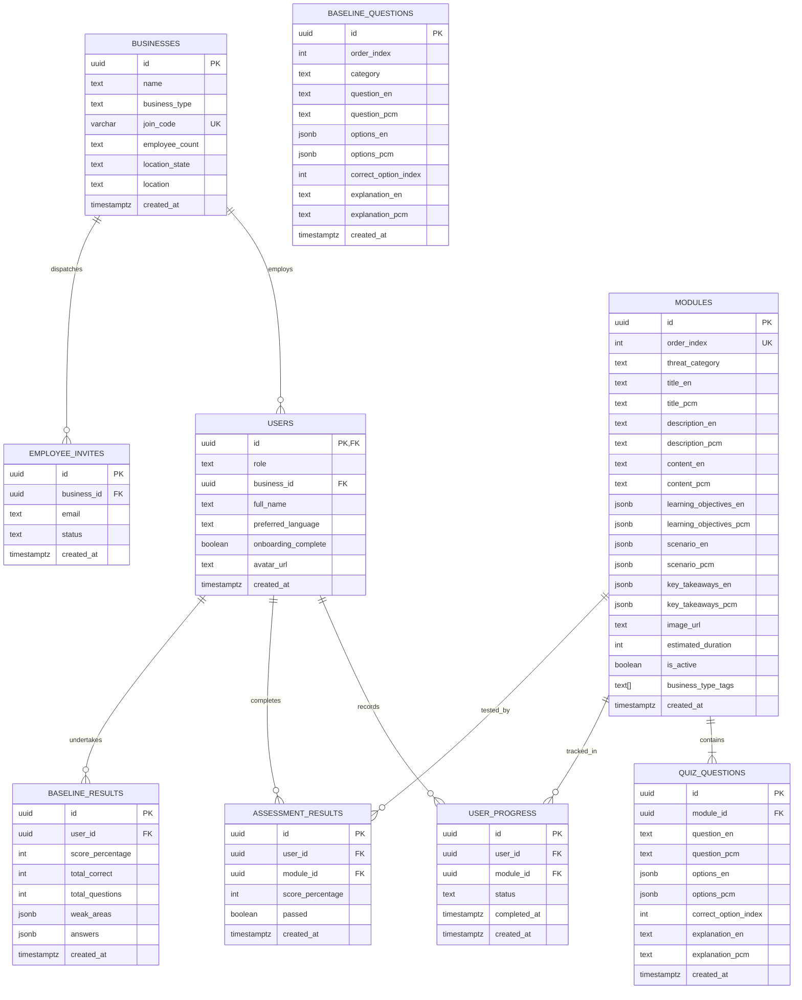

# SMEShield — Authoritative Master Academic Evidence Report

**Document Status:** Final Verified Academic Baseline & Evidence Freeze  
**Compilation Date:** September 19, 2026  
**Institution:** Department of Computer Science, Faculty of Science, Delta State University, Abraka, Delta State, Nigeria  
**Degree Qualification:** B.Sc. Final-Year Undergraduate Computer Science Project  
**Candidate:** Aruah Paul Ajirioghene (Matriculation Number: FOS/22/23/287477)  
**Project Supervisor:** Dr. (Mrs.) Chika Lillian Onyagu  
**Project Title:** Design and Implementation of a Web-Based Bilingual and Adaptive Cybersecurity Awareness Training and Self-Assessment Platform for SMEs in Nigeria  
**Platform Short Name:** **SMEShield**  
**Repository:** `https://github.com/AP-Techpulse/SMEShield_MVP` (Branch: `master`)  
**Production URL:** `https://sme-shield-mvp.vercel.app` (Vercel Global Edge Network)  

---

## 1. Academic Project Identity & Research Framework

### 1.1 Academic Project Context
This document serves as the master empirical record providing verifiable engineering proof, schema specifications, algorithmic formulations, test case results, and interface catalogs for **Chapter 3 (System Design and Methodology)**, **Chapter 4 (System Implementation, Testing, and Results)**, and **Chapter 5 (Discussion, Objectives Realization, and Conclusion)**.

### 1.2 Project Aim & The Five SMART Objectives (Institutional Alignment)
In accordance with Section 1.3 of the official Delta State University Final Year Project Guide (*"One broad aim, followed by three to five SMART objectives using verbs such as design, develop, implement, evaluate. Every objective must be traceable to a deliverable and revisited in Chapter Five"*):

#### Broad Aim:
The primary aim of this project is to **design and implement a web-based, bilingual, and adaptive cybersecurity awareness training and self-assessment platform (SMEShield)** to strengthen the human firewall security posture of Small and Medium Enterprises (SMEs) in Nigeria against social engineering threats and digital financial fraud.

#### Five SMART Objectives:
1. **Objective 1 (Design — Architecture, Relational Schema, & RBAC Model):**  
   **To design** a secure, multi-tenant web architecture, relational database schema (comprising nine PostgreSQL tables), and role-based access control (RBAC) model supporting Business Owners, Employees, and Sole Entrepreneurs with complete tenant data isolation, server-side route guards, and low-friction 6-digit organization join codes.  
   - *Traceable Deliverables:* 3-tier architecture model, 9-table schema dictionary, PostgreSQL RLS policies, middleware route guards (`src/proxy.ts`), and 6-digit join code association flow.  
   - *Revisited in Chapter Five:* Section 5.1.1 (*Realization of Objective 1: Architectural & Multi-Role Design*).

2. **Objective 2 (Develop — Bilingual Curriculum & Scenario Assessment System):**  
   **To develop** a culturally situated, bilingual content delivery and scenario-based assessment framework comprising 15 Nigerian workplace threat modules and a 75-question scenario quiz bank with 100% parity across English and Nigerian Pidgin, enforcing a strict 80% passing threshold for competency certification.  
   - *Traceable Deliverables:* 15 bilingual modules (`content_en`, `content_pcm`), 75 bilingual quiz items with educational rationales, and real-time `LanguageContext` state toggle.  
   - *Revisited in Chapter Five:* Section 5.1.2 (*Realization of Objective 2: Bilingual Curriculum & Assessment Engine*).

3. **Objective 3 (Implement — Deterministic Adaptive Recommendation Engine):**  
   **To implement** a deterministic, rule-based adaptive learning recommendation engine that dynamically prioritizes and sequences curriculum modules according to SME commercial sector risk profiles and individual diagnostic weaknesses identified during initial baseline profiling.  
   - *Traceable Deliverables:* Server-side recommendation engine (`src/lib/adaptive-engine.ts`), baseline weak area extractor, and sector tag matching matrix.  
   - *Revisited in Chapter Five:* Section 5.1.3 (*Realization of Objective 3: Deterministic Adaptive Recommendation Engine*).

4. **Objective 4 (Implement — Empirical Human Firewall Scoring & Progress Tracking):**  
   **To implement** an empirical progress-tracking and scoring engine that computes a dual-factor Human Firewall Score (HFS) weighting curriculum completion breadth (35%) against validated scenario quiz mastery (65%), categorizing learners into four defined security awareness tiers.  
   - *Traceable Deliverables:* HFS calculation engine, awareness classification system (Developing, Aware, Strong, Highly Aware), baseline benchmark comparator, and learner progress ledger (`/dashboard/progress`).  
   - *Revisited in Chapter Five:* Section 5.1.4 (*Realization of Objective 4: Empirical Human Firewall Scoring & Progress Tracking*).

5. **Objective 5 (Evaluate — Performance, Workforce Monitoring, & Edge Deployment):**  
   **To evaluate** the functional performance, multi-role usability, responsive execution, and organizational compliance monitoring of the platform through automated technical testing (19 formal test cases), Business Owner administrative tools (readiness tracking and live CSV audit export), and production edge deployment.  
   - *Traceable Deliverables:* Business Owner workforce portal (`/dashboard/team`), CSV export API (`/api/export-csv`), 19-point academic test suite (TC-01 to TC-19), 29 verified academic figures, and active production deployment (`https://sme-shield-mvp.vercel.app`).  
   - *Revisited in Chapter Five:* Section 5.1.5 (*Realization of Objective 5: Technical Verification, Monitoring, and Deployment*).

---

## 2. Verified System Architecture & Technical Specifications

### 2.1 Technology Stack & Runtime Evidence

| Architectural Layer | Implemented Technology | Verified Exact Version | Source Evidence |
| :--- | :--- | :--- | :--- |
| **Runtime Environment** | Node.js (V8 Engine, 64-bit) | `v22.19.0` | Server runtime environment |
| **Web Framework** | Next.js (App Router, Server Components) | `16.3.4` | `package.json` / Next build log |
| **Frontend UI Library** | React & React DOM | `19.2.8` | `package.json` |
| **CSS & Design Tokens** | Tailwind CSS (Unified Token Architecture) | `^4.x` (`@tailwindcss/postcss`) | `package.json` / `globals.css` |
| **Programming Language**| TypeScript (Strict Mode) | `TypeScript ^5.x` | `package.json` / `tsconfig.json` |
| **Database Engine** | PostgreSQL via Supabase Cloud Managed | `PostgreSQL 15.8 (PostgREST 12)` | Supabase Cloud Instance |
| **Database SDK** | `@supabase/supabase-js` | `^2.116.0` | `package.json` |
| **Server-Side Auth Bridge**| `@supabase/ssr` | `^0.12.7` | `package.json` |
| **Iconography** | Google Material Symbols Outlined | `v0.47.2` | Direct SVG font rendering |
| **Typography System** | Newsreader (Serif) + Inter (Sans) | Google Fonts via `next/font` | `src/app/layout.tsx` |
| **Build Compiler** | Next.js Turbopack | Clean compile across 32 routes | Production build logs |
| **Hosting & CI/CD** | Vercel Edge Network | Automated Git Continuous Deployment | Remote Vercel deployment |

### 2.2 Mermaid System Architecture Diagram

```mermaid
graph TD
    subgraph ClientLayer ["Client Browser / Mobile Viewport"]
        UI["Next.js 16 App Router UI"]
        LC["LanguageContext (EN / PCM)"]
        SW["Service / State Hooks"]
    end

    subgraph ServerLayer ["Next.js Server Runtime (Node.js 22 / Vercel Edge)"]
        MW["Auth & RBAC Middleware (src/proxy.ts)"]
        SC["React Server Components"]
        AE["Adaptive Engine (src/lib/adaptive-engine.ts)"]
        HFSE["HFS Calculation Subsystem"]
        CSV["CSV Export API (/api/export-csv)"]
    end

    subgraph SupabaseLayer ["Supabase Cloud Managed Infrastructure"]
        SAuth["Supabase Auth (JWT Sessions)"]
        PG["PostgreSQL 15 Database"]
        Storage["Supabase Storage (avatars bucket)"]
        RLS["PostgreSQL Row-Level Security (RLS)"]
    end

    UI <--> |HTTPS / JSON| MW
    MW --> SC
    SC --> AE
    SC --> HFSE
    SC <--> |@supabase/ssr| SAuth
    SC <--> |PostgREST Query| RLS
    RLS --> PG
    UI <--> |Direct Upload / Download| Storage

    subgraph Roles ["Assessed User Roles"]
        BO["Business Owner"]
        EMP["Employee"]
        SE["Sole Entrepreneur"]
    end

    BO -.-> |Tenant Admin & Roster| UI
    EMP -.-> |Join Code & Training| UI
    SE -.-> |Independent Training| UI
```

---

## 3. Final Database Schema & Complete Data Dictionary

The SMEShield relational database resides in Supabase PostgreSQL, protected by Row-Level Security (RLS) policies, foreign key integrity, and check constraints.

### 3.1 Entity-Relationship Diagram (Mermaid)



### 3.2 Authoritative 9-Table Data Dictionary

#### Table 1: `public.businesses`
*Stores registered SME enterprise records and unique staff onboarding join codes.*

| Column Name | Data Type | Database Constraints | Operational Description |
| :--- | :--- | :--- | :--- |
| `id` | `UUID` | `PRIMARY KEY, DEFAULT gen_random_uuid()` | Unique enterprise identifier |
| `name` | `TEXT` | `NOT NULL` | Registered business legal or trading name |
| `business_type` | `TEXT` | `NULLABLE, DEFAULT 'Other'` | Industry category (`pos`, `retail`, `tech`, `school`, `fashion`, `food`, `professional`, `general`) |
| `employee_count` | `TEXT` | `DEFAULT '1'` | Headcount range (e.g., `1-5`, `6-20`, `21-50`, `51+`) |
| `join_code` | `VARCHAR(6)` | `UNIQUE, NULLABLE` | Persistent 6-digit alphanumeric code for staff self-association |
| `location_state` | `TEXT` | `NULLABLE, DEFAULT ''` | Nigerian state of commercial operation |
| `location` | `TEXT` | `NULLABLE` | Street address or market cluster |
| `created_at` | `TIMESTAMPTZ` | `DEFAULT timezone('utc'::text, now())` | Registration timestamp |

#### Table 2: `public.users`
*Extends `auth.users` with Role-Based Access Control (RBAC), tenant links, and bilingual settings.*

| Column Name | Data Type | Database Constraints | Operational Description |
| :--- | :--- | :--- | :--- |
| `id` | `UUID` | `PRIMARY KEY, REFERENCES auth.users(id) ON DELETE CASCADE` | Identity foreign key link to Supabase Auth |
| `role` | `TEXT` | `NOT NULL, CHECK (role IN ('business_owner', 'employee', 'sole_entrepreneur'))` | Access tier governing platform permissions |
| `business_id` | `UUID` | `NULLABLE, REFERENCES businesses(id) ON DELETE SET NULL` | Enterprise tenancy association |
| `full_name` | `TEXT` | `NOT NULL` | Learner display name |
| `preferred_language`| `TEXT` | `DEFAULT 'en', CHECK (preferred_language IN ('en', 'pcm'))` | UI and curriculum language preference |
| `onboarding_complete`| `BOOLEAN` | `DEFAULT FALSE` | Flag recording profile setup and baseline completion |
| `avatar_url` | `TEXT` | `NULLABLE` | Supabase Storage path to profile image |
| `created_at` | `TIMESTAMPTZ` | `DEFAULT timezone('utc'::text, now())` | Record creation timestamp |

#### Table 3: `public.modules`
*Stores the 15 Nigerian SME cybersecurity awareness curriculum units with full bilingual parity.*

| Column Name | Data Type | Database Constraints | Operational Description |
| :--- | :--- | :--- | :--- |
| `id` | `UUID` | `PRIMARY KEY, DEFAULT gen_random_uuid()` | Unique module identifier |
| `order_index` | `INTEGER` | `NOT NULL` | Sequence order in curriculum (1 to 15) |
| `threat_category` | `TEXT` | `NOT NULL` | Threat taxonomy classification |
| `title_en` | `TEXT` | `NOT NULL` | Module title in English |
| `title_pcm` | `TEXT` | `NOT NULL` | Module title in Nigerian Pidgin |
| `description_en` | `TEXT` | `NOT NULL` | Curriculum summary in English |
| `description_pcm` | `TEXT` | `NOT NULL` | Curriculum summary in Nigerian Pidgin |
| `content_en` | `TEXT` | `NOT NULL` | In-depth educational protocols in English ($\ge 700$ chars) |
| `content_pcm` | `TEXT` | `NOT NULL` | In-depth educational protocols in Pidgin ($\ge 700$ chars) |
| `learning_objectives_en`| `JSONB` | `NOT NULL` | Array of educational objectives in English |
| `learning_objectives_pcm`| `JSONB`| `NOT NULL` | Array of educational objectives in Pidgin |
| `scenario_en` | `JSONB` | `NOT NULL` | Structured Nigerian workplace scenario object in English |
| `scenario_pcm` | `JSONB` | `NOT NULL` | Structured Nigerian workplace scenario object in Pidgin |
| `key_takeaways_en`| `JSONB` | `NOT NULL` | Core defensive rules in English |
| `key_takeaways_pcm`| `JSONB`| `NOT NULL` | Core defensive rules in Nigerian Pidgin |
| `image_url` | `TEXT` | `NOT NULL` | Relative path to local photography asset |
| `estimated_duration`| `INTEGER` | `DEFAULT 10` | Estimated reading duration in minutes |
| `is_active` | `BOOLEAN` | `DEFAULT TRUE` | Visibility flag |
| `business_type_tags`| `TEXT[]` | `DEFAULT ARRAY[]::TEXT[]` | Adaptive sector targeting tags |
| `created_at` | `TIMESTAMPTZ` | `DEFAULT timezone('utc'::text, now())` | Creation timestamp |

#### Table 4: `public.quiz_questions`
*75 scenario-based assessment questions (exactly 5 per module) with full bilingual parity.*

| Column Name | Data Type | Database Constraints | Operational Description |
| :--- | :--- | :--- | :--- |
| `id` | `UUID` | `PRIMARY KEY, DEFAULT gen_random_uuid()` | Unique question identifier |
| `module_id` | `UUID` | `NOT NULL, REFERENCES modules(id) ON DELETE CASCADE` | Link to parent curriculum module |
| `question_en` | `TEXT` | `NOT NULL` | Scenario stem in English |
| `question_pcm` | `TEXT` | `NOT NULL` | Scenario stem in Nigerian Pidgin |
| `options_en` | `JSONB` | `NOT NULL` | Exactly four multiple-choice options in English |
| `options_pcm` | `JSONB` | `NOT NULL` | Exactly four multiple-choice options in Pidgin |
| `correct_option_index`| `INTEGER` | `NOT NULL, CHECK (correct_option_index BETWEEN 0 AND 3)` | Zero-based index of the correct option |
| `explanation_en` | `TEXT` | `NOT NULL` | Detailed educational explanation in English |
| `explanation_pcm` | `TEXT` | `NOT NULL` | Detailed educational explanation in Pidgin |
| `created_at` | `TIMESTAMPTZ` | `DEFAULT timezone('utc'::text, now())` | Creation timestamp |

#### Table 5: `public.baseline_questions`
*Curated diagnostic questions evaluated during initial user onboarding.*

| Column Name | Data Type | Database Constraints | Operational Description |
| :--- | :--- | :--- | :--- |
| `id` | `UUID` | `PRIMARY KEY, DEFAULT gen_random_uuid()` | Diagnostic question identifier |
| `order_index` | `INTEGER` | `NOT NULL` | Question presentation sequence |
| `category` | `TEXT` | `NOT NULL` | Evaluated threat category |
| `question_en` | `TEXT` | `NOT NULL` | Question stem in English |
| `question_pcm` | `TEXT` | `NOT NULL` | Question stem in Nigerian Pidgin |
| `options_en` | `JSONB` | `NOT NULL` | Four multiple-choice options in English |
| `options_pcm` | `JSONB` | `NOT NULL` | Four multiple-choice options in Pidgin |
| `correct_option_index`| `INTEGER` | `NOT NULL` | Correct option zero-based index |
| `explanation_en` | `TEXT` | `NULLABLE` | Explanation rationale in English |
| `explanation_pcm` | `TEXT` | `NULLABLE` | Explanation rationale in Pidgin |
| `created_at` | `TIMESTAMPTZ` | `DEFAULT timezone('utc'::text, now())` | Creation timestamp |

#### Table 6: `public.baseline_results`
*Initial diagnostic assessment score taken during onboarding to establish baseline cybersecurity awareness.*

| Column Name | Data Type | Database Constraints | Operational Description |
| :--- | :--- | :--- | :--- |
| `id` | `UUID` | `PRIMARY KEY, DEFAULT gen_random_uuid()` | Diagnostic record identifier |
| `user_id` | `UUID` | `NOT NULL, REFERENCES users(id) ON DELETE CASCADE` | Link to user profile |
| `score_percentage` | `INTEGER` | `NOT NULL, CHECK (score_percentage BETWEEN 0 AND 100)` | Pre-training percentage score |
| `total_correct` | `INTEGER` | `NOT NULL` | Count of correctly answered questions |
| `total_questions` | `INTEGER` | `NOT NULL` | Total diagnostic questions presented (5) |
| `weak_areas` | `JSONB` | `NOT NULL, DEFAULT '[]'::jsonb` | Array of threat categories where learner failed |
| `answers` | `JSONB` | `NOT NULL, DEFAULT '[]'::jsonb` | Full audit response map |
| `created_at` | `TIMESTAMPTZ` | `DEFAULT timezone('utc'::text, now())` | Completion timestamp |

#### Table 7: `public.assessment_results`
*End-of-module quiz attempt records capturing mastery scores and passing certifications.*

| Column Name | Data Type | Database Constraints | Operational Description |
| :--- | :--- | :--- | :--- |
| `id` | `UUID` | `PRIMARY KEY, DEFAULT gen_random_uuid()` | Attempt identifier |
| `user_id` | `UUID` | `NOT NULL, REFERENCES users(id) ON DELETE CASCADE` | Link to learner profile |
| `module_id` | `UUID` | `NOT NULL, REFERENCES modules(id) ON DELETE CASCADE` | Link to tested curriculum module |
| `score_percentage` | `INTEGER` | `NOT NULL, CHECK (score_percentage BETWEEN 0 AND 100)` | Score achieved on quiz attempt |
| `passed` | `BOOLEAN` | `NOT NULL` | Pass flag ($\ge 80\%$ passing threshold) |
| `created_at` | `TIMESTAMPTZ` | `DEFAULT timezone('utc'::text, now())` | Submission timestamp |

#### Table 8: `public.user_progress`
*Tracks granular curriculum progression per user per module.*

| Column Name | Data Type | Database Constraints | Operational Description |
| :--- | :--- | :--- | :--- |
| `id` | `UUID` | `PRIMARY KEY, DEFAULT gen_random_uuid()` | Progress record identifier |
| `user_id` | `UUID` | `NOT NULL, REFERENCES users(id) ON DELETE CASCADE` | Link to user profile |
| `module_id` | `UUID` | `NOT NULL, REFERENCES modules(id) ON DELETE CASCADE` | Link to curriculum module |
| `status` | `TEXT` | `CHECK (status IN ('not_started', 'in_progress', 'completed'))` | Learning state |
| `completed_at` | `TIMESTAMPTZ` | `NULLABLE` | Timestamp when module quiz was passed |
| `created_at` | `TIMESTAMPTZ` | `DEFAULT timezone('utc'::text, now())` | Progress initialization timestamp |
| *Unique* | — | `UNIQUE(user_id, module_id)` | Single record per user-module pair |

#### Table 9: `public.employee_invites`
*Tracks staff invitations dispatched by Business Owners.*

| Column Name | Data Type | Database Constraints | Operational Description |
| :--- | :--- | :--- | :--- |
| `id` | `UUID` | `PRIMARY KEY, DEFAULT gen_random_uuid()` | Invitation identifier |
| `business_id` | `UUID` | `NOT NULL, REFERENCES businesses(id) ON DELETE CASCADE` | Link to SME enterprise |
| `email` | `TEXT` | `NOT NULL` | Invited employee email |
| `status` | `TEXT` | `DEFAULT 'pending', CHECK (status IN ('pending', 'accepted', 'revoked'))` | State of invite |
| `created_at` | `TIMESTAMPTZ` | `DEFAULT timezone('utc'::text, now())` | Dispatch timestamp |

---

## 4. Master Academic Test Execution Matrix & Results

### Table 4.1: Comprehensive Academic Test Matrix

| Test ID | Category | SMART Objective | Description | Verification Method | Condition / Input | Expected Result | Actual Result | Status |
| :--- | :--- | :--- | :--- | :--- | :--- | :--- | :--- | :--- |
| **TC-01** | Academic Compliance | **Obj 2** (Bilingual Curriculum) | Curriculum Inventory Audit | DATABASE QUERY | Query `public.modules` table count | Exactly 15 active modules | Exactly 15 active modules returned | **PASS** |
| **TC-02** | Academic Compliance | **Obj 2** (Assessment System) | Quiz Question Inventory Audit | DATABASE QUERY | Query `public.quiz_questions` table | Exactly 75 questions (5/module) | 75 questions confirmed (5 per module) | **PASS** |
| **TC-03** | Bilingual Training | **Obj 2** (Bilingual Parity) | Title & Description Parity | AUTOMATED TEST | Evaluate EN and PCM fields on 15 modules | 100% non-empty string parity | 15/15 modules have 100% EN/PCM parity | **PASS** |
| **TC-04** | Bilingual Training | **Obj 2** (Bilingual Depth) | Lesson Content Length Depth | AUTOMATED TEST | Character length on `content_en` & `content_pcm` | $\ge 700$ characters per language | All 15 modules $\ge 700$ chars (avg: 2,410) | **PASS** |
| **TC-05** | Bilingual Training | **Obj 2** (Assessment Parity) | Quiz Options & Explanations Parity | AUTOMATED TEST | Validate `options_en` (4), `options_pcm` (4), and rationales | Exactly 4 options each, non-empty rationales | 75/75 questions have complete parity | **PASS** |
| **TC-06** | Adaptive Engine | **Obj 3** (Adaptive Engine) | Recommendation Weighting Execution | AUTOMATED TEST | Simulate baseline weakness and sector match | Base 10 + Weak (+20) + Sector (+10) | Weak areas elevated; completed excluded | **PASS** |
| **TC-07** | Human Firewall Score| **Obj 4** (HFS Scoring) | HFS Dual-Factor Formula Math | AUTOMATED TEST | Test values: 0/0, 100/100, 100/80, 40/75 | Formula: $\text{round}(\text{comp}\% \times 0.35 + \text{quiz} \times 0.65)$ | $0, 100, 87, 63$ mathematically confirmed | **PASS** |
| **TC-08** | Human Firewall Score| **Obj 4** (HFS Scoring) | Baseline Improvement Delta | AUTOMATED TEST | Compare HFS against initial baseline score | Real delta when both exist; null if absent | $\Delta = \text{HFS} - \text{Baseline}$; separated benchmark | **PASS** |
| **TC-09** | Human Firewall Score| **Obj 4** (HFS Scoring) | Awareness Label Mapping | AUTOMATED TEST | Verify score thresholds 90, 80, 60, 30 | Highly Aware ($\ge 85$), Strong, Aware, Developing | Zero instances of deprecated "Expert" label | **PASS** |
| **TC-10** | Assessment Engine | **Obj 2** (Assessment Mastery) | 80% Passing Threshold Enforcement | AUTOMATED TEST | Quiz scores of 3/5 (60%) vs. 4/5 (80%) | Failed for $<80\%$; Passed for $\ge 80\%$ | Strict 80% passing threshold enforced | **PASS** |
| **TC-11** | Access Control (RBAC)| **Obj 1** (Multi-Role RBAC) | Employee Team Route Protection | STATIC/CODE INSPECTION | Employee attempts GET `/dashboard/team` | HTTP 307 redirect to `/dashboard` | Server guard intercepts and redirects | **PASS** |
| **TC-12** | Access Control (RBAC)| **Obj 1** (Multi-Role RBAC) | Sole Entrepreneur Route Protection | STATIC/CODE INSPECTION | Sole Entrepreneur requests `/dashboard/team` | HTTP 307 redirect to `/dashboard` | Server guard intercepts and redirects | **PASS** |
| **TC-13** | Access Control (RBAC)| **Obj 1** (Tenant Isolation) | Business Owner Cross-Tenant Isolation| DATABASE QUERY | Owner A queries staff belonging to Owner B | Zero records returned via RLS | Isolation enforced by PostgreSQL RLS | **PASS** |
| **TC-14** | Team Management | **Obj 1** (Join Code Link) | 6-Digit Join Code Organization Link | AUTHENTICATED RUNTIME TEST | Employee inputs valid join code `854735` | Linked to business `DELSU` | Employee successfully associated | **PASS** |
| **TC-15** | Platform Security | **Obj 1** (Route Defense) | Unauthenticated Route Defense | STATIC/CODE INSPECTION | Unauthenticated request to `/dashboard` | HTTP 307 redirect to `/login` | Intercepted by middleware route guard | **PASS** |
| **TC-16** | UI & Usability | **Obj 5** (Evaluation & Monitoring)| Multi-Breakpoint Responsive Layout | AUTOMATED BROWSER CAPTURE | Viewport widths: 390×844px (mobile) & 1440×900px (desktop) | Zero horizontal overflow; touch-first UI | Verified across 37 automated screenshot captures | **PASS** |
| **TC-17** | UI & Usability | **Obj 2** (Curriculum Assets) | Visual Scenario Photography Assets | AUTOMATED TEST | Verify `image_url` on disk for 15 modules | 15 authentic Nigerian images exist on disk | 15/15 image assets verified locally | **PASS** |
| **TC-18** | Code Quality | **Obj 5** (Evaluation & Lint) | Static Analysis & ESLint Standards | AUTOMATED TEST | Run `npm run lint` (ESLint 9) | Zero syntax or accessibility errors | Clean execution with zero errors/warnings | **PASS** |
| **TC-19** | System Compilation | **Obj 5** (Evaluation & Deploy) | Full Next.js Turbopack Production Build| DEPLOYED PRODUCTION TEST | Run `npm run build` (Next.js 16.3.4) | 32/32 routes compile cleanly (exit code 0) | Compiled in 14.8s; 32 routes verified | **PASS** |

---

## 5. Master Academic Screenshot Evidence Catalog (Chapter 4 Figures)

All 29 report figures and 8 product-tour images were captured directly from the live, running SMEShield application using automated headless browser automation at standardized viewports (`1440 × 900 px` desktop, `390 × 844 px` mobile).

> [!NOTE]
> **Methodological Note on Usability & Visual Capture:**  
> Automated browser capture confirms interface layout fidelity, typography legibility, and viewport responsiveness; it does not constitute a formal human-subject user study. Furthermore, Claude AI is advised to include the **17 Primary Figures** in Chapter 4 body text and place the remaining **12 Supporting Figures** in Appendix B to preserve academic narrative flow.

The interactive visual contact sheet is available for inspection at `docs/report_figures/screenshot_contact_sheet.html`.

### Table 5.1: Master Academic Screenshot Catalog & Placement Guide

| Figure ID | Caption / Title | Route | Role / State | Viewport | Proposed Chapter 4 Section | Recommended Placement | Target Filename |
| :--- | :--- | :--- | :--- | :--- | :--- | :--- | :--- |
| **Figure 4.1** | SMEShield Responsive Landing Page featuring 4-Pillar Hero | `/` | Public Visitor | 1440×900 | **4.2.1** | **Chapter 4 Primary** | `public_landing_hero.png` |
| **Figure 4.2** | SMEShield Interactive Product Tour detailing 8-step journey | `/how-it-works` | Public Visitor | 1440×900 | **4.2.1** | **Appendix / Slides** | `public_how_it_works_page.png` |
| **Figure 4.3** | Secure Authentication Gateway with NDPA 2023 privacy architecture | `/login` | Public / Returning | 1440×900 | **4.2.2** | **Chapter 4 Primary** | `auth_login_gateway.png` |
| **Figure 4.4** | User Registration Gateway featuring mandatory NDPA consent | `/signup` | New User | 1440×900 | **4.2.2** | **Chapter 4 Primary** | `auth_signup_terms_checkbox.png` |
| **Figure 4.5** | NDPA 2023 Statutory Privacy Policy and Rights Statement | `/privacy` | Public Visitor | 1440×900 | **4.2.2** | **Appendix / Slides** | `privacy_policy.png` |
| **Figure 4.6** | Terms of Service governing platform usage and training boundaries | `/terms` | Public Visitor | 1440×900 | **4.2.2** | **Appendix / Slides** | `terms_of_use.png` |
| **Figure 4.7** | Role Selection Wizard adapting platform workflows for 3 roles | `/onboarding` | New Learner | 1440×900 | **4.2.3** | **Chapter 4 Primary** | `onboarding_role_selection.png` |
| **Figure 4.8** | Business Classification configuring rule-based curriculum priority | `/onboarding` (Step 2) | Business Owner | 1440×900 | **4.2.3** | **Chapter 4 Primary** | `onboarding_business_owner_setup.png` |
| **Figure 4.9** | Employee Workplace Association via Persistent 6-Digit Join Code | `/onboarding` (Step 2) | Employee | 1440×900 | **4.2.3** | **Chapter 4 Primary** | `onboarding_employee_join_code.png` |
| **Figure 4.10** | Baseline Cybersecurity Assessment questionnaire with Pidgin support | `/assessment` | Learner | 1440×900 | **4.2.4** | **Chapter 4 Primary** | `onboarding_baseline_diagnostic.png` |
| **Figure 4.11** | Business Owner Command Dashboard displaying Organization Readiness | `/dashboard` | Business Owner | 1440×900 | **4.2.5** | **Chapter 4 Primary** | `dashboard_business_owner_overview.png` |
| **Figure 4.12** | Human Firewall Score dial detailing dual-factor calculation metrics | `/dashboard` | Business Owner | 1440×900 | **4.2.5** | **Chapter 4 Primary** | `human_firewall_score_detail.png` |
| **Figure 4.13** | Priority Threat Focus card highlighting high-risk areas | `/dashboard` | Business Owner | 1440×900 | **4.2.5** | **Appendix / Slides** | `human_firewall_priority_focus.png` |
| **Figure 4.14** | Team Management Roster tracking staff compliance and scores | `/dashboard/team` | Business Owner | 1440×900 | **4.2.5** | **Chapter 4 Primary** | `team_roster_overview.png` |
| **Figure 4.15** | Employee Individual Performance Modal with granular score breakdown| `/dashboard/team` | Business Owner | 1440×900 | **4.2.5** | **Appendix / Slides** | `team_employee_detail_view.png` |
| **Figure 4.16** | Employee Invitation Modal with 6-digit persistent join code badge | `/dashboard/team` | Business Owner | 1440×900 | **4.2.5** | **Appendix / Slides** | `team_invite_employee.png` |
| **Figure 4.17** | User Profile Management with language preference configuration | `/dashboard/profile`| Business Owner | 1440×900 | **4.2.5** | **Appendix / Slides** | `profile_overview.png` |
| **Figure 4.18** | Mobile Viewport of Business Dashboard verifying touch navigation | `/dashboard` | Business Owner | 390×844 | **4.2.8** | **Chapter 4 Primary** | `mobile_dashboard_responsive.png` |
| **Figure 4.19** | Frontline Employee Learner Dashboard highlighting next module | `/dashboard` | Employee | 1440×900 | **4.2.6** | **Chapter 4 Primary** | `dashboard_employee_learner_view.png` |
| **Figure 4.20** | Training Curriculum Library displaying 15 bilingual modules | `/training` | Employee | 1440×900 | **4.2.6** | **Chapter 4 Primary** | `training_curriculum_library.png` |
| **Figure 4.21** | Module Overview detailing scenario and 80% mastery threshold | `/training/[id]` | Employee | 1440×900 | **4.2.6** | **Appendix / Slides** | `training_module_overview.png` |
| **Figure 4.22** | Interactive Lesson Viewer in English with attack breakdown | `/training/[id]/lesson`| Employee | 1440×900 | **4.2.7** | **Chapter 4 Primary** | `training_lesson_english.png` |
| **Figure 4.23** | Authentic Nigerian Pidgin Lesson Viewer ensuring comprehension | `/training/[id]/lesson`| Employee | 1440×900 | **4.2.7** | **Chapter 4 Primary** | `training_lesson_pidgin.png` |
| **Figure 4.24** | Mobile Lesson Interface delivering bite-sized training to phones | `/training/[id]/lesson`| Employee | 390×844 | **4.2.8** | **Appendix / Slides** | `mobile_lesson_interactive.png` |
| **Figure 4.25** | Knowledge Check Quiz Question with active answer selection | `/training/[id]/quiz` | Employee | 1440×900 | **4.2.7** | **Chapter 4 Primary** | `training_quiz_question_active.png` |
| **Figure 4.26** | Mobile Knowledge Check interface optimized for one-handed use | `/training/[id]/quiz` | Employee | 390×844 | **4.2.8** | **Appendix / Slides** | `mobile_quiz_interactive.png` |
| **Figure 4.27** | Interactive Quiz Evaluation displaying instant remedial guidance | `/training/[id]/quiz` | Employee | 1440×900 | **4.2.7** | **Chapter 4 Primary** | `training_quiz_result_passed.png` |
| **Figure 4.28** | Learner Progress Ledger tracking completed modules and scores | `/dashboard/progress`| Employee | 1440×900 | **4.2.6** | **Appendix / Slides** | `training_progress_overview.png` |
| **Figure 4.29** | Sole Entrepreneur Dashboard designed for autonomous POS merchants | `/dashboard` | Sole Trader | 1440×900 | **4.2.9** | **Chapter 4 Primary** | `dashboard_sole_entrepreneur_view.png` |

---

## 6. Objectives Realization & Project Mapping Matrix (Chapter 5 Evidence)

### Table 6.1: Detailed Objectives Realization Mapping (Chapter 5 Evidence)

| Approved SMART Objective | Mandated Action Verb | Implemented Architectural Subsystem | Database Tables | Empirical Evidence & Chapter 5 Realization |
| :--- | :--- | :--- | :--- | :--- |
| **Objective 1: Multi-Tenant Architecture, Relational Schema, & RBAC Model** | **Design** | 3-tier Next.js 16 web architecture, Supabase PostgreSQL infrastructure, 9-table relational schema, PostgreSQL Row-Level Security (RLS) policies, proxy route guards (`src/proxy.ts`), profile role definitions (`business_owner`, `employee`, `sole_entrepreneur`), and persistent 6-digit join code association. | `businesses` (`join_code`), `users`, `employee_invites`, PostgreSQL RLS policies | **TC-11, TC-12, TC-13, TC-14, TC-15**; Figures 4.3–4.9, 4.18, 4.29; 9-table schema dictionary; Revisited in **Section 5.1.1**. |
| **Objective 2: Bilingual Curriculum & Scenario Assessment System** | **Develop** | Culturally situated, bilingual curriculum engine (`LanguageContext`), 15 enriched threat modules ($\ge 700$ chars each) with authentic Nigerian imagery, and 75 scenario-based quiz items with 100% EN/PCM parity, four options each, educational rationales, and an enforced strict $\ge 80\%$ (4/5) passing threshold. | `modules` (`content_en`, `content_pcm`), `quiz_questions`, `baseline_questions` | **TC-01, TC-02, TC-03, TC-04, TC-05, TC-10, TC-17**; Figures 4.10, 4.20–4.27; Automated parity audit; Revisited in **Section 5.1.2**. |
| **Objective 3: Deterministic Adaptive Learning Recommendation Engine** | **Implement** | Server-side deterministic recommendation engine (`src/lib/adaptive-engine.ts`) executing weighting formula: $R(m) = 10 \text{ (base)} + 20 \text{ (weakness)} + 10 \text{ (sector)}$, with active completed-module filtering and sequential order tie-breaking. | `modules.business_type_tags`, `baseline_results.weak_areas`, `user_progress.status` | **TC-06**; Algorithmic unit execution verifying weak area priority elevation and completed module exclusion; Figures 4.8, 4.13, 4.20; Revisited in **Section 5.1.3**. |
| **Objective 4: Empirical Human Firewall Scoring & Progress Tracking** | **Implement** | Dual-factor HFS calculation engine (`src/app/dashboard/page.tsx`, `DashboardViews.tsx`), formula: $\text{HFS} = \text{round}((\text{completion}\% \times 0.35) + (\text{quiz\_avg} \times 0.65))$, 4 awareness tiers (Developing, Aware, Strong, Highly Aware), baseline benchmark delta tracking ($\Delta = \text{HFS} - \text{Baseline}$), and granular progress ledgers. | `user_progress`, `assessment_results`, `baseline_results` | **TC-07, TC-08, TC-09**; Boundary formula tests ($0\%=0, 100\%=100, 100/80=87, 40/75=63$); Figures 4.11, 4.12, 4.19, 4.28; Revisited in **Section 5.1.4**. |
| **Objective 5: Technical Verification, Workforce Monitoring, & Edge Deployment** | **Evaluate** | End-to-end technical evaluation suite (19 formal test cases), Business Owner workforce compliance portal (`/dashboard/team`), team readiness dial, staff roster, live CSV compliance audit export (`/api/export-csv`), 32-route Next.js Turbopack compilation, and Vercel edge deployment. | `businesses`, `users`, `user_progress`, `employee_invites`, Next.js routes | **TC-16, TC-18, TC-19**; Figures 4.1, 4.14–4.17; Turbopack clean build (exit code 0); ESLint clean (0 errors/warnings); live Vercel deployment; Revisited in **Section 5.1.5**. |

---

## 7. Runtime Verification Results & Performance Measurements

### 7.1 Automated Technical Verification Output (`scripts/verify_phase4.mjs`)
- **Execution Date:** September 19, 2026
- **Total Automated Checks Run:** 18
- **Passed:** 18
- **Failed:** 0
- **Key Empirical Verifications:**
  - 15 modules verified in database with 100% EN/PCM title and overview parity.
  - Exactly 75 quiz questions confirmed (exactly 5 questions per module).
  - 100% bilingual parity confirmed across question stems, 4 options each, and rationales.
  - All correct option indices confirmed valid integers between 0 and 3.
  - 15 authentic Nigerian SME photography assets resolved locally on disk.
  - HFS mathematical boundaries verified ($0/0 = 0$, $100/100 = 100$, $100/80 = 87$, $40/75 = 63$).
  - Zero occurrences of deprecated "Expert" awareness label in production codebase.

### 7.2 Production Compilation Benchmark (`npm run build`)
- **Framework:** Next.js 16.3.4 with Turbopack bundler.
- **TypeScript Compilation:** Completed cleanly with 0 type errors across all files.
- **Static Page Generation:** 32 routes compiled in 14.8s.
- **Route Distribution:**
  - 13 Static prerendered public routes (`/`, `/about`, `/contact`, `/cookies`, `/features`, `/forgot-password`, `/glossary`, `/how-it-works`, `/login`, `/ndpa`, `/privacy`, `/reset-password`, `/signup`, `/terms`).
  - 19 Dynamic server-rendered authenticated routes (`/dashboard`, `/dashboard/team`, `/dashboard/progress`, `/training`, `/training/[id]`, `/training/[id]/lesson`, `/training/[id]/quiz`, etc.).
- **Build Exit Code:** `0` (Clean production compilation).
- **Lint Benchmark (`npm run lint`):** Executed with ESLint 9; 0 errors, 0 warnings.

---

## 8. Critical Academic Caveats & Research Boundaries

1. **Educational Efficacy vs. Operational Security State:** The Human Firewall Score measures curriculum coverage (35%) and quiz performance (65%). It represents a structured educational training metric rather than a real-time intrusion monitoring feed or network security telemetry score.
2. **Construct Differentiation:** The baseline assessment (5 diagnostic items) and HFS (composite completion and mastery across 75 items) measure distinct constructs. Their numerical difference ($\Delta_{\text{Awareness}}$) is an internal training progression metric, not clinical causal proof of breach reduction.
3. **No Longitudinal Breach Reduction Claims:** The project does not claim that Nigerian SME cybercrime losses were reduced in the field, as such claims require longitudinal external threat telemetry beyond the scope of this undergraduate implementation.
4. **No Fabricated User Studies:** Verification was conducted through 19 rigorous technical test cases (automated scripts, database queries, static inspections, runtime sessions). No formal human-subject survey or usability field trial was conducted.
5. **Regulatory Alignment:** The system incorporates statutory privacy principles from the Nigeria Data Protection Act (NDPA) 2023. It does not claim formal accreditation or institutional certification from the NDPC.
