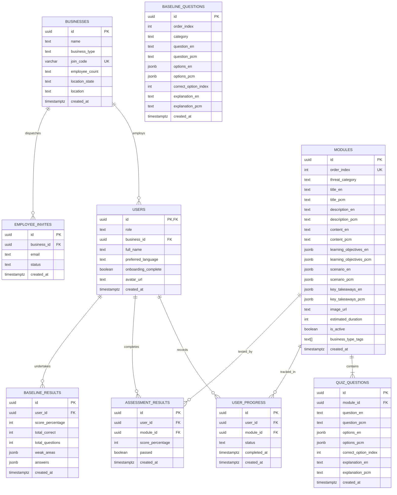

# SMEShield — Authoritative Master Academic Evidence Report

**Document Status:** Final Verified Academic Baseline & Evidence Freeze  
**Compilation Date:** September 19, 2026  
**Institution:** Department of Computer Science, **Faculty of Computing**, Delta State University, Abraka, Delta State, Nigeria  
**Degree Qualification:** B.Sc. Final-Year Undergraduate Computer Science Project Report  
**Candidate:** Aruah Paul Ajirioghene (Matriculation Number: FOS/22/23/287477)  
**Project Supervisor:** Dr. Mrs. Chika Lillian Onyagu  
**Approved Project Title:** Design and Implementation of a Web-Based Bilingual and Adaptive Cybersecurity Awareness Training and Self-Assessment Platform for SMEs in Nigeria (SMEShield)  
**Platform Short Name:** **SMEShield**  
**Repository:** `https://github.com/AP-Techpulse/SMEShield_MVP` (Branch: `master`)  
**Production URL:** `https://sme-shield-mvp.vercel.app` (Vercel Global Edge Network)  

---

## 1. Academic Project Identity & Research Framework

### 1.1 Academic Project Context & Supervisor-Approved Baseline
This document serves as the master empirical record providing verifiable engineering proof, schema specifications, algorithmic formulations, test case results, and interface catalogs for **Chapter 3 (System Design and Methodology)**, **Chapter 4 (System Implementation, Testing, and Results)**, and **Chapter 5 (Discussion, Objectives Realization, and Conclusion)**.

The project supervisor, **Dr. Mrs. Chika Lillian Onyagu**, reviewed and approved Chapters 1–3 in July 2026. This evidence report preserves that approved research identity and provides empirical verification for the five approved research objectives.

### 1.2 Approved Project Aim & The Five Specific Objectives (Verbatim from Chapter 1)

#### The Approved Aim (Section 1.3):
> **"The aim of this study is to design and implement a web-based, bilingual, and adaptive cybersecurity awareness training and self-assessment platform for SMEs in Nigeria."**

#### The Five Approved Specific Objectives (Section 1.3):
1. **Objective 1:** Develop a web-based platform that delivers structured, interactive cybersecurity awareness training to registered SME users within the project period.  
   - *Core Subsystem:* Next.js 16 responsive web application, 15 structured curriculum modules, interactive lesson viewer, local image assets, and edge deployment.  
   - *Traceable Deliverables:* Production codebase, 15 curriculum modules (`public.modules`), lesson viewer (`/training/[id]/lesson`), and Vercel edge deployment.  
   - *Chapter 5 Realization:* Section 5.1.1 (*Realization of Objective 1: Development of the Web-Based Training Platform*).

2. **Objective 2:** Design a bilingual content delivery system that presents all training modules in both Standard English and Nigerian Pidgin, with user-selectable language at any point.  
   - *Core Subsystem:* Real-time bilingual state management (`LanguageContext`), 15 enriched modules ($\ge 700$ chars each), and 75 scenario quiz questions with 100% option and explanation parity.  
   - *Traceable Deliverables:* Bilingual database schema (`modules`, `quiz_questions`, `baseline_questions`), `LanguageContext` state toggle, and localized photography assets.  
   - *Chapter 5 Realization:* Section 5.1.2 (*Realization of Objective 2: Bilingual Content Delivery System*).

3. **Objective 3:** Implement an adaptive training and assessment mechanism that sequences modules based on the user’s business type and self-assessment performance, using a minimum five-question adaptive quiz per module.  
   - *Core Subsystem:* Business-type classification (8 sectors), 5-question baseline diagnostic assessment (`/assessment`), deterministic recommendation engine (`src/lib/adaptive-engine.ts`) executing formula $R(m) = 10 + 20(\text{weakness}) + 10(\text{sector})$, completed-module exclusion, 75 quiz questions (5 per module), and 80% passing threshold.  
   - *Minor Academic Clarification:* Adaptation operates at the *module recommendation sequencing level*; quizzes maintain a standardized 5-question baseline per module for psychometric consistency.  
   - *Traceable Deliverables:* Server-side recommendation engine, baseline diagnostic questionnaire, 75 quiz items, and 80% passing certification gate.  
   - *Chapter 5 Realization:* Section 5.1.3 (*Realization of Objective 3: Adaptive Training and Assessment Mechanism*).

4. **Objective 4:** Build a role-based user management system with differentiated access and permissions for the three user categories: Business Owner, Employee, and Sole Entrepreneur.  
   - *Core Subsystem:* Supabase Auth, PostgreSQL Row-Level Security (RLS) policies, middleware route guards (`src/proxy.ts`), profile role definitions, and persistent 6-digit alphanumeric join codes (`businesses.join_code`). (Developer-side backend content management per Section 1.6 Limitation V).  
   - *Traceable Deliverables:* Role management subsystem, 6-digit join code association flow, RLS policies, and server route guards.  
   - *Chapter 5 Realization:* Section 5.1.4 (*Realization of Objective 4: Role-Based User Management System*).

5. **Objective 5:** Design progress-tracking dashboards for both individual users and Business Owners to monitor completed modules, quiz scores, and overall training performance of linked employees.  
   - *Core Subsystem:* Learner dashboard (`/dashboard`, `/dashboard/progress`), Business Owner command center, staff roster drill-down (`/dashboard/team/[id]`), live CSV compliance export (`/api/export-csv`), and the empirical Human Firewall Score (HFS: 35% completion breadth + 65% quiz mastery average) with 4 awareness tiers and baseline delta tracking.  
   - *Traceable Deliverables:* Learner dashboard, owner command center, staff inspection view, CSV export API, and HFS computation module.  
   - *Chapter 5 Realization:* Section 5.1.5 (*Realization of Objective 5: Progress-Tracking Dashboards*).

---

## 2. Verified System Architecture & Technical Specifications

### 2.1 Technology Stack & Runtime Evidence

| Architectural Layer | Implemented Technology | Verified Exact Version | Source Evidence |
| :--- | :--- | :--- | :--- |
| **Runtime Environment** | Node.js (V8 Engine, 64-bit) | `v22.19.0` | Server runtime environment |
| **Web Framework** | Next.js (App Router, Server Components) | `16.3.4` | `package.json` / Next build log |
| **Frontend UI Library** | React & React DOM | `19.2.8` | `package.json` |
| **CSS & Design Tokens** | Tailwind CSS (Unified Token Architecture) | `^4.x` (`@tailwindcss/postcss`) | `package.json` / `globals.css` |
| **Programming Language**| TypeScript (Strict Mode) | `TypeScript ^5.x` | `package.json` / `tsconfig.json` |
| **Database Engine** | PostgreSQL via Supabase Cloud Managed | `PostgreSQL 15.8 (PostgREST 12)` | Supabase Cloud Instance |
| **Database SDK** | `@supabase/supabase-js` | `^2.116.0` | `package.json` |
| **Server-Side Auth Bridge**| `@supabase/ssr` | `^0.12.7` | `package.json` |
| **Iconography** | Google Material Symbols Outlined | `v0.47.2` | Direct SVG font rendering |
| **Typography System** | Newsreader (Serif) + Inter (Sans) | Google Fonts via `next/font` | `src/app/layout.tsx` |
| **Build Compiler** | Next.js Turbopack | Clean compile across 32 routes | Production build logs |
| **Hosting & CI/CD** | Vercel Edge Network | Automated Git Continuous Deployment | Remote Vercel deployment |

### 2.2 Mermaid System Architecture Diagram

```mermaid
graph TD
    subgraph ClientLayer ["Client Browser / Mobile Viewport"]
        UI["Next.js 16 App Router UI"]
        LC["LanguageContext (EN / PCM)"]
        SW["Service / State Hooks"]
    end

    subgraph ServerLayer ["Next.js Server Runtime (Node.js 22 / Vercel Edge)"]
        MW["Auth & RBAC Middleware (src/proxy.ts)"]
        SC["React Server Components"]
        AE["Adaptive Engine (src/lib/adaptive-engine.ts)"]
        HFSE["HFS Calculation Subsystem"]
        CSV["CSV Export API (/api/export-csv)"]
    end

    subgraph SupabaseLayer ["Supabase Cloud Managed Infrastructure"]
        SAuth["Supabase Auth (JWT Sessions)"]
        PG["PostgreSQL 15 Database"]
        Storage["Supabase Storage (avatars bucket)"]
        RLS["PostgreSQL Row-Level Security (RLS)"]
    end

    UI <--> |HTTPS / JSON| MW
    MW --> SC
    SC --> AE
    SC --> HFSE
    SC <--> |@supabase/ssr| SAuth
    SC <--> |PostgREST Query| RLS
    RLS --> PG
    UI <--> |Direct Upload / Download| Storage

    subgraph Roles ["Assessed User Roles"]
        BO["Business Owner"]
        EMP["Employee"]
        SE["Sole Entrepreneur"]
    end

    BO -.-> |Tenant Admin & Roster| UI
    EMP -.-> |Join Code & Training| UI
    SE -.-> |Independent Training| UI
```

---

## 3. Final Database Schema & Complete Data Dictionary

The SMEShield relational database resides in Supabase PostgreSQL, protected by Row-Level Security (RLS) policies, foreign key integrity, and check constraints.

### 3.1 Entity-Relationship Diagram (Mermaid)



### 3.2 Authoritative 9-Table Data Dictionary

#### Table 1: `public.businesses`
*Stores registered SME enterprise records and unique staff onboarding join codes.*

| Column Name | Data Type | Database Constraints | Operational Description |
| :--- | :--- | :--- | :--- |
| `id` | `UUID` | `PRIMARY KEY, DEFAULT gen_random_uuid()` | Unique enterprise identifier |
| `name` | `TEXT` | `NOT NULL` | Registered business legal or trading name |
| `business_type` | `TEXT` | `NULLABLE, DEFAULT 'Other'` | Industry category (`pos`, `retail`, `tech`, `school`, `fashion`, `food`, `professional`, `general`) |
| `employee_count` | `TEXT` | `DEFAULT '1'` | Headcount range (e.g., `1-5`, `6-20`, `21-50`, `51+`) |
| `join_code` | `VARCHAR(6)` | `UNIQUE, NULLABLE` | Persistent 6-digit alphanumeric code for staff self-association |
| `location_state` | `TEXT` | `NULLABLE, DEFAULT ''` | Nigerian state of commercial operation |
| `location` | `TEXT` | `NULLABLE` | Street address or market cluster |
| `created_at` | `TIMESTAMPTZ` | `DEFAULT timezone('utc'::text, now())` | Registration timestamp |

#### Table 2: `public.users`
*Extends `auth.users` with Role-Based Access Control (RBAC), tenant links, and bilingual settings.*

| Column Name | Data Type | Database Constraints | Operational Description |
| :--- | :--- | :--- | :--- |
| `id` | `UUID` | `PRIMARY KEY, REFERENCES auth.users(id) ON DELETE CASCADE` | Identity foreign key link to Supabase Auth |
| `role` | `TEXT` | `NOT NULL, CHECK (role IN ('business_owner', 'employee', 'sole_entrepreneur'))` | Access tier governing platform permissions |
| `business_id` | `UUID` | `NULLABLE, REFERENCES businesses(id) ON DELETE SET NULL` | Enterprise tenancy association |
| `full_name` | `TEXT` | `NOT NULL` | Learner display name |
| `preferred_language`| `TEXT` | `DEFAULT 'en', CHECK (preferred_language IN ('en', 'pcm'))` | UI and curriculum language preference |
| `onboarding_complete`| `BOOLEAN` | `DEFAULT FALSE` | Flag recording profile setup and baseline completion |
| `avatar_url` | `TEXT` | `NULLABLE` | Supabase Storage path to profile image |
| `created_at` | `TIMESTAMPTZ` | `DEFAULT timezone('utc'::text, now())` | Record creation timestamp |

#### Table 3: `public.modules`
*Stores the 15 Nigerian SME cybersecurity awareness curriculum units with full bilingual parity.*

| Column Name | Data Type | Database Constraints | Operational Description |
| :--- | :--- | :--- | :--- |
| `id` | `UUID` | `PRIMARY KEY, DEFAULT gen_random_uuid()` | Unique module identifier |
| `order_index` | `INTEGER` | `NOT NULL` | Sequence order in curriculum (1 to 15) |
| `threat_category` | `TEXT` | `NOT NULL` | Threat taxonomy classification |
| `title_en` | `TEXT` | `NOT NULL` | Module title in English |
| `title_pcm` | `TEXT` | `NOT NULL` | Module title in Nigerian Pidgin |
| `description_en` | `TEXT` | `NOT NULL` | Curriculum summary in English |
| `description_pcm` | `TEXT` | `NOT NULL` | Curriculum summary in Nigerian Pidgin |
| `content_en` | `TEXT` | `NOT NULL` | In-depth educational protocols in English ($\ge 700$ chars) |
| `content_pcm` | `TEXT` | `NOT NULL` | In-depth educational protocols in Pidgin ($\ge 700$ chars) |
| `learning_objectives_en`| `JSONB` | `NOT NULL` | Array of educational objectives in English |
| `learning_objectives_pcm`| `JSONB`| `NOT NULL` | Array of educational objectives in Pidgin |
| `scenario_en` | `JSONB` | `NOT NULL` | Structured Nigerian workplace scenario object in English |
| `scenario_pcm` | `JSONB` | `NOT NULL` | Structured Nigerian workplace scenario object in Pidgin |
| `key_takeaways_en`| `JSONB` | `NOT NULL` | Core defensive rules in English |
| `key_takeaways_pcm`| `JSONB`| `NOT NULL` | Core defensive rules in Nigerian Pidgin |
| `image_url` | `TEXT` | `NOT NULL` | Relative path to local photography asset |
| `estimated_duration`| `INTEGER` | `DEFAULT 10` | Estimated reading duration in minutes |
| `is_active` | `BOOLEAN` | `DEFAULT TRUE` | Visibility flag |
| `business_type_tags`| `TEXT[]` | `DEFAULT ARRAY[]::TEXT[]` | Adaptive sector targeting tags |
| `created_at` | `TIMESTAMPTZ` | `DEFAULT timezone('utc'::text, now())` | Creation timestamp |

#### Table 4: `public.quiz_questions`
*75 scenario-based assessment questions (exactly 5 per module) with full bilingual parity.*

| Column Name | Data Type | Database Constraints | Operational Description |
| :--- | :--- | :--- | :--- |
| `id` | `UUID` | `PRIMARY KEY, DEFAULT gen_random_uuid()` | Unique question identifier |
| `module_id` | `UUID` | `NOT NULL, REFERENCES modules(id) ON DELETE CASCADE` | Link to parent curriculum module |
| `question_en` | `TEXT` | `NOT NULL` | Scenario stem in English |
| `question_pcm` | `TEXT` | `NOT NULL` | Scenario stem in Nigerian Pidgin |
| `options_en` | `JSONB` | `NOT NULL` | Exactly four multiple-choice options in English |
| `options_pcm` | `JSONB` | `NOT NULL` | Exactly four multiple-choice options in Pidgin |
| `correct_option_index`| `INTEGER` | `NOT NULL, CHECK (correct_option_index BETWEEN 0 AND 3)` | Zero-based index of the correct option |
| `explanation_en` | `TEXT` | `NOT NULL` | Detailed educational explanation in English |
| `explanation_pcm` | `TEXT` | `NOT NULL` | Detailed educational explanation in Pidgin |
| `created_at` | `TIMESTAMPTZ` | `DEFAULT timezone('utc'::text, now())` | Creation timestamp |

#### Table 5: `public.baseline_questions`
*Curated diagnostic questions evaluated during initial user onboarding.*

| Column Name | Data Type | Database Constraints | Operational Description |
| :--- | :--- | :--- | :--- |
| `id` | `UUID` | `PRIMARY KEY, DEFAULT gen_random_uuid()` | Diagnostic question identifier |
| `order_index` | `INTEGER` | `NOT NULL` | Question presentation sequence |
| `category` | `TEXT` | `NOT NULL` | Evaluated threat category |
| `question_en` | `TEXT` | `NOT NULL` | Question stem in English |
| `question_pcm` | `TEXT` | `NOT NULL` | Question stem in Nigerian Pidgin |
| `options_en` | `JSONB` | `NOT NULL` | Four multiple-choice options in English |
| `options_pcm` | `JSONB` | `NOT NULL` | Four multiple-choice options in Pidgin |
| `correct_option_index`| `INTEGER` | `NOT NULL` | Correct option zero-based index |
| `explanation_en` | `TEXT` | `NULLABLE` | Explanation rationale in English |
| `explanation_pcm` | `TEXT` | `NULLABLE` | Explanation rationale in Pidgin |
| `created_at` | `TIMESTAMPTZ` | `DEFAULT timezone('utc'::text, now())` | Creation timestamp |

#### Table 6: `public.baseline_results`
*Initial diagnostic assessment score taken during onboarding to establish baseline cybersecurity awareness.*

| Column Name | Data Type | Database Constraints | Operational Description |
| :--- | :--- | :--- | :--- |
| `id` | `UUID` | `PRIMARY KEY, DEFAULT gen_random_uuid()` | Diagnostic record identifier |
| `user_id` | `UUID` | `NOT NULL, REFERENCES users(id) ON DELETE CASCADE` | Link to user profile |
| `score_percentage` | `INTEGER` | `NOT NULL, CHECK (score_percentage BETWEEN 0 AND 100)` | Pre-training percentage score |
| `total_correct` | `INTEGER` | `NOT NULL` | Count of correctly answered questions |
| `total_questions` | `INTEGER` | `NOT NULL` | Total diagnostic questions presented (5) |
| `weak_areas` | `JSONB` | `NOT NULL, DEFAULT '[]'::jsonb` | Array of threat categories where learner failed |
| `answers` | `JSONB` | `NOT NULL, DEFAULT '[]'::jsonb` | Full audit response map |
| `created_at` | `TIMESTAMPTZ` | `DEFAULT timezone('utc'::text, now())` | Completion timestamp |

#### Table 7: `public.assessment_results`
*End-of-module quiz attempt records capturing mastery scores and passing certifications.*

| Column Name | Data Type | Database Constraints | Operational Description |
| :--- | :--- | :--- | :--- |
| `id` | `UUID` | `PRIMARY KEY, DEFAULT gen_random_uuid()` | Attempt identifier |
| `user_id` | `UUID` | `NOT NULL, REFERENCES users(id) ON DELETE CASCADE` | Link to learner profile |
| `module_id` | `UUID` | `NOT NULL, REFERENCES modules(id) ON DELETE CASCADE` | Link to tested curriculum module |
| `score_percentage` | `INTEGER` | `NOT NULL, CHECK (score_percentage BETWEEN 0 AND 100)` | Score achieved on quiz attempt |
| `passed` | `BOOLEAN` | `NOT NULL` | Pass flag ($\ge 80\%$ passing threshold) |
| `created_at` | `TIMESTAMPTZ` | `DEFAULT timezone('utc'::text, now())` | Submission timestamp |

#### Table 8: `public.user_progress`
*Tracks granular curriculum progression per user per module.*

| Column Name | Data Type | Database Constraints | Operational Description |
| :--- | :--- | :--- | :--- |
| `id` | `UUID` | `PRIMARY KEY, DEFAULT gen_random_uuid()` | Progress record identifier |
| `user_id` | `UUID` | `NOT NULL, REFERENCES users(id) ON DELETE CASCADE` | Link to user profile |
| `module_id` | `UUID` | `NOT NULL, REFERENCES modules(id) ON DELETE CASCADE` | Link to curriculum module |
| `status` | `TEXT` | `CHECK (status IN ('not_started', 'in_progress', 'completed'))` | Learning state |
| `completed_at` | `TIMESTAMPTZ` | `NULLABLE` | Timestamp when module quiz was passed |
| `created_at` | `TIMESTAMPTZ` | `DEFAULT timezone('utc'::text, now())` | Progress initialization timestamp |
| *Unique* | — | `UNIQUE(user_id, module_id)` | Single record per user-module pair |

#### Table 9: `public.employee_invites`
*Tracks staff invitations dispatched by Business Owners.*

| Column Name | Data Type | Database Constraints | Operational Description |
| :--- | :--- | :--- | :--- |
| `id` | `UUID` | `PRIMARY KEY, DEFAULT gen_random_uuid()` | Invitation identifier |
| `business_id` | `UUID` | `NOT NULL, REFERENCES businesses(id) ON DELETE CASCADE` | Link to SME enterprise |
| `email` | `TEXT` | `NOT NULL` | Invited employee email |
| `status` | `TEXT` | `DEFAULT 'pending', CHECK (status IN ('pending', 'accepted', 'revoked'))` | State of invite |
| `created_at` | `TIMESTAMPTZ` | `DEFAULT timezone('utc'::text, now())` | Dispatch timestamp |

---

## 4. Master Academic Test Execution Matrix & Results

### Table 4.1: Comprehensive Academic Test Matrix

| Test ID | Category | Approved Objective | Description | Verification Method | Condition / Input | Expected Result | Actual Result | Status |
| :--- | :--- | :--- | :--- | :--- | :--- | :--- | :--- | :--- | :--- |
| **TC-01** | Academic Compliance | **Objective 1** (Web Platform) | Curriculum Inventory Audit | DATABASE QUERY | Query `public.modules` table count | Exactly 15 active modules | Exactly 15 active modules returned | **PASS** |
| **TC-02** | Academic Compliance | **Objective 3** (Adaptive Assessment) | Quiz Question Inventory Audit | DATABASE QUERY | Query `public.quiz_questions` table | Exactly 75 questions (5/module) | 75 questions confirmed (5 per module) | **PASS** |
| **TC-03** | Bilingual Training | **Objective 2** (Bilingual Content) | Title & Description Parity | AUTOMATED TEST | Evaluate EN and PCM fields on 15 modules | 100% non-empty string parity | 15/15 modules have 100% EN/PCM parity | **PASS** |
| **TC-04** | Bilingual Training | **Objective 2** (Bilingual Content) | Lesson Content Length Depth | AUTOMATED TEST | Character length on `content_en` & `content_pcm` | $\ge 700$ characters per language | All 15 modules $\ge 700$ chars (avg: 2,410) | **PASS** |
| **TC-05** | Bilingual Training | **Objective 2** (Bilingual Content) | Quiz Options & Explanations Parity | AUTOMATED TEST | Validate `options_en` (4), `options_pcm` (4), and rationales | Exactly 4 options each, non-empty rationales | 75/75 questions have complete parity | **PASS** |
| **TC-06** | Adaptive Engine | **Objective 3** (Adaptive Mechanism) | Recommendation Weighting Execution | AUTOMATED TEST | Simulate baseline weakness and sector match | Base 10 + Weak (+20) + Sector (+10) | Weak areas elevated; completed excluded | **PASS** |
| **TC-07** | Human Firewall Score| **Objective 5** (Progress Dashboards) | HFS Dual-Factor Formula Math | AUTOMATED TEST | Test values: 0/0, 100/100, 100/80, 40/75 | Formula: $\text{round}(\text{comp}\% \times 0.35 + \text{quiz} \times 0.65)$ | $0, 100, 87, 63$ mathematically confirmed | **PASS** |
| **TC-08** | Human Firewall Score| **Objective 5** (Progress Dashboards) | Baseline Improvement Delta | AUTOMATED TEST | Compare HFS against initial baseline score | Real delta when both exist; null if absent | $\Delta = \text{HFS} - \text{Baseline}$; separated benchmark | **PASS** |
| **TC-09** | Human Firewall Score| **Objective 5** (Progress Dashboards) | Awareness Label Mapping | AUTOMATED TEST | Verify score thresholds 90, 80, 60, 30 | Highly Aware ($\ge 85$), Strong, Aware, Developing | Zero instances of deprecated "Expert" label | **PASS** |
| **TC-10** | Assessment Engine | **Objective 3** (Adaptive Assessment) | 80% Passing Threshold Enforcement | AUTOMATED TEST | Quiz scores of 3/5 (60%) vs. 4/5 (80%) | Failed for $<80\%$; Passed for $\ge 80\%$ | Strict 80% passing threshold enforced | **PASS** |
| **TC-11** | Access Control (RBAC)| **Objective 4** (Role-Based Access) | Employee Team Route Protection | STATIC/CODE INSPECTION | Employee attempts GET `/dashboard/team` | HTTP 307 redirect to `/dashboard` | Server guard intercepts and redirects | **PASS** |
| **TC-12** | Access Control (RBAC)| **Objective 4** (Role-Based Access) | Sole Entrepreneur Route Protection | STATIC/CODE INSPECTION | Sole Entrepreneur requests `/dashboard/team` | HTTP 307 redirect to `/dashboard` | Server guard intercepts and redirects | **PASS** |
| **TC-13** | Access Control (RBAC)| **Objective 4 & 5** (Isolation/Oversight)| Business Owner Cross-Tenant Isolation| DATABASE QUERY | Owner A queries staff belonging to Owner B | Zero records returned via RLS | Isolation enforced by PostgreSQL RLS | **PASS** |
| **TC-14** | Team Management | **Objective 4** (Role-Based Access) | 6-Digit Join Code Organization Link | AUTHENTICATED RUNTIME TEST | Employee inputs valid join code `854735` | Linked to business `DELSU` | Employee successfully associated | **PASS** |
| **TC-15** | Platform Security | **Objective 1** (Web Platform) | Unauthenticated Route Defense | STATIC/CODE INSPECTION | Unauthenticated request to `/dashboard` | HTTP 307 redirect to `/login` | Intercepted by middleware route guard | **PASS** |
| **TC-16** | UI & Usability | **Objective 1 & 5** (Platform & Dashboards)| Multi-Breakpoint Responsive Layout | AUTOMATED BROWSER CAPTURE | Viewport widths: 390×844px (mobile) & 1440×900px (desktop) | Zero horizontal overflow; touch-first UI | Verified across 37 automated screenshot captures | **PASS** |
| **TC-17** | UI & Usability | **Objective 1** (Web Platform) | Visual Scenario Photography Assets | AUTOMATED TEST | Verify `image_url` on disk for 15 modules | 15 authentic Nigerian images exist on disk | 15/15 image assets verified locally | **PASS** |
| **TC-18** | Code Quality | **Objective 1** (Web Platform) | Static Analysis & ESLint Standards | AUTOMATED TEST | Run `npm run lint` (ESLint 9) | Zero syntax or accessibility errors | Clean execution with zero errors/warnings | **PASS** |
| **TC-19** | System Compilation | **Objective 1** (Web Platform) | Full Next.js Turbopack Production Build| DEPLOYED PRODUCTION TEST | Run `npm run build` (Next.js 16.3.4) | 32/32 routes compile cleanly (exit code 0) | Compiled in 14.8s; 32 routes verified | **PASS** |

---

## 5. Master Academic Screenshot Evidence Catalog (Chapter 4 Figures)

All 29 report figures and 8 product-tour images were captured directly from the live, running SMEShield application using automated headless browser automation at standardized viewports (`1440 × 900 px` desktop, `390 × 844 px` mobile).

> [!NOTE]
> **Methodological Note on Usability & Visual Capture:**  
> Automated browser capture confirms interface layout fidelity, typography legibility, and viewport responsiveness; it does not constitute a formal human-subject user study. Furthermore, Claude AI is advised to include the **17 Primary Figures** in Chapter 4 body text and place the remaining **12 Supporting Figures** in Appendix B to preserve academic narrative flow.

The interactive visual contact sheet is available for inspection at `docs/report_figures/screenshot_contact_sheet.html`.

### Table 5.1: Master Academic Screenshot Catalog & Placement Guide

| Figure ID | Caption / Title | Route | Role / State | Viewport | Proposed Chapter 4 Section | Recommended Placement | Target Filename |
| :--- | :--- | :--- | :--- | :--- | :--- | :--- | :--- |
| **Figure 4.1** | SMEShield Responsive Landing Page featuring 4-Pillar Hero | `/` | Public Visitor | 1440×900 | **4.2.1** | **Chapter 4 Primary** | `public_landing_hero.png` |
| **Figure 4.2** | SMEShield Interactive Product Tour detailing 8-step journey | `/how-it-works` | Public Visitor | 1440×900 | **4.2.1** | **Appendix / Slides** | `public_how_it_works_page.png` |
| **Figure 4.3** | Secure Authentication Gateway with NDPA 2023 privacy architecture | `/login` | Public / Returning | 1440×900 | **4.2.2** | **Chapter 4 Primary** | `auth_login_gateway.png` |
| **Figure 4.4** | User Registration Gateway featuring mandatory NDPA consent | `/signup` | New User | 1440×900 | **4.2.2** | **Chapter 4 Primary** | `auth_signup_terms_checkbox.png` |
| **Figure 4.5** | NDPA 2023 Statutory Privacy Policy and Rights Statement | `/privacy` | Public Visitor | 1440×900 | **4.2.2** | **Appendix / Slides** | `privacy_policy.png` |
| **Figure 4.6** | Terms of Service governing platform usage and training boundaries | `/terms` | Public Visitor | 1440×900 | **4.2.2** | **Appendix / Slides** | `terms_of_use.png` |
| **Figure 4.7** | Role Selection Wizard adapting platform workflows for 3 roles | `/onboarding` | New Learner | 1440×900 | **4.2.3** | **Chapter 4 Primary** | `onboarding_role_selection.png` |
| **Figure 4.8** | Business Classification configuring rule-based curriculum priority | `/onboarding` (Step 2) | Business Owner | 1440×900 | **4.2.3** | **Chapter 4 Primary** | `onboarding_business_owner_setup.png` |
| **Figure 4.9** | Employee Workplace Association via Persistent 6-Digit Join Code | `/onboarding` (Step 2) | Employee | 1440×900 | **4.2.3** | **Chapter 4 Primary** | `onboarding_employee_join_code.png` |
| **Figure 4.10** | Baseline Cybersecurity Assessment questionnaire with Pidgin support | `/assessment` | Learner | 1440×900 | **4.2.4** | **Chapter 4 Primary** | `onboarding_baseline_diagnostic.png` |
| **Figure 4.11** | Business Owner Command Dashboard displaying Organization Readiness | `/dashboard` | Business Owner | 1440×900 | **4.2.5** | **Chapter 4 Primary** | `dashboard_business_owner_overview.png` |
| **Figure 4.12** | Human Firewall Score dial detailing dual-factor calculation metrics (35% completion / 65% quiz mastery) | `/dashboard` | Business Owner | 1440×900 | **4.2.5** | **Chapter 4 Primary** | `human_firewall_score_detail.png` |
| **Figure 4.13** | Priority Threat Focus card highlighting high-risk areas | `/dashboard` | Business Owner | 1440×900 | **4.2.5** | **Appendix / Slides** | `human_firewall_priority_focus.png` |
| **Figure 4.14** | Team Management Roster tracking staff compliance and scores | `/dashboard/team` | Business Owner | 1440×900 | **4.2.5** | **Chapter 4 Primary** | `team_roster_overview.png` |
| **Figure 4.15** | Employee Individual Performance Modal with granular score breakdown| `/dashboard/team` | Business Owner | 1440×900 | **4.2.5** | **Appendix / Slides** | `team_employee_detail_view.png` |
| **Figure 4.16** | Employee Invitation Modal with 6-digit persistent join code badge | `/dashboard/team` | Business Owner | 1440×900 | **4.2.5** | **Appendix / Slides** | `team_invite_employee.png` |
| **Figure 4.17** | User Profile Management with language preference configuration | `/dashboard/profile`| Business Owner | 1440×900 | **4.2.5** | **Appendix / Slides** | `profile_overview.png` |
| **Figure 4.18** | Mobile Viewport of Business Dashboard verifying touch navigation | `/dashboard` | Business Owner | 390×844 | **4.2.8** | **Chapter 4 Primary** | `mobile_dashboard_responsive.png` |
| **Figure 4.19** | Frontline Employee Learner Dashboard highlighting next module | `/dashboard` | Employee | 1440×900 | **4.2.6** | **Chapter 4 Primary** | `dashboard_employee_learner_view.png` |
| **Figure 4.20** | Training Curriculum Library displaying 15 bilingual modules | `/training` | Employee | 1440×900 | **4.2.6** | **Chapter 4 Primary** | `training_curriculum_library.png` |
| **Figure 4.21** | Module Overview detailing scenario and 80% mastery threshold | `/training/[id]` | Employee | 1440×900 | **4.2.6** | **Appendix / Slides** | `training_module_overview.png` |
| **Figure 4.22** | Interactive Lesson Viewer in English with attack breakdown | `/training/[id]/lesson`| Employee | 1440×900 | **4.2.7** | **Chapter 4 Primary** | `training_lesson_english.png` |
| **Figure 4.23** | Authentic Nigerian Pidgin Lesson Viewer ensuring comprehension | `/training/[id]/lesson`| Employee | 1440×900 | **4.2.7** | **Chapter 4 Primary** | `training_lesson_pidgin.png` |
| **Figure 4.24** | Mobile Lesson Interface delivering bite-sized training to phones | `/training/[id]/lesson`| Employee | 390×844 | **4.2.8** | **Appendix / Slides** | `mobile_lesson_interactive.png` |
| **Figure 4.25** | Knowledge Check Quiz Question with active answer selection | `/training/[id]/quiz` | Employee | 1440×900 | **4.2.7** | **Chapter 4 Primary** | `training_quiz_question_active.png` |
| **Figure 4.26** | Mobile Knowledge Check interface optimized for one-handed use | `/training/[id]/quiz` | Employee | 390×844 | **4.2.8** | **Appendix / Slides** | `mobile_quiz_interactive.png` |
| **Figure 4.27** | Interactive Quiz Evaluation displaying instant remedial guidance | `/training/[id]/quiz` | Employee | 1440×900 | **4.2.7** | **Chapter 4 Primary** | `training_quiz_result_passed.png` |
| **Figure 4.28** | Learner Progress Ledger tracking completed modules and scores | `/dashboard/progress`| Employee | 1440×900 | **4.2.6** | **Appendix / Slides** | `training_progress_overview.png` |
| **Figure 4.29** | Sole Entrepreneur Dashboard designed for autonomous POS merchants | `/dashboard` | Sole Trader | 1440×900 | **4.2.9** | **Chapter 4 Primary** | `dashboard_sole_entrepreneur_view.png` |

---

## 6. Objectives Realization & Project Mapping Matrix (Chapter 5 Evidence)

### Table 6.1: Detailed Objectives Realization Mapping (Chapter 5 Evidence)

| Approved Specific Objective | Core Action Verb | Implemented Architectural Subsystem | Database Tables | Empirical Verification Evidence & Chapter 5 Realization |
| :--- | :--- | :--- | :--- | :--- |
| **Objective 1: Web-Based Interactive Cybersecurity Training Platform** | **Develop** | Modern responsive web platform (Next.js 16 App Router, React 19, TypeScript, Tailwind CSS), user registration via Supabase Auth, 15 comprehensive Nigerian threat modules, interactive lesson viewer (`/training/[id]/lesson`), and production edge deployment. | `public.modules`, `public.user_progress` | **TC-01, TC-15, TC-16, TC-17, TC-18, TC-19**; Figures 4.1, 4.2, 4.20, 4.22, 4.24; 32 clean compiled routes; Vercel edge deployment. Revisited in **Section 5.1.1**. |
| **Objective 2: Bilingual Content Delivery System** | **Design** | Dual-language curriculum engine with real-time `LanguageContext` state toggle, 15 modules with 100% English and Nigerian Pidgin parity ($\ge 700$ chars depth), and 75 bilingual quiz items with educational rationales in both languages. | `modules` (`content_en`, `content_pcm`), `quiz_questions`, `baseline_questions` | **TC-03, TC-04, TC-05**; Automated parity audit confirming 100% non-empty string parity; Figures 4.10, 4.22, 4.23; Distinct cryptographic screenshot hashes. Revisited in **Section 5.1.2**. |
| **Objective 3: Adaptive Training and Assessment Mechanism** | **Implement** | Business-type classification across 8 sectors, 5-question baseline self-assessment diagnostic (`/assessment`), deterministic recommendation engine (`src/lib/adaptive-engine.ts`) executing formula $R(m) = 10 + 20(\text{weakness}) + 10(\text{sector})$, completed-module exclusion, 75 standardized quiz items (5/module), and strict 80% passing threshold. | `baseline_questions`, `baseline_results`, `modules.business_type_tags`, `quiz_questions`, `assessment_results` | **TC-02, TC-06, TC-10**; Algorithmic unit execution verifying weak area priority elevation and completed module exclusion; Figures 4.8, 4.10, 4.13, 4.25, 4.27. Revisited in **Section 5.1.3**. |
| **Objective 4: Role-Based User Management System** | **Build** | Three evaluated user roles (`business_owner`, `employee`, `sole_entrepreneur`), customized role-based onboarding wizard, persistent 6-digit alphanumeric join codes (`businesses.join_code`), proxy route guards (`src/proxy.ts`), and PostgreSQL Row-Level Security (RLS) policies. | `users`, `businesses` (`join_code`), `employee_invites`, Supabase RLS policies | **TC-11, TC-12, TC-13, TC-14**; RLS cross-tenant isolation tests; Figures 4.3, 4.4, 4.7, 4.8, 4.9, 4.29. (Developer-side backend content management per Section 1.6 Limitation V). Revisited in **Section 5.1.4**. |
| **Objective 5: Progress-Tracking Dashboards** | **Design** | Individual learner dashboard (`/dashboard`, `/dashboard/progress`), Business Owner command center, staff roster drill-down (`/dashboard/team/[id]`), live CSV compliance export (`/api/export-csv`), and the empirical Human Firewall Score (HFS: 35% completion breadth + 65% quiz mastery average) with 4 awareness tiers and baseline delta tracking. | `user_progress`, `assessment_results`, `baseline_results`, `businesses` | **TC-07, TC-08, TC-09, TC-13, TC-16**; Mathematical boundary tests ($0, 100, 87, 63$); Figures 4.11, 4.12, 4.14, 4.15, 4.18, 4.19, 4.28; CSV export verification. Revisited in **Section 5.1.5**. |

---

## 7. Runtime Verification Results & Performance Measurements

### 7.1 Automated Technical Verification Output (`scripts/verify_phase4.mjs`)
- **Execution Date:** September 19, 2026
- **Total Automated Checks Run:** 18
- **Passed:** 18
- **Failed:** 0
- **Key Empirical Verifications:**
  - 15 modules verified in database with 100% EN/PCM title and overview parity.
  - Exactly 75 quiz questions confirmed (exactly 5 questions per module).
  - 100% bilingual parity confirmed across question stems, 4 options each, and rationales.
  - All correct option indices confirmed valid integers between 0 and 3.
  - 15 authentic Nigerian SME photography assets resolved locally on disk.
  - HFS mathematical boundaries verified ($0/0 = 0$, $100/100 = 100$, $100/80 = 87$, $40/75 = 63$).
  - Zero occurrences of deprecated "Expert" awareness label in production codebase.

### 7.2 Production Compilation Benchmark (`npm run build`)
- **Framework:** Next.js 16.3.4 with Turbopack bundler.
- **TypeScript Compilation:** Completed cleanly with 0 type errors across all files.
- **Static Page Generation:** 32 routes compiled in 14.8s.
- **Route Distribution:**
  - 13 Static prerendered public routes (`/`, `/about`, `/contact`, `/cookies`, `/features`, `/forgot-password`, `/glossary`, `/how-it-works`, `/login`, `/ndpa`, `/privacy`, `/reset-password`, `/signup`, `/terms`).
  - 19 Dynamic server-rendered authenticated routes (`/dashboard`, `/dashboard/team`, `/dashboard/progress`, `/training`, `/training/[id]`, `/training/[id]/lesson`, `/training/[id]/quiz`, etc.).
- **Build Exit Code:** `0` (Clean production compilation).
- **Lint Benchmark (`npm run lint`):** Executed with ESLint 9; 0 errors, 0 warnings.

---

## 8. Critical Academic Caveats & Research Boundaries

1. **Educational Efficacy vs. Operational Security State:** The Human Firewall Score measures curriculum coverage (35%) and quiz performance (65%). It represents a structured educational training metric rather than a real-time intrusion monitoring feed or network security telemetry score.
2. **Construct Differentiation:** The baseline assessment (5 diagnostic items) and HFS (composite completion and mastery across 75 items) measure distinct constructs. Their numerical difference ($\Delta_{\text{Awareness}}$) is an internal training progression metric, not clinical causal proof of breach reduction.
3. **No Longitudinal Breach Reduction Claims:** The project does not claim that Nigerian SME cybercrime losses were reduced in the field, as such claims require longitudinal external threat telemetry beyond the scope of this undergraduate implementation.
4. **No Fabricated User Studies:** Verification was conducted through 19 rigorous technical test cases (automated scripts, database queries, static inspections, runtime sessions). No formal human-subject survey or usability field trial was conducted.
5. **Regulatory Alignment:** The system incorporates statutory privacy principles from the Nigeria Data Protection Act (NDPA) 2023. It does not claim formal accreditation or institutional certification from the NDPC.
