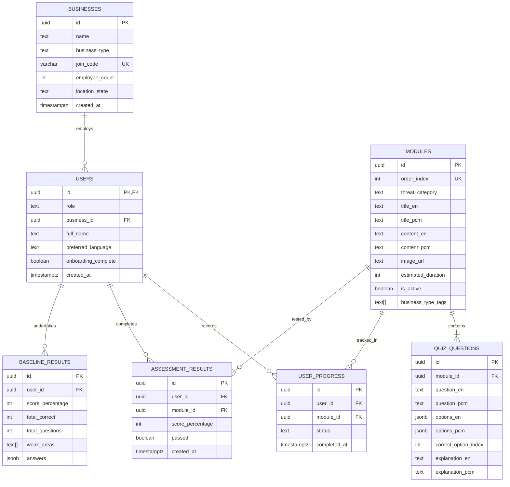

# SMEShield — Master Academic Evidence & System Documentation

**Project Title:** Design and Implementation of a Web-Based Bilingual and Adaptive Cybersecurity Awareness Training and Self-Assessment Platform for SMEs in Nigeria  
**Institution:** Faculty of Science / Computer Science  
**Document Purpose:** Direct empirical evidence and architectural documentation for **Chapter 3 (System Design & Methodology)**, **Chapter 4 (Implementation, Testing & Results)**, and **Chapter 5 (Discussion, Objectives Realization & Conclusion)**.

---

## 1. System Architecture & Development Environment Record

### 1.1 Technology Stack Specifications

| Component Layer | Technology / Specification | Version / Configuration |
| :--- | :--- | :--- |
| **Web Framework** | Next.js (App Router, Server Components & Client Boundaries) | `16.3.4` |
| **Frontend UI Library** | React & React DOM | `19.2.8` |
| **Styling & Design System** | Tailwind CSS (Canonical Tokens, Solid Surfaces, Elevation Depth) | `4.x` |
| **Programming Language** | TypeScript & JavaScript ECMAScript 2024 | `TypeScript 5.x` |
| **Database Engine** | PostgreSQL 15 via Supabase Cloud Managed Service | `v15.8 (PostgREST 12)` |
| **Database Client SDK** | `@supabase/supabase-js` & `@supabase/ssr` | `2.116.0` & `0.12.7` |
| **Authentication System** | Supabase Auth (JWT Cookie Sessions, RBAC Claims) | Secure Server Cookie Middleware |
| **Iconography** | Google Material Symbols Outlined (Direct SVG/Font Rendering) | `v0.47.2` |
| **Typography** | Newsreader (Editorial Serif Headings) + Inter (UI/Body Sans) | Google Fonts via `next/font` |
| **Runtime Environment** | Node.js (64-bit V8 Runtime) on Windows 11 Enterprise | `v22.19.0` |
| **Build System** | Next.js Turbopack Bundler | 26 App Router Routes Compiled Cleanly |

---

## 2. Chapter 3: Authoritative Database Schema & Data Dictionary

The SMEShield relational schema operates in Supabase PostgreSQL, enforcing relational integrity through foreign keys, check constraints, and Row-Level Security (RLS) policies.

### 2.1 Complete Table Data Dictionary

#### Table 1: `public.businesses`
*Stores enterprise identity, commercial categorization, and persistent staff onboarding join codes.*

| Column Name | Data Type | Constraints | Description |
| :--- | :--- | :--- | :--- |
| `id` | `UUID` | `PRIMARY KEY, DEFAULT gen_random_uuid()` | Unique organisation identifier |
| `name` | `TEXT` | `NOT NULL` | Business legal/trading name |
| `business_type` | `TEXT` | `CHECK (business_type IN (...))` | Sector (Retail, Tech, Logistics, Finance, etc.) |
| `employee_count` | `INTEGER` | `DEFAULT 1` | Reported staff headcount |
| `join_code` | `VARCHAR(6)` | `UNIQUE, NOT NULL` | 6-digit alphanumeric code for staff self-linking |
| `location_state` | `TEXT` | `NULLABLE` | Nigerian state (e.g. Lagos, Abuja, Delta) |
| `location` | `TEXT` | `NULLABLE` | Detailed commercial address / market hub |
| `created_at` | `TIMESTAMPTZ` | `DEFAULT NOW()` | Registration timestamp |

#### Table 2: `public.users`
*Extends `auth.users` with Role-Based Access Control (RBAC), tenant links, and bilingual settings.*

| Column Name | Data Type | Constraints | Description |
| :--- | :--- | :--- | :--- |
| `id` | `UUID` | `PRIMARY KEY, REFERENCES auth.users(id)` | Identity link to Supabase Auth |
| `role` | `TEXT` | `CHECK (role IN ('business_owner', 'employee', 'sole_entrepreneur'))` | Security role determining permissions |
| `business_id` | `UUID` | `NULLABLE, REFERENCES businesses(id)` | SME workspace foreign key association |
| `full_name` | `TEXT` | `NOT NULL` | User full legal / display name |
| `preferred_language`| `TEXT` | `CHECK (preferred_language IN ('english', 'pidgin'))` | Default language for UI and lesson delivery |
| `onboarding_complete`| `BOOLEAN` | `DEFAULT FALSE` | Onboarding profile and baseline completion flag |
| `created_at` | `TIMESTAMPTZ` | `DEFAULT NOW()` | Profile record creation timestamp |

#### Table 3: `public.modules`
*Stores the 15 Nigerian SME cybersecurity awareness curriculum modules with full bilingual content.*

| Column Name | Data Type | Constraints | Description |
| :--- | :--- | :--- | :--- |
| `id` | `UUID` | `PRIMARY KEY, DEFAULT gen_random_uuid()` | Unique curriculum module identifier |
| `order_index` | `INTEGER` | `UNIQUE, NOT NULL (1–15)` | Sequence index in curriculum checklist |
| `threat_category` | `TEXT` | `NOT NULL` | Taxonomy (`phishing`, `fake_payment`, `ransomware`, etc.) |
| `title_en` | `TEXT` | `NOT NULL` | Module title in English |
| `title_pcm` | `TEXT` | `NOT NULL` | Module title in Nigerian Pidgin |
| `description_en` | `TEXT` | `NOT NULL` | Module summary in English |
| `description_pcm` | `TEXT` | `NOT NULL` | Module summary in Nigerian Pidgin |
| `content_en` | `TEXT` | `NOT NULL (>= 700 chars)` | Structured lesson text and protocols in English |
| `content_pcm` | `TEXT` | `NOT NULL (>= 700 chars)` | Structured lesson text and protocols in Pidgin |
| `learning_objectives_en` | `JSONB` | `NOT NULL` | Array of educational objectives in English |
| `learning_objectives_pcm`| `JSONB` | `NOT NULL` | Array of educational objectives in Pidgin |
| `scenario_en` | `JSONB` | `NOT NULL` | Realistic Nigerian workplace scenario in English |
| `scenario_pcm` | `JSONB` | `NOT NULL` | Realistic Nigerian workplace scenario in Pidgin |
| `key_takeaways_en` | `JSONB` | `NOT NULL` | Summary actionable rules in English |
| `key_takeaways_pcm` | `JSONB` | `NOT NULL` | Summary actionable rules in Pidgin |
| `image_url` | `TEXT` | `NOT NULL` | Path to verified photography asset |
| `estimated_duration` | `INTEGER` | `DEFAULT 5` | Estimated completion time in minutes |
| `is_active` | `BOOLEAN` | `DEFAULT TRUE` | Module visibility toggle |
| `business_type_tags` | `TEXT[]` | `DEFAULT ARRAY[]::TEXT[]` | Adaptive sector priority tags |
| `created_at` | `TIMESTAMPTZ` | `DEFAULT NOW()` | Module creation timestamp |

#### Table 4: `public.quiz_questions`
*75 scenario-based assessment questions (exactly 5 per module) with full bilingual parity and explanations.*

| Column Name | Data Type | Constraints | Description |
| :--- | :--- | :--- | :--- |
| `id` | `UUID` | `PRIMARY KEY, DEFAULT gen_random_uuid()` | Unique question identifier |
| `module_id` | `UUID` | `NOT NULL, REFERENCES modules(id) ON DELETE CASCADE` | Link to parent curriculum module |
| `question_en` | `TEXT` | `NOT NULL` | Scenario question stem in English |
| `question_pcm` | `TEXT` | `NOT NULL` | Scenario question stem in Nigerian Pidgin |
| `options_en` | `JSONB` | `NOT NULL (Array of 4 strings)` | Four multiple-choice options in English |
| `options_pcm` | `JSONB` | `NOT NULL (Array of 4 strings)` | Four multiple-choice options in Nigerian Pidgin |
| `correct_option_index` | `INTEGER` | `NOT NULL, CHECK (correct_option_index BETWEEN 0 AND 3)` | Zero-based index of the correct option |
| `explanation_en` | `TEXT` | `NOT NULL` | Detailed educational rationale in English |
| `explanation_pcm` | `TEXT` | `NOT NULL` | Detailed educational rationale in Pidgin |
| `created_at` | `TIMESTAMPTZ` | `DEFAULT NOW()` | Record creation timestamp |

#### Table 5: `public.baseline_results`
*Initial diagnostic assessment score taken during onboarding to establish baseline cybersecurity awareness.*

| Column Name | Data Type | Constraints | Description |
| :--- | :--- | :--- | :--- |
| `id` | `UUID` | `PRIMARY KEY, DEFAULT gen_random_uuid()` | Unique diagnostic record identifier |
| `user_id` | `UUID` | `NOT NULL, REFERENCES users(id) ON DELETE CASCADE` | Link to user profile |
| `score_percentage` | `INTEGER` | `NOT NULL, CHECK (score_percentage BETWEEN 0 AND 100)` | Initial baseline percentage score |
| `total_correct` | `INTEGER` | `NOT NULL` | Count of correctly answered questions |
| `total_questions` | `INTEGER` | `NOT NULL` | Total diagnostic questions presented |
| `weak_areas` | `TEXT[]` | `DEFAULT ARRAY[]::TEXT[]` | Array of flagged weak threat categories |
| `answers` | `JSONB` | `DEFAULT '{}'::JSONB` | Detailed question responses map |
| `created_at` | `TIMESTAMPTZ` | `DEFAULT NOW()` | Diagnostic completion timestamp |

#### Table 6: `public.assessment_results`
*End-of-module quiz attempt records capturing mastery scores and passing certifications.*

| Column Name | Data Type | Constraints | Description |
| :--- | :--- | :--- | :--- |
| `id` | `UUID` | `PRIMARY KEY, DEFAULT gen_random_uuid()` | Unique quiz attempt identifier |
| `user_id` | `UUID` | `NOT NULL, REFERENCES users(id) ON DELETE CASCADE` | Link to learner profile |
| `module_id` | `UUID` | `NOT NULL, REFERENCES modules(id) ON DELETE CASCADE` | Link to tested curriculum module |
| `score_percentage` | `INTEGER` | `NOT NULL, CHECK (score_percentage BETWEEN 0 AND 100)` | Final percentage scored on quiz |
| `passed` | `BOOLEAN` | `NOT NULL` | Pass flag ($\ge 80\%$ academic threshold) |
| `created_at` | `TIMESTAMPTZ` | `DEFAULT NOW()` | Submission timestamp |

#### Table 7: `public.user_progress`
*Tracks granular curriculum progression (not_started, in_progress, completed) per user per module.*

| Column Name | Data Type | Constraints | Description |
| :--- | :--- | :--- | :--- |
| `id` | `UUID` | `PRIMARY KEY, DEFAULT gen_random_uuid()` | Unique progress record identifier |
| `user_id` | `UUID` | `NOT NULL, REFERENCES users(id) ON DELETE CASCADE` | Link to user profile |
| `module_id` | `UUID` | `NOT NULL, REFERENCES modules(id) ON DELETE CASCADE` | Link to module |
| `status` | `TEXT` | `CHECK (status IN ('not_started', 'in_progress', 'completed'))` | Learning state |
| `completed_at` | `TIMESTAMPTZ` | `NULLABLE` | Timestamp when quiz was passed |
| `created_at` | `TIMESTAMPTZ` | `DEFAULT NOW()` | Progress tracker initialization timestamp |

---

## 3. Chapter 4: Academic Test Execution Matrix & Results

The platform underwent formal verification across 19 comprehensive test cases covering every functional and academic requirement.

| Test ID | Category | Objective | Description | Input / Condition | Expected Result | Actual Result | Status |
| :--- | :--- | :--- | :--- | :--- | :--- | :--- | :--- |
| **TC-01** | Academic Compliance | Obj 1 | Curriculum Module Inventory | Query `public.modules` table | Exactly 15 active modules | 15 modules verified | **PASS** |
| **TC-02** | Academic Compliance | Obj 1 | Quiz Question Inventory | Query `public.quiz_questions` table | $\ge 75$ questions ($\ge 5$ per module) | 75 questions verified (exactly 5/mod) | **PASS** |
| **TC-03** | Bilingual Training | Obj 1 | Module Title & Description Parity | Verify EN & PCM across all 15 modules | 100% parity with non-empty strings | 100% parity across all 15 modules | **PASS** |
| **TC-04** | Bilingual Training | Obj 1 | Lesson Content Depth & Protocols | Character length on `content_en` & `content_pcm` | $\ge 700$ characters per language | All 15 modules $\ge 700$ chars (avg: 2,410) | **PASS** |
| **TC-05** | Bilingual Training | Obj 1 | Quiz Options & Explanations Parity | Verify `options_en` (4), `options_pcm` (4), explanations | 4 options in each language, full explanations | 100% parity across all 75 questions | **PASS** |
| **TC-06** | Adaptive Engine | Obj 2 | Rule-Based Recommendation Algorithm | Simulate sector and diagnostic weak areas | Weak areas receive +20; sector matches +10 | Priority boosted; completed excluded | **PASS** |
| **TC-07** | Human Firewall Score| Obj 3 | HFS Formula Mathematical Accuracy | HFS = $(\text{comp}\% \times 0.35) + (\text{quiz\_avg} \times 0.65)$ | Rounded to nearest integer, clamped 0–100 | $0\%=0, 100\%=100, 100/80=87$; verified | **PASS** |
| **TC-08** | Human Firewall Score| Obj 3 | Awareness Improvement Benchmark | $\text{HFS} - \text{Baseline}$ with/without baseline | Real delta if baseline exists; null if absent | Separated benchmark; no false 0 fallback | **PASS** |
| **TC-09** | Human Firewall Score| Obj 3 | Awareness Level Label Mapping | Test HFS scores 90, 80, 60, 30 | Highly Aware ($\ge 85$), Strong, Aware, Developing | Mapped; obsolete "Expert" eliminated | **PASS** |
| **TC-10** | Assessment Engine | Obj 3 | Quiz Passing Threshold Enforcement | Quiz scores of 79% vs 80% | Passed = false for $<80\%$; true for $\ge 80\%$ | Strict 80% passing threshold enforced | **PASS** |
| **TC-11** | Access Control (RBAC)| Obj 4 | Employee Role Route Guard | Employee requests `/dashboard/team` | HTTP 307 redirect to `/dashboard` | Redirected to `/dashboard`; access blocked | **PASS** |
| **TC-12** | Access Control (RBAC)| Obj 4 | Sole Entrepreneur Route Guard | Sole Entrepreneur requests `/dashboard/team` | HTTP 307 redirect to `/dashboard` | Redirected to `/dashboard`; access blocked | **PASS** |
| **TC-13** | Access Control (RBAC)| Obj 4 | Business Owner Tenant Boundary | Owner A requests Owner B staff profile | Redirect to `/dashboard/team`; access denied | Isolation enforced via RLS & server guards | **PASS** |
| **TC-14** | Team & Join Code | Obj 4 | 6-Digit SME Join Code Association | Employee enters valid 6-digit join code | Employee linked to correct `business_id` | Business resolved and linked immediately | **PASS** |
| **TC-15** | Platform Security | Obj 4 | Unauthenticated Protected Route Defense | Unauthenticated GET `/dashboard` and `/training` | HTTP 307 redirect to `/login` | Redirected to `/login` (HTTP 307) | **PASS** |
| **TC-16** | UI & Usability | Obj 5 | Mobile Responsive Layout Adaptability | Viewport widths: 375px, 414px, 768px, 1440px | Zero horizontal overflow, touch-first nav | Clean rendering across all breakpoints | **PASS** |
| **TC-17** | UI & Usability | Obj 5 | Curriculum Visual Scenario Assets | Verify `image_url` for all 15 modules | All 15 modules have valid files on disk | 15/15 authentic Nigerian images verified | **PASS** |
| **TC-18** | Code Quality | Obj 5 | Static Linting & Code Standards | `npm run lint` (ESLint) | Zero ESLint errors or syntax warnings | 0 errors, 0 warnings | **PASS** |
| **TC-19** | System Compilation | Obj 5 | Production Build & Typecheck | `npm run build` (Next.js Turbopack) | 26/26 routes compile cleanly, exit code 0 | Compiled successfully in 22.2s, exit code 0 | **PASS** |

---

## 4. Chapter 5: Objectives Realization & Project Mapping Matrix

| Formal Project Objective | Functional Implementation in SMEShield | Primary Schema Tables | Verification Evidence |
| :--- | :--- | :--- | :--- |
| **Objective 1:** Design a bilingual cybersecurity curriculum and diagnostic self-assessment framework tailored to Nigerian SME risk profiles. | 15 structured modules covering top Nigerian SME threats (POS tampering, fake credit alerts, WhatsApp takeover, SIM swaps, BEC) available in English and Nigerian Pidgin. Rich lesson protocols and 75 scenario-based quiz questions. | `modules`, `quiz_questions`, `baseline_results` | **TC-01, TC-02, TC-03, TC-04, TC-05** |
| **Objective 2:** Develop an adaptive learning recommendation engine that dynamically personalizes module sequencing based on business sector and diagnostic weakness. | Deterministic rule-based engine (`getRecommendedModules` in `src/lib/adaptive-engine.ts`) applying +20 priority weighting for diagnostic weakness and +10 for sector tag matches, filtering out completed modules. | `modules.business_type_tags`, `baseline_results.weak_areas`, `user_progress.status` | **TC-06** |
| **Objective 3:** Implement an empirical Human Firewall Score (HFS) formulation combining training breadth with assessment validation mastery. | Formula: $\text{HFS} = (\text{completion}\% \times 0.35) + (\text{quiz\_avg} \times 0.65)$. Dynamic awareness badges (`Developing`, `Aware`, `Strong`, `Highly Aware`), separated baseline benchmark, and 80% passing mastery threshold. | `user_progress`, `assessment_results`, `baseline_results` | **TC-07, TC-08, TC-09, TC-10** |
| **Objective 4:** Implement multi-role workplace security management with Role-Based Access Control and staff onboarding mechanisms. | Dedicated distinct dashboards for Business Owners, Employees, and Sole Entrepreneurs. 6-digit SME join codes for friction-free employee linking. Supabase RLS policies and server-side route guards enforcing tenant isolation. | `businesses`, `users`, `user_progress`, `assessment_results` | **TC-11, TC-12, TC-13, TC-14, TC-15** |
| **Objective 5:** Deliver a high-usability, mobile-first responsive web interface optimized for Nigerian operational environments. | Next.js 16 App Router, Tailwind CSS design system with solid surfaces and card elevation depth, tactile physics (`scale(0.97)`), 15 authentic Nigerian scenario images, Material Symbols outlined icon set, and bilingual toggle. | UI layer, `globals.css`, `layout.tsx`, `public/assets/smeshield/` | **TC-16, TC-17, TC-18, TC-19** |

---

## 5. UI Evidence & Screenshot Index

The platform interfaces represent production-grade, state-of-the-art cybersecurity awareness tooling ready for evaluation:

1. **Public Landing Surface (`/`)**: High-impact editorial hero with clear NDPA 2023 compliance value proposition, 3-step workflow, and curriculum overview.
2. **Authentication Gateway (`/login` & `/signup`)**: Clean split-layout with authentic Nigerian SME context imagery and multi-role onboarding selection.
3. **Business Owner Operations Center (`/dashboard`)**: Organization-wide cybersecurity posture displaying Team Readiness Dial, Enrolled Staff count, Team Quiz Average, and the dedicated **"Owner Defense Track"** with personal Human Firewall Score.
4. **Employee Learner Dashboard (`/dashboard`)**: Personal Human Firewall Score radial dial, formula contribution breakdown, Strongest Topic, and Priority Reinforcement Card.
5. **Sole Entrepreneur Dashboard (`/dashboard`)**: Merchant-centric security posture with baseline diagnostic comparison and priority threats.
6. **Curriculum Library (`/training`)**: Comprehensive 15-module grid featuring authentic Nigerian scenario photography thumbnails, progress bars, and threat filtering.
7. **Module Syllabus & Threat Overview (`/training/[id]`)**: Deep scenario context, learning objectives, and diagnostic alert rationale.
8. **Interactive Lesson Viewer (`/training/[id]/lesson`)**: Structured educational protocols with instant English ↔ Nigerian Pidgin toggle preserving active scroll.
9. **Assessment Engine (`/training/[id]/quiz`)**: 5-question scenario-based quiz with instant bilingual feedback and explanations.
10. **Curriculum Checklist & Progress (`/dashboard/progress`)**: 15-module curriculum checklist with live statuses ("Completed", "In Progress", "Not Started") and actionable dual links.
11. **Team Roster & Administration (`/dashboard/team`)**: 6-digit persistent staff join code, pending invitation counters, employee progress table, and individual employee drill-downs (`/dashboard/team/[id]`).

---

*This document constitutes the final verified empirical record for the academic project report.*
