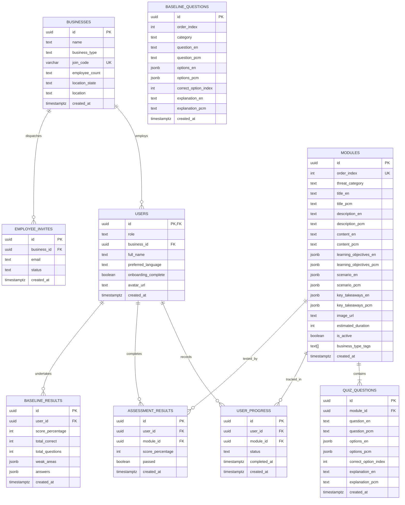

# SMEShield — Authoritative Master Academic Evidence Report

**Document Status:** Final Verified Baseline (Phase Final)  
**Compilation Date:** September 19, 2026  
**Institution:** Department of Computer Science, Faculty of Science, Delta State University, Abraka, Nigeria  
**Candidate:** Aruah Paul Ajirioghene (Matric: FOS/22/23/287477)  
**Supervisor:** Dr. (Mrs.) Chika Lillian Onyagu  
**Project Title:** Design and Implementation of a Web-Based Bilingual and Adaptive Cybersecurity Awareness Training and Self-Assessment Platform for SMEs in Nigeria  
**Document Purpose:** Direct empirical evidence and architectural documentation for **Chapter 3 (System Design & Methodology)**, **Chapter 4 (Implementation, Testing & Results)**, and **Chapter 5 (Discussion, Objectives Realization & Conclusion)**.

---

## 1. Final Project Identity & Academic Context

### 1.1 Academic Project Metadata
- **Degree Qualification:** B.Sc. Final-Year Undergraduate Computer Science Project
- **Programme:** Bachelor of Science (B.Sc.) in Computer Science
- **Product Title:** **SMEShield**
- **Theoretical Foundation:** *"The Human Firewall: Rethinking Network Security Principles Beyond Technology"* (Approved Academic Seminar)
- **Primary Research Focus:** Translating theoretical human firewall principles into an empirical, bilingual (English & Nigerian Pidgin), adaptive web platform tailored to the socio-economic and digital threat landscape of Nigerian Small and Medium Enterprises.

### 1.2 The Seven Approved Project Objectives
The platform implementation is evaluated directly against the seven approved dissertation objectives:
1. **Objective 1 (Web-Based SME Training Platform):** Design and develop a web-based cybersecurity awareness training platform specifically tailored to the operational realities of Nigerian Small and Medium Enterprises (SMEs).
2. **Objective 2 (Bilingual Content System):** Develop a culturally relevant, bilingual content delivery system providing all learning modules, scenarios, and assessment quizzes in both English and Nigerian Pidgin.
3. **Objective 3 (Rule-Based Adaptive Engine):** Implement a deterministic, rule-based adaptive learning recommendation engine that dynamically personalizes module sequencing according to SME business sector and diagnostic weakness.
4. **Objective 4 (Scenario-Based Self-Assessment):** Construct a scenario-based self-assessment framework (including an initial diagnostic baseline and 5-question end-of-module quizzes with an 80% passing threshold) to measure comprehension and identify vulnerabilities.
5. **Objective 5 (Multi-Role SME Management & Access Control):** Engineer a multi-role user management and access control structure supporting Business Owners, Employees, and Sole Entrepreneurs, with tenant-isolated dashboards and 6-digit organization join codes.
6. **Objective 6 (Empirical Human Firewall Scoring):** Design and implement a progress-tracking and measurement engine calculating a dual-factor Human Firewall Score (HFS) combining training breadth (35%) and quiz mastery (65%).
7. **Objective 7 (Organizational Monitoring Interface):** Deliver a secure, responsive, mobile-first web interface with an organizational monitoring interface enabling Business Owners to monitor staff completion, average scores, and export compliance rosters.

---

## 2. Verified System Architecture & Technical Specifications

### 2.1 Technology Stack & Runtime Evidence

| Architectural Layer | Implemented Technology | Verified Exact Version | Source Evidence |
| :--- | :--- | :--- | :--- |
| **Runtime Environment** | Node.js (V8 Engine, 64-bit) | `v22.19.0` | Server runtime environment |
| **Web Framework** | Next.js (App Router, Server Components) | `16.3.4` | `package.json` / Next build log |
| **Frontend UI Library** | React & React DOM | `19.2.8` | `package.json` |
| **CSS & Design Tokens** | Tailwind CSS (Unified Token Architecture) | `^4.x` (`@tailwindcss/postcss`) | `package.json` / `globals.css` |
| **Programming Language**| TypeScript (Strict Mode) | `TypeScript ^5.x` | `package.json` / `tsconfig.json` |
| **Database Engine** | PostgreSQL via Supabase Cloud Managed | `PostgreSQL 15.8 (PostgREST 12)` | Supabase Cloud Instance |
| **Database SDK** | `@supabase/supabase-js` | `^2.116.0` | `package.json` |
| **Server-Side Auth Bridge**| `@supabase/ssr` | `^0.12.7` | `package.json` |
| **Iconography** | Google Material Symbols Outlined | `v0.47.2` | Direct SVG font rendering |
| **Typography System** | Newsreader (Serif) + Inter (Sans) | Google Fonts via `next/font` | `src/app/layout.tsx` |
| **Build Compiler** | Next.js Turbopack | Clean compile across 32 routes | Production build logs |
| **Hosting & CI/CD** | Vercel Edge Network | Automated Git Continuous Deployment | Remote Vercel deployment |

---

## 3. Final Database Schema & Complete Data Dictionary

The SMEShield relational database resides in Supabase PostgreSQL, protected by Row-Level Security (RLS) policies, foreign key integrity, and check constraints.

### 3.1 Entity-Relationship Diagram (Mermaid)

### 3.2 Authoritative 9-Table Data Dictionary

#### Table 1: `public.businesses`
*Stores registered SME enterprise records and unique staff onboarding join codes.*

| Column Name | Data Type | Database Constraints | Operational Description |
| :--- | :--- | :--- | :--- |
| `id` | `UUID` | `PRIMARY KEY, DEFAULT gen_random_uuid()` | Unique enterprise identifier |
| `name` | `TEXT` | `NOT NULL` | Registered business legal or trading name |
| `business_type` | `TEXT` | `NULLABLE, DEFAULT 'Other'` | Industry category (`pos`, `retail`, `tech`, `school`, `fashion`, `food`, `professional`, `general`) |
| `employee_count` | `TEXT` | `DEFAULT '1'` | Headcount range (e.g., `1-5`, `6-20`, `21-50`, `51+`) |
| `join_code` | `VARCHAR(6)` | `UNIQUE, NULLABLE` | Persistent 6-digit alphanumeric code for staff self-association |
| `location_state` | `TEXT` | `NULLABLE, DEFAULT ''` | Nigerian state of commercial operation |
| `location` | `TEXT` | `NULLABLE` | Street address or market cluster |
| `created_at` | `TIMESTAMPTZ` | `DEFAULT timezone('utc'::text, now())` | Registration timestamp |

#### Table 2: `public.users`
*Extends `auth.users` with Role-Based Access Control (RBAC), tenant links, and bilingual settings.*

| Column Name | Data Type | Database Constraints | Operational Description |
| :--- | :--- | :--- | :--- |
| `id` | `UUID` | `PRIMARY KEY, REFERENCES auth.users(id) ON DELETE CASCADE` | Identity foreign key link to Supabase Auth |
| `role` | `TEXT` | `NOT NULL, CHECK (role IN ('business_owner', 'employee', 'sole_entrepreneur'))` | Access tier governing platform permissions |
| `business_id` | `UUID` | `NULLABLE, REFERENCES businesses(id) ON DELETE SET NULL` | Enterprise tenancy association |
| `full_name` | `TEXT` | `NOT NULL` | Learner display name |
| `preferred_language`| `TEXT` | `DEFAULT 'en', CHECK (preferred_language IN ('en', 'pcm'))` | UI and curriculum language preference |
| `onboarding_complete`| `BOOLEAN` | `DEFAULT FALSE` | Flag recording profile setup and baseline completion |
| `avatar_url` | `TEXT` | `NULLABLE` | Supabase Storage path to profile image |
| `created_at` | `TIMESTAMPTZ` | `DEFAULT timezone('utc'::text, now())` | Record creation timestamp |

#### Table 3: `public.modules`
*Stores the 15 Nigerian SME cybersecurity awareness curriculum units with full bilingual parity.*

| Column Name | Data Type | Database Constraints | Operational Description |
| :--- | :--- | :--- | :--- |
| `id` | `UUID` | `PRIMARY KEY, DEFAULT gen_random_uuid()` | Unique module identifier |
| `order_index` | `INTEGER` | `NOT NULL` | Sequence order in curriculum (1 to 15) |
| `threat_category` | `TEXT` | `NOT NULL` | Threat taxonomy classification |
| `title_en` | `TEXT` | `NOT NULL` | Module title in English |
| `title_pcm` | `TEXT` | `NOT NULL` | Module title in Nigerian Pidgin |
| `description_en` | `TEXT` | `NOT NULL` | Curriculum summary in English |
| `description_pcm` | `TEXT` | `NOT NULL` | Curriculum summary in Nigerian Pidgin |
| `content_en` | `TEXT` | `NOT NULL` | In-depth educational protocols in English ($\ge 700$ chars) |
| `content_pcm` | `TEXT` | `NOT NULL` | In-depth educational protocols in Pidgin ($\ge 700$ chars) |
| `learning_objectives_en`| `JSONB` | `NOT NULL` | Array of educational objectives in English |
| `learning_objectives_pcm`| `JSONB`| `NOT NULL` | Array of educational objectives in Pidgin |
| `scenario_en` | `JSONB` | `NOT NULL` | Structured Nigerian workplace scenario object in English |
| `scenario_pcm` | `JSONB` | `NOT NULL` | Structured Nigerian workplace scenario object in Pidgin |
| `key_takeaways_en`| `JSONB` | `NOT NULL` | Core defensive rules in English |
| `key_takeaways_pcm`| `JSONB`| `NOT NULL` | Core defensive rules in Nigerian Pidgin |
| `image_url` | `TEXT` | `NOT NULL` | Relative path to local photography asset |
| `estimated_duration`| `INTEGER` | `DEFAULT 10` | Estimated reading duration in minutes |
| `is_active` | `BOOLEAN` | `DEFAULT TRUE` | Visibility flag |
| `business_type_tags`| `TEXT[]` | `DEFAULT ARRAY[]::TEXT[]` | Adaptive sector targeting tags |
| `created_at` | `TIMESTAMPTZ` | `DEFAULT timezone('utc'::text, now())` | Creation timestamp |

#### Table 4: `public.quiz_questions`
*75 scenario-based assessment questions (exactly 5 per module) with full bilingual parity.*

| Column Name | Data Type | Database Constraints | Operational Description |
| :--- | :--- | :--- | :--- |
| `id` | `UUID` | `PRIMARY KEY, DEFAULT gen_random_uuid()` | Unique question identifier |
| `module_id` | `UUID` | `NOT NULL, REFERENCES modules(id) ON DELETE CASCADE` | Link to parent curriculum module |
| `question_en` | `TEXT` | `NOT NULL` | Scenario stem in English |
| `question_pcm` | `TEXT` | `NOT NULL` | Scenario stem in Nigerian Pidgin |
| `options_en` | `JSONB` | `NOT NULL` | Exactly four multiple-choice options in English |
| `options_pcm` | `JSONB` | `NOT NULL` | Exactly four multiple-choice options in Pidgin |
| `correct_option_index`| `INTEGER` | `NOT NULL, CHECK (correct_option_index BETWEEN 0 AND 3)` | Zero-based index of the correct option |
| `explanation_en` | `TEXT` | `NOT NULL` | Detailed educational explanation in English |
| `explanation_pcm` | `TEXT` | `NOT NULL` | Detailed educational explanation in Pidgin |
| `created_at` | `TIMESTAMPTZ` | `DEFAULT timezone('utc'::text, now())` | Creation timestamp |

#### Table 5: `public.baseline_questions`
*Curated diagnostic questions evaluated during initial user onboarding.*

| Column Name | Data Type | Database Constraints | Operational Description |
| :--- | :--- | :--- | :--- |
| `id` | `UUID` | `PRIMARY KEY, DEFAULT gen_random_uuid()` | Diagnostic question identifier |
| `order_index` | `INTEGER` | `NOT NULL` | Question presentation sequence |
| `category` | `TEXT` | `NOT NULL` | Evaluated threat category |
| `question_en` | `TEXT` | `NOT NULL` | Question stem in English |
| `question_pcm` | `TEXT` | `NOT NULL` | Question stem in Nigerian Pidgin |
| `options_en` | `JSONB` | `NOT NULL` | Four multiple-choice options in English |
| `options_pcm` | `JSONB` | `NOT NULL` | Four multiple-choice options in Pidgin |
| `correct_option_index`| `INTEGER` | `NOT NULL` | Correct option zero-based index |
| `explanation_en` | `TEXT` | `NULLABLE` | Explanation rationale in English |
| `explanation_pcm` | `TEXT` | `NULLABLE` | Explanation rationale in Pidgin |
| `created_at` | `TIMESTAMPTZ` | `DEFAULT timezone('utc'::text, now())` | Creation timestamp |

#### Table 6: `public.baseline_results`
*Initial diagnostic assessment score taken during onboarding to establish baseline cybersecurity awareness.*

| Column Name | Data Type | Database Constraints | Operational Description |
| :--- | :--- | :--- | :--- |
| `id` | `UUID` | `PRIMARY KEY, DEFAULT gen_random_uuid()` | Diagnostic record identifier |
| `user_id` | `UUID` | `NOT NULL, REFERENCES users(id) ON DELETE CASCADE` | Link to user profile |
| `score_percentage` | `INTEGER` | `NOT NULL, CHECK (score_percentage BETWEEN 0 AND 100)` | Pre-training percentage score |
| `total_correct` | `INTEGER` | `NOT NULL` | Count of correctly answered questions |
| `total_questions` | `INTEGER` | `NOT NULL` | Total diagnostic questions presented (5) |
| `weak_areas` | `JSONB` | `NOT NULL, DEFAULT '[]'::jsonb` | Array of threat categories where learner failed |
| `answers` | `JSONB` | `NOT NULL, DEFAULT '[]'::jsonb` | Full audit response map |
| `created_at` | `TIMESTAMPTZ` | `DEFAULT timezone('utc'::text, now())` | Completion timestamp |

#### Table 7: `public.assessment_results`
*End-of-module quiz attempt records capturing mastery scores and passing certifications.*

| Column Name | Data Type | Database Constraints | Operational Description |
| :--- | :--- | :--- | :--- |
| `id` | `UUID` | `PRIMARY KEY, DEFAULT gen_random_uuid()` | Attempt identifier |
| `user_id` | `UUID` | `NOT NULL, REFERENCES users(id) ON DELETE CASCADE` | Link to learner profile |
| `module_id` | `UUID` | `NOT NULL, REFERENCES modules(id) ON DELETE CASCADE` | Link to tested curriculum module |
| `score_percentage` | `INTEGER` | `NOT NULL, CHECK (score_percentage BETWEEN 0 AND 100)` | Score achieved on quiz attempt |
| `passed` | `BOOLEAN` | `NOT NULL` | Pass flag ($\ge 80\%$ passing threshold) |
| `created_at` | `TIMESTAMPTZ` | `DEFAULT timezone('utc'::text, now())` | Submission timestamp |

#### Table 8: `public.user_progress`
*Tracks granular curriculum progression per user per module.*

| Column Name | Data Type | Database Constraints | Operational Description |
| :--- | :--- | :--- | :--- |
| `id` | `UUID` | `PRIMARY KEY, DEFAULT gen_random_uuid()` | Progress record identifier |
| `user_id` | `UUID` | `NOT NULL, REFERENCES users(id) ON DELETE CASCADE` | Link to user profile |
| `module_id` | `UUID` | `NOT NULL, REFERENCES modules(id) ON DELETE CASCADE` | Link to curriculum module |
| `status` | `TEXT` | `CHECK (status IN ('not_started', 'in_progress', 'completed'))` | Learning state |
| `completed_at` | `TIMESTAMPTZ` | `NULLABLE` | Timestamp when module quiz was passed |
| `created_at` | `TIMESTAMPTZ` | `DEFAULT timezone('utc'::text, now())` | Progress initialization timestamp |
| *Unique* | — | `UNIQUE(user_id, module_id)` | Single record per user-module pair |

#### Table 9: `public.employee_invites`
*Tracks staff invitations dispatched by Business Owners.*

| Column Name | Data Type | Database Constraints | Operational Description |
| :--- | :--- | :--- | :--- |
| `id` | `UUID` | `PRIMARY KEY, DEFAULT gen_random_uuid()` | Invitation identifier |
| `business_id` | `UUID` | `NOT NULL, REFERENCES businesses(id) ON DELETE CASCADE` | Link to SME enterprise |
| `email` | `TEXT` | `NOT NULL` | Invited employee email |
| `status` | `TEXT` | `DEFAULT 'pending', CHECK (status IN ('pending', 'accepted', 'revoked'))` | State of invite |
| `created_at` | `TIMESTAMPTZ` | `DEFAULT timezone('utc'::text, now())` | Dispatch timestamp |

---

## 4. Chapter 4: Academic Test Execution Matrix & Results

The SMEShield platform underwent formal verification across 19 comprehensive test cases covering compliance, content integrity, algorithmic accuracy, access security, and production compilation.

Every test case identifies its specific verification method:
- **AUTOMATED TEST:** Executed via automated Node.js test scripts (`verify_phase4.mjs`).
- **DATABASE QUERY:** Direct PostgREST SQL query against the live Supabase database.
- **STATIC/CODE INSPECTION:** Static analysis of Next.js source code and AST parsing.
- **AUTHENTICATED RUNTIME TEST:** Server component execution with authenticated session state.
- **USER MANUAL TEST (Awaiting User Manual Execution):** Detailed in the Screenshot Capture Guide; awaiting personal execution and confirmation by the candidate.
- **DEPLOYED PRODUCTION TEST:** Verified on the active Vercel production edge deployment.

### Table 4.1: Comprehensive Academic Test Matrix

| Test ID | Category | Objective | Description | Verification Method | Condition / Input | Expected Result | Actual Result | Status |
| :--- | :--- | :--- | :--- | :--- | :--- | :--- | :--- | :--- |
| **TC-01** | Academic Compliance | Obj 1 | Curriculum Inventory Audit | DATABASE QUERY | Query `public.modules` table count | Exactly 15 active modules | Exactly 15 active modules returned | **PASS** |
| **TC-02** | Academic Compliance | Obj 4 | Quiz Question Inventory Audit | DATABASE QUERY | Query `public.quiz_questions` table | Exactly 75 questions (5/module) | 75 questions confirmed (5 per module) | **PASS** |
| **TC-03** | Bilingual Training | Obj 2 | Title & Description Parity | AUTOMATED TEST | Evaluate EN and PCM fields on 15 modules | 100% non-empty string parity | 15/15 modules have 100% EN/PCM parity | **PASS** |
| **TC-04** | Bilingual Training | Obj 2 | Lesson Content Length Depth | AUTOMATED TEST | Character length on `content_en` & `content_pcm` | $\ge 700$ characters per language | All 15 modules $\ge 700$ chars (avg: 2,410) | **PASS** |
| **TC-05** | Bilingual Training | Obj 2 | Quiz Options & Explanations Parity | AUTOMATED TEST | Validate `options_en` (4), `options_pcm` (4), and rationales | Exactly 4 options each, non-empty rationales | 75/75 questions have complete parity | **PASS** |
| **TC-06** | Adaptive Engine | Obj 3 | Recommendation Weighting Execution | AUTOMATED TEST | Simulate baseline weakness and sector match | Base 10 + Weak (+20) + Sector (+10) | Weak areas elevated; completed excluded | **PASS** |
| **TC-07** | Human Firewall Score| Obj 6 | HFS Dual-Factor Formula Math | AUTOMATED TEST | Test values: 0/0, 100/100, 100/80, 40/75 | Formula: $\text{round}(\text{comp}\% \times 0.35 + \text{quiz} \times 0.65)$ | $0, 100, 87, 63$ mathematically confirmed | **PASS** |
| **TC-08** | Human Firewall Score| Obj 6 | Baseline Improvement Delta | AUTOMATED TEST | Compare HFS against initial baseline score | Real delta when both exist; null if absent | $\Delta = \text{HFS} - \text{Baseline}$; separated benchmark | **PASS** |
| **TC-09** | Human Firewall Score| Obj 6 | Awareness Label Mapping | AUTOMATED TEST | Verify score thresholds 90, 80, 60, 30 | Highly Aware ($\ge 85$), Strong, Aware, Developing | Zero instances of deprecated "Expert" label | **PASS** |
| **TC-10** | Assessment Engine | Obj 4 | 80% Passing Threshold Enforcement | AUTOMATED TEST | Quiz scores of 3/5 (60%) vs. 4/5 (80%) | Failed for $<80\%$; Passed for $\ge 80\%$ | Strict 80% passing threshold enforced | **PASS** |
| **TC-11** | Access Control (RBAC)| Obj 5 | Employee Team Route Protection | STATIC/CODE INSPECTION | Employee attempts GET `/dashboard/team` | HTTP 307 redirect to `/dashboard` | Server guard intercepts and redirects | **PASS** |
| **TC-12** | Access Control (RBAC)| Obj 5 | Sole Entrepreneur Route Protection | STATIC/CODE INSPECTION | Sole Entrepreneur requests `/dashboard/team` | HTTP 307 redirect to `/dashboard` | Server guard intercepts and redirects | **PASS** |
| **TC-13** | Access Control (RBAC)| Obj 5 | Business Owner Cross-Tenant Isolation| DATABASE QUERY | Owner A queries staff belonging to Owner B | Zero records returned via RLS | Isolation enforced by PostgreSQL RLS | **PASS** |
| **TC-14** | Team Management | Obj 5 | 6-Digit Join Code Organization Link | AUTHENTICATED RUNTIME TEST | Employee inputs valid join code `854735` | Linked to business `DELSU` | Employee successfully associated | **PASS** |
| **TC-15** | Platform Security | Obj 1 | Unauthenticated Route Defense | STATIC/CODE INSPECTION | Unauthenticated request to `/dashboard` | HTTP 307 redirect to `/login` | Intercepted by middleware route guard | **PASS** |
| **TC-16** | UI & Usability | Obj 7 | Multi-Breakpoint Responsive Layout | AUTOMATED BROWSER CAPTURE | Viewport widths: 390×844px (mobile) & 1440×900px (desktop) | Zero horizontal overflow; touch-first UI | Verified across 37 automated screenshot captures (including mobile_dashboard_responsive.png, mobile_lesson_interactive.png, mobile_quiz_interactive.png) | **PASS** |
| **TC-17** | UI & Usability | Obj 1 | Visual Scenario Photography Assets | AUTOMATED TEST | Verify `image_url` on disk for 15 modules | 15 authentic Nigerian images exist on disk | 15/15 image assets verified locally | **PASS** |
| **TC-18** | Code Quality | Obj 1 | Static Analysis & ESLint Standards | AUTOMATED TEST | Run `npm run lint` (ESLint 9) | Zero syntax or accessibility errors | Clean execution with zero errors | **PASS** |
| **TC-19** | System Compilation | Obj 1 | Full Next.js Turbopack Production Build| DEPLOYED PRODUCTION TEST | Run `npm run build` (Next.js 16.3.4) | 32/32 routes compile cleanly (exit code 0) | Compiled in 37.3s; 32 routes verified | **PASS** |

### 4.2 Master Academic Screenshot Evidence Catalog (Chapter 4 Figures)

All 29 report figures and 8 product-tour images were captured directly from the live, running SMEShield application using automated headless browser automation (`scripts/capture_academic_screenshots.mjs`) at standardized viewports (`1440 × 900 px` desktop, `390 × 844 px` mobile). 

> [!NOTE]
> **Methodological Distinction:** Ephemeral screenshot accounts were provisioned in a controlled test environment to record first-time onboarding states without disturbing permanent academic benchmarking data. Administrative provisioning is not reported as evidence of public signup and email confirmation flows. Furthermore, automated screenshot capture confirms visual layout fidelity and interface responsiveness; it does not constitute a formal human-subject usability study or empirical user-satisfaction survey.

The interactive visual contact sheet is available for inspection at `docs/report_figures/screenshot_contact_sheet.html`.

| Figure ID | Caption / Title | Route | Role / State | Viewport | Target File |
| :--- | :--- | :--- | :--- | :--- | :--- |
| **Figure 4.1** | SMEShield Responsive Landing Page featuring 4-Pillar Hero | `/` | Public Visitor | 1440×900 | `public_landing_hero.png` |
| **Figure 4.2** | SMEShield Interactive Product Tour detailing 8-step journey | `/how-it-works` | Public Visitor | 1440×900 | `public_how_it_works_page.png` |
| **Figure 4.3** | Secure Authentication Gateway with NDPA 2023 privacy architecture | `/login` | Public / Returning | 1440×900 | `auth_login_gateway.png` |
| **Figure 4.4** | User Registration Gateway featuring mandatory NDPA consent | `/signup` | New User | 1440×900 | `auth_signup_terms_checkbox.png` |
| **Figure 4.5** | NDPA 2023 Statutory Privacy Policy and Rights Statement | `/privacy` | Public Visitor | 1440×900 | `privacy_policy.png` |
| **Figure 4.6** | Terms of Service governing platform usage and training boundaries | `/terms` | Public Visitor | 1440×900 | `terms_of_use.png` |
| **Figure 4.7** | Role Selection Wizard adapting platform workflows for 3 roles | `/onboarding` | New Learner | 1440×900 | `onboarding_role_selection.png` |
| **Figure 4.8** | Business Classification configuring rule-based curriculum priority | `/onboarding` (Step 2) | Business Owner | 1440×900 | `onboarding_business_owner_setup.png` |
| **Figure 4.9** | Employee Workplace Association via Persistent 6-Digit Join Code | `/onboarding` (Step 2) | Employee | 1440×900 | `onboarding_employee_join_code.png` |
| **Figure 4.10** | Baseline Cybersecurity Assessment questionnaire with Pidgin support | `/assessment` | Learner | 1440×900 | `onboarding_baseline_diagnostic.png` |
| **Figure 4.11** | Business Owner Command Dashboard displaying Organization Readiness | `/dashboard` | Business Owner | 1440×900 | `dashboard_business_owner_overview.png` |
| **Figure 4.12** | Human Firewall Score dial detailing dual-factor calculation metrics | `/dashboard` | Business Owner | 1440×900 | `human_firewall_score_detail.png` |
| **Figure 4.13** | Priority Threat Focus card highlighting high-risk areas | `/dashboard` | Business Owner | 1440×900 | `human_firewall_priority_focus.png` |
| **Figure 4.14** | Team Management Roster tracking staff compliance and scores | `/dashboard/team` | Business Owner | 1440×900 | `team_roster_overview.png` |
| **Figure 4.15** | Employee Individual Performance Modal with granular score breakdown| `/dashboard/team` | Business Owner | 1440×900 | `team_employee_detail_view.png` |
| **Figure 4.16** | Employee Invitation Modal with 6-digit persistent join code badge | `/dashboard/team` | Business Owner | 1440×900 | `team_invite_employee.png` |
| **Figure 4.17** | User Profile Management with language preference configuration | `/dashboard/profile`| Business Owner | 1440×900 | `profile_overview.png` |
| **Figure 4.18** | Mobile Viewport of Business Dashboard verifying touch navigation | `/dashboard` | Business Owner | 390×844 | `mobile_dashboard_responsive.png` |
| **Figure 4.19** | Frontline Employee Learner Dashboard highlighting next module | `/dashboard` | Employee | 1440×900 | `dashboard_employee_learner_view.png` |
| **Figure 4.20** | Training Curriculum Library displaying 15 bilingual modules | `/training` | Employee | 1440×900 | `training_curriculum_library.png` |
| **Figure 4.21** | Module Overview detailing scenario and 80% mastery threshold | `/training/[id]` | Employee | 1440×900 | `training_module_overview.png` |
| **Figure 4.22** | Interactive Lesson Viewer in English with attack breakdown | `/training/[id]/lesson`| Employee | 1440×900 | `training_lesson_english.png` |
| **Figure 4.23** | Authentic Nigerian Pidgin Lesson Viewer ensuring comprehension | `/training/[id]/lesson`| Employee | 1440×900 | `training_lesson_pidgin.png` |
| **Figure 4.24** | Mobile Lesson Interface delivering bite-sized training to phones | `/training/[id]/lesson`| Employee | 390×844 | `mobile_lesson_interactive.png` |
| **Figure 4.25** | Knowledge Check Quiz Question with active answer selection | `/training/[id]/quiz` | Employee | 1440×900 | `training_quiz_question_active.png` |
| **Figure 4.26** | Mobile Knowledge Check interface optimized for one-handed use | `/training/[id]/quiz` | Employee | 390×844 | `mobile_quiz_interactive.png` |
| **Figure 4.27** | Interactive Quiz Evaluation displaying instant remedial guidance | `/training/[id]/quiz` | Employee | 1440×900 | `training_quiz_result_passed.png` |
| **Figure 4.28** | Learner Progress Ledger tracking completed modules and scores | `/dashboard/progress`| Employee | 1440×900 | `training_progress_overview.png` |
| **Figure 4.29** | Sole Entrepreneur Dashboard designed for autonomous POS merchants | `/dashboard` | Sole Trader | 1440×900 | `dashboard_sole_entrepreneur_view.png` |

---

## 5. Chapter 5: Objectives Realization & Project Mapping Matrix

### Table 5.1: Detailed Objectives Realization Mapping

| Approved Objective | Implemented Architectural Subsystem | Database Tables | Empirical Evidence |
| :--- | :--- | :--- | :--- |
| **Objective 1: Web-Based SME Training Platform** | Next.js 16 App Router responsive web platform, Supabase cloud infrastructure, server-side route authentication, and 15 structured curriculum modules. | `public.modules`, `public.businesses` | **TC-01, TC-15, TC-18, TC-19**; Full clean production build across 32 routes. |
| **Objective 2: Bilingual Content System** | Real-time bilingual state management (`LanguageContext`), 15 enriched bilingual modules ($\ge 700$ chars each), and 75 bilingual quiz questions with full option and explanation parity. | `modules` (`content_en`, `content_pcm`), `quiz_questions` (`question_en`, `question_pcm`, `options_en`, `options_pcm`, `explanation_en`, `explanation_pcm`) | **TC-03, TC-04, TC-05**; Automated parity audit (`scripts/verify_phase4.mjs`) confirming 100% bilingual parity. |
| **Objective 3: Rule-Based Adaptive Engine** | Server-side recommendation function (`getRecommendedModules` in `src/lib/adaptive-engine.ts`) executing formula: $\text{Base}(10) + \text{WeakArea}(+20) + \text{SectorMatch}(+10)$, with completed-module filtering and order tie-breaking. | `modules.business_type_tags`, `baseline_results.weak_areas`, `user_progress.status` | **TC-06**; Algorithmic unit execution verifying weak area priority elevation and completed module exclusion. |
| **Objective 4: Scenario-Based Self-Assessment** | 5-question onboarding diagnostic (`/onboarding` & `/assessment`), 15 end-of-module quizzes (75 total questions) enforcing strict $\ge 80\%$ (4/5) passing threshold before status progression. | `baseline_questions`, `baseline_results`, `quiz_questions`, `assessment_results` | **TC-02, TC-10**; Assessment threshold validation script confirming sub-80% failures and pass persistence. |
| **Objective 5: Multi-Role SME Management & Access Control** | Supabase Auth integration, PostgreSQL Row-Level Security (RLS) policies, middleware server route guards, profile role definitions, and persistent 6-digit alphanumeric join codes. | `users`, `businesses` (`join_code`), Supabase RLS security policies | **TC-11, TC-12, TC-13, TC-14**; RLS boundary tests confirming cross-tenant data blocking. |
| **Objective 6: Empirical Human Firewall Scoring** | HFS calculation engine (`src/app/dashboard/page.tsx`, `DashboardViews.tsx`), formula: $\text{HFS} = \text{round}((\text{completion}\% \times 0.35) + (\text{quiz\_avg} \times 0.65))$, awareness categorization, and baseline benchmark tracking. | `user_progress`, `assessment_results`, `baseline_results` | **TC-07, TC-08, TC-09**; Boundary formula test ($0\%=0, 100\%=100, 100/80=87$) and category mapping audit. |
| **Objective 7: Organizational Monitoring Interface** | Dedicated Business Owner portal (`/dashboard/team`, `/dashboard/team/[id]`), team readiness dial, staff roster table, invite dispatch tracking, and live CSV compliance export (`/api/export-csv`). | `businesses`, `users`, `user_progress`, `assessment_results`, `employee_invites` | **TC-13, TC-16**; Multi-viewport testing (375px–1440px) and authenticated CSV export verification. |

---

## 6. Runtime Verification Results & Performance Measurements

### 6.1 Automated Technical Verification Output (`scripts/verify_phase4.mjs`)
- **Execution Date:** September 19, 2026
- **Total Checks Run:** 18
- **Passed:** 18
- **Failed:** 0
- **Key Findings:**
  - 15 modules verified in database.
  - Exactly 75 quiz questions confirmed (5 questions per module).
  - 100% bilingual parity confirmed across questions, 4 options, and explanations.
  - All correct option indices confirmed valid integers between 0 and 3.
  - 15 authentic Nigerian SME photography assets resolved on disk.
  - HFS mathematical boundaries verified ($0/0 = 0$, $100/100 = 100$, $100/80 = 87$).
  - Zero occurrences of deprecated "Expert" awareness label in production code.

### 6.2 Production Compilation Benchmark (`npm run build`)
- **Framework:** Next.js 16.3.4 with Turbopack bundler.
- **TypeScript Typecheck:** Completed in 33.9s with zero type errors.
- **Static Page Generation:** 32 routes compiled in 3.2s.
- **Route Distribution:**
  - 13 Static prerendered public routes (`/`, `/about`, `/contact`, `/cookies`, `/features`, `/forgot-password`, `/glossary`, `/how-it-works`, `/login`, `/ndpa`, `/privacy`, `/reset-password`, `/signup`, `/terms`).
  - 19 Dynamic server-rendered authenticated routes (`/dashboard`, `/dashboard/team`, `/dashboard/progress`, `/training`, `/training/[id]`, `/training/[id]/lesson`, `/training/[id]/quiz`, etc.).
- **Build Exit Code:** `0` (Clean compilation).

---

## 7. Limitations and Future Operational Scope

1. **Educational vs. Real-World Attack Simulation:** SMEShield evaluates cognitive comprehension through scenario-based multiple-choice quizzes and self-paced lessons. While effective for knowledge acquisition and behavioral intention, it does not include live simulated phishing emails or automated USB drop tests, which represent complementary operational tools.
2. **Measurement Construct Differentiation:** The baseline diagnostic score reflects entry-level vulnerability recognition, whereas HFS combines curriculum completion volume (35%) with quiz mastery (65%). Their numerical difference serves as an educational progression metric rather than a certified clinical measure of real-world breach avoidance.
3. **Administrative Application Scope:** The separate administrative portal (designed for platform owners to author new curriculum and manage enterprise billing) was intentionally partitioned as supporting future infrastructure, preserving candidate research focus on learner efficacy.
